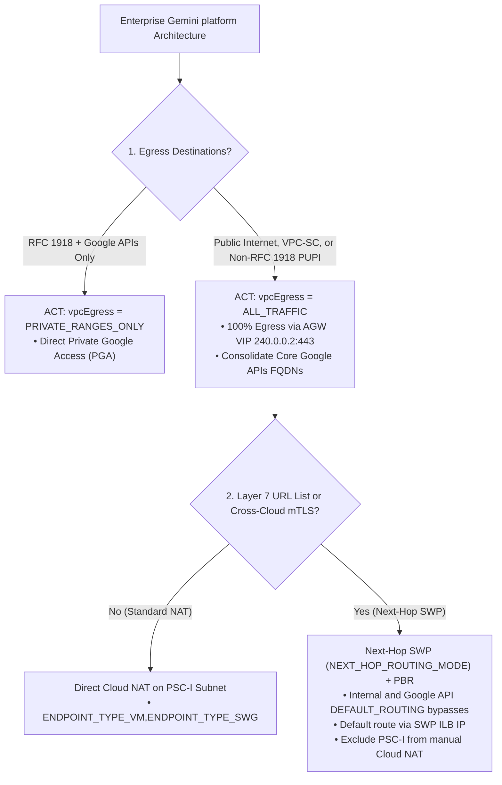

# Gemini platform Architecture and Engineering Guide

This skill is the reference system for designing, engineering, and validating enterprise-grade **Gemini platform** architectures across multi-project hierarchies, hybrid/cross-cloud networks, zero-trust identity boundaries, and inline safety/policy enforcement planes.

## Usage Attribution

**MUST READ**: Before executing any `gcloud`, REST API, or MCP command, you
MUST read and follow the instructions in
[Usage Attribution](references/attribution.md).

> [!IMPORTANT] **Architectural Scope and Reference Discipline**: Use `SKILL.md` to
> select the target topology, egress mode, ingress pattern, and governance
> plane, then consult the authoritative `references/*.md` manual for exact CLI
> commands, REST/YAML schemas, Common Expression Language (CEL) expressions, and
> Python Agent Development Kit (ADK) runtime code (`references/*.md` is the
> single source of truth for all implementation syntax). When remote Model
> Context Protocol (MCP) tools (such as the Google Developer Knowledge MCP
> server or Google-managed MCP endpoints) are available, prefer remote MCP tool
> invocation over raw CLI/REST commands. Do not execute unrequested live
> mutations against customer projects when asked for architectural designs.

> [!CAUTION] **Human Approval Gate for Sensitive Operations**: Always prompt the
> user for explicit confirmation before executing commands or applying
> configurations that grant permissive Identity and Access Management (IAM)
> bindings (`roles/iap.egressor`, `roles/compute.networkUser`,
> `roles/networkservices.admin`), modify Organization Policies
> (`constraints/iam.managed.disableAccessPolicyBinding`), update Unified Access
> Policy (UAP) or VPC Service Controls (VPC-SC) policies, or delete resources
> (REST `DELETE ...?force=true` or CLI `--quiet`).

---

## Prerequisites, Authentication, Region, and Billing Setup

1.  **Google Cloud SDK, Authentication, and Project Setup**:
    -   Install the
        [Google Cloud SDK (`gcloud`)](https://cloud.google.com/sdk/docs/install)
        and authenticate CLI and Application Default Credentials
        (`gcloud auth login && gcloud auth application-default login`, or set
        `GOOGLE_APPLICATION_CREDENTIALS`).
    -   Select or create the target project (`gcloud projects create
        {project_id}` / `gcloud config set project {project_id}`), set the
        default region (`gcloud config set compute/region {region}`, defaulting
        to **`us-central1`**; see
        [Google Cloud Locations](https://cloud.google.com/about/locations)), and
        enable required APIs:

        ```bash
        gcloud services enable aiplatform.googleapis.com agentregistry.googleapis.com \
          agentidentity.googleapis.com agentidentitycredentials.googleapis.com \
          networkservices.googleapis.com networksecurity.googleapis.com iap.googleapis.com \
          modelarmor.googleapis.com compute.googleapis.com dns.googleapis.com \
          certificatemanager.googleapis.com servicenetworking.googleapis.com
        ```
2.  **Billing, Least-Privilege IAM, and Product Terminology**:
    -   Verify an active billing account is attached (`gcloud billing projects
        describe {project_id} --format="value(billingEnabled)"`) across
        `{host_project_id}`, `{gov_project_id}`, `{runtime_project_id}`, and
        `{mcp_project_id}` (required even when evaluating free-tier allowances;
        review [Google Cloud Pricing](https://cloud.google.com/pricing)).
    -   Grant explicit least-privilege IAM roles (`roles/aiplatform.user`,
        `roles/networkservices.admin`, `roles/compute.networkAdmin`,
        `roles/compute.networkUser`, `roles/iap.egressor`, or a custom role with
        `networkservices.agentGateways.get,networkservices.agentGateways.use,networkservices.operations.get`)
        rather than primitive `roles/owner` or `roles/editor`.
    -   Use approved product names: **Gemini platform**,
        **Agent Runtime** (`reasoningEngines`), **Agent Gateway**
        (`240.0.0.2:443`), **Agent Connectivity Template (ACT)**, **Agent
        Registry**, and **Unified Access Policy (UAP Policy V2)** / **Semantic
        Governance Policy (SGP)**.

---

## 3-Phase Architect Workflow and Decision Tree



1.  **Phase 1 — Scope Verification and Architecture Discovery**:
    -   **Scope Boundaries and Single-Region Discovery**: Decline generic Google
        Cloud IAM/Compute/Storage debugging unrelated to the Gemini platform
        stack or requests to run broad multi-region live project scanning loops,
        pointing instead to `gcloud ai reasoning-engines list --region={region}`.
    -   **Architecture Design and Engineering**: Identify the project
        hierarchy (`Host`, `Governance Hub`, `Runtime Spoke`, `Tool/MCP Spoke`),
        egress mode (`ALL_TRAFFIC` vs `PRIVATE_RANGES_ONLY`), policy plane (UAP
        V2, SGP, Model Armor), and target output format (topology
        specification, `gcloud` CLI commands, or REST/YAML manifests).
2.  **Phase 2 — Draft Architecture Plan and Resource Mapping**:
    -   Synthesize the topology diagram, project/VPC layout, IAM bootstrap
        matrix, and security controls using the **Domain Router and Symptom
        Matrix**, and map each manual's canonical REST/YAML schema and CLI
        commands into the target deployment artifacts.
3.  **Phase 3 — Post-Deployment and Audit Log Verification**:
    -   Pair every architecture design with the **Post-Deployment and Cloud Audit
        Log Verification** checklist
        (`references/topologies_and_project_layouts.md`) and runtime query
        validation (`references/agent_runtime_and_identity.md`).

---

## Domain Router and Symptom Matrix

Each reference manual in `references/` is the **single source of truth** for its
domain's CLI commands, REST/YAML schemas, quotas, and CEL expressions. Always
read the corresponding reference manual before generating configurations or
answering domain-specific questions:

Architecture Domain                                               | Topics and Architectural Decisions Covered                                                                                                                                                                                                                                            | Symptoms and Failure Modes Routed Here                                                                                                                                                                                         | Canonical Reference Manual
:---------------------------------------------------------------- | :------------------------------------------------------------------------------------------------------------------------------------------------------------------------------------------------------------------------------------------------------------------------------------ | :----------------------------------------------------------------------------------------------------------------------------------------------------------------------------------------------------------------------------- | :-------------------------
**1. Project Hierarchy, Shared VPC, VPC-SC, and Custom Routing**  | Multi-project separation (`Host`, `Governance Hub`, `Runtime Spoke`, `Tool/MCP Spoke`), PSC-I subnet sizing, cross-project Service Agent IAM bootstrap, VPC-SC perimeters, non-RFC 1918 PUPI/peered custom route exchange, and post-deployment Cloud Audit Log verification.          | PSC-I IP exhaustion, cross-project attachment or `addressGroup` permission denials, VPC-SC perimeter blocks, dropped non-RFC 1918 internal routes, or post-deployment verification.                                            | [`references/topologies_and_project_layouts.md`](references/topologies_and_project_layouts.md)
**2. Agent Connectivity Template (ACT) and Agent Gateway**        | Choosing `ALL_TRAFFIC` vs `PRIVATE_RANGES_ONLY`, ACT and Agent Gateway REST/YAML schemas, control-plane URI formatting, registry attachment limits, and container custom Root CA bundle trust.                                                                                        | Control-plane URI validation errors, registry attachment limit errors, or container TLS verification failures (`[SSL: UNEXPECTED_EOF_WHILE_READING]`).                                                                         | [`references/agent_gateway_and_act.md`](references/agent_gateway_and_act.md)
**3. Outbound Routing, Next-Hop SWP, PBR, and Hybrid mTLS**       | Source-range Policy-Based Routes (PBR) for PSC-I subnets, Next-Hop Secure Web Proxy (`NEXT_HOP_ROUTING_MODE`), `swg-autogen-nat` vs manual Cloud NAT coexistence, gRPC/A2A/WebSocket routing, Spanner SA impersonation, and Cross-Cloud mTLS Egress Hubs (`Hybrid NEG`).              | Asymmetric return-routing drops between manual Cloud NAT and `swg-autogen-nat`, outbound URL filtering on PSC-I interfaces, or cross-cloud mTLS origination over Cloud Interconnect/VPN.                                       | [`references/egress_routing_and_swp.md`](references/egress_routing_and_swp.md)
**4. Ingress ALB, URL Rewrites, Private CA, and 3P IdP STS**      | Two-Tier and Single-Tier ALB ingress with URL Map `hostRewrite`/`pathPrefixRewrite`, Private CA `TrustConfig` with Regional Internal ALB + Serverless NEG for Cloud Run MCP servers, and 3P IdP (`EntraID`/`Ping`/`Okta`) token exchange via `LbTrafficExtension` (`ext_proc` + STS). | WebPKI root stripping (`NO_ADDITIONAL_ROOTS`), empty `:authority` drops on Serverless NEGs, `*.run.app` Google-managed certificate mismatches, or OAuth/IAP header collisions.                                                 | [`references/ingress_patterns_and_rewrites.md`](references/ingress_patterns_and_rewrites.md)
**5. UAP Policy V2, IAP V1, SGP, and Model Armor Governance**     | Organization/Folder/Project UAP Policy V2 and IAP V1 CEL authorization rules, Semantic Governance Policy (SGP `CONTENT_AUTHZ`), custom `AuthzExtension` / `AuthzPolicy` targets, and fail-closed Model Armor Floor Settings, templates, and ADK callbacks.                            | `Egress request is not authorized` (`HTTP 403` / `status.code=7`) on MCP `initialize` or `tools/list`, `failed to parse the service URL` on `AuthzExtension`, binary gRPC parser crashes, or fail-open safety bypasses.        | [`references/governance_security_policies.md`](references/governance_security_policies.md)
**6. Agent Registry, Consolidated `googleapis`, and Federation**  | Consolidating core Google APIs FQDNs into a single `googleapis` service (`ALL_TRAFFIC`), registering MCP/A2A/REST services, extracting server-generated `registryResource` UUIDs for `roles/iap.egressor`, and Event-Driven Spoke-to-Hub Registry Federation.                         | `ALL_TRAFFIC` agent startup or telemetry blackholing, IAM binding target mismatches on Registry resources, OpenAPI/MCP spec size rejections, or multi-project catalog drift.                                                   | [`references/registry_and_federation.md`](references/registry_and_federation.md)
**7. ADK Runtime Packaging, Agent Identity, and Day-2 Operations**| Packaging ADK agents with `AGENT_IDENTITY` (SPIFFE) and Auth Manager, regional residency, BigQuery pre-execution cost guards, in-place ACT updates, reverse-dependency teardown, and external Cloud NAT IP verification.                                                              | Raw credential exposure, `HTTP 409 ABORTED` control-plane mutex locks, `HTTP 400 FAILED_PRECONDITION` (`FROM_AGENT_GATEWAY*` or `contains child resources: sessions`), or `X-Forwarded-For: 0.0.0.0` when probing `*.run.app`. | [`references/agent_runtime_and_identity.md`](references/agent_runtime_and_identity.md)

---

## Supporting Public Documentation Links

- [Agent Runtime Overview](https://docs.cloud.google.com/gemini-enterprise-agent-platform/agents.md.txt)
- [Agent Gateway Overview](https://docs.cloud.google.com/gemini-enterprise-agent-platform/govern/gateways/agent-gateway-overview.md.txt)
- [Policies Overview](https://docs.cloud.google.com/gemini-enterprise-agent-platform/govern/policies/overview.md.txt)
- [Agent Identity Overview](https://docs.cloud.google.com/gemini-enterprise-agent-platform/govern/agent-identity-overview.md.txt)
- [Agent Registry Overview](https://docs.cloud.google.com/gemini-enterprise-agent-platform/govern/agent-registry.md.txt)
- [Deploy Agent Gateway Runtime](https://docs.cloud.google.com/gemini-enterprise-agent-platform/scale/runtime/agent-gateway-runtime-deploy.md.txt)
- [Private Service Connect Interface](https://docs.cloud.google.com/gemini-enterprise-agent-platform/scale/runtime/private-service-connect-interface.md.txt)
