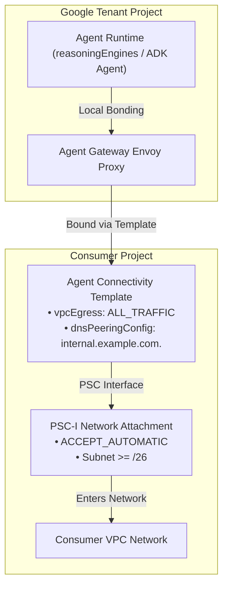

# Agent Gateway, Agent Connectivity Template (ACT), and Security Policies

This reference provides technical specifications, YAML templates, REST/CLI
commands, resource attribute contracts, and lifecycle management workflows for
Agent Gateway, Agent Connectivity Templates (ACT), Authorization Extensions
(`AuthzExtension`), Authorization Policies (`AuthzPolicy`), and Semantic
Governance Policies (SGP).

--------------------------------------------------------------------------------

## Table of Contents

-   [1. Architecture: Tenant Bridging and Control Plane Topology](#1-architecture-tenant-bridging-and-control-plane-topology): Lines 21-83
-   [2. ACT Egress Modes: ALL_TRAFFIC vs PRIVATE_RANGES_ONLY](#2-act-egress-modes-all_traffic-vs-private_ranges_only): Lines 84-108
-   [3. Production Resource Manifests and REST Deployment](#3-production-resource-manifests-and-rest-deployment): Lines 109-203
-   [4. Authorization Extensions and Policies (`authzExtensions` and `authzPolicies`)](#4-authorization-extensions-and-policies-authzextensions-and-authzpolicies): Lines 204-245
-   [5. Operational Gotchas and Container Trust](#5-operational-gotchas-and-container-trust): Lines 246-279

--------------------------------------------------------------------------------

## 1. Architecture: Tenant Bridging and Control Plane Topology

The **Agent Connectivity Template (ACT)** defines the foundational networking
contract between Google-managed tenant projects (where agent reasoning engines
run) and the customer VPC.



### Control Plane Policy and Extension Hierarchy

```text
+-----------------------------------------------------------------------------------------+
| Agent Connectivity Template (ACT)                                                       |
|   - Template ID: ${TEMPLATE_ID}                                                         |
|   - vpcEgress: ALL_TRAFFIC (or PRIVATE_RANGES_ONLY)                                     |
|   - networkAttachment: projects/${PROJECT_NUMBER}/regions/${REGION}/networkAttachments  |
|   - dnsPeeringConfig: domain: ${PEERING_DOMAIN} -> targetNetwork: ${VPC_NAME}           |
+--------------------------------------------+--------------------------------------------+
                                             |
                                             v (Referenced by Gateway)
+-----------------------------------------------------------------------------------------+
| Agent Gateway (${GATEWAY_ID})                                                           |
|   - Governed Access Path: AGENT_TO_ANYWHERE                                             |
|   - Registries: //agentregistry.googleapis.com/projects/${PROJECT_NUMBER}/locations/... |
|                 (Max 2: 1 global + 1 regional; never register in us/eu multi-regions)   |
+---------------------+---------------------------------------------+---------------------+
                      |                                             |
                      v                                             v
+-------------------------------------------+ +-------------------------------------------+
| IAP Request Authz Extension & Policy      | | Model Armor Content Authz Ext & Policy    |
| • service: iap.googleapis.com             | | • service: modelarmor.REGION.rep:443      |
| • metadata: iapPolicyVersion: "V1" / "V2" | | • metadata: model_armor_settings          |
| • policyProfile: REQUEST_AUTHZ            | | • policyProfile: CONTENT_AUTHZ            |
+-------------------------------------------+ +-------------------------------------------+
                      |                                             |
                      v                                             v
+-------------------------------------------+ +-------------------------------------------+
| Semantic Governance Policies (SGP)        | | Secure Web Proxy (SWP) Egress             |
| • Semantic Governance Policy Engine       | | • Dedicated Proxy-Only Subnet (/26)       |
| • Stripped DNS Trailing Dot Record        | | • Gateway: NEXT_HOP_ROUTING_MODE          |
| • CEL gRPC Exclusion Rule                 | | • Policy-Based Route (PBR) from PSC-I     |
+-------------------------------------------+ +-------------------------------------------+
```

--------------------------------------------------------------------------------

## 2. ACT Egress Modes: ALL_TRAFFIC vs PRIVATE_RANGES_ONLY

| Feature | `ALL_TRAFFIC` Mode | `PRIVATE_RANGES_ONLY` Mode |
| :------------- | :-------------------------------------------------------- | :-------------------- |
| **Outbound DNS Resolution** | All public and private hostnames resolve to synthetic PSC VIP `240.0.0.2:443`. | Only RFC 1918 / private domains route to VPC; public domains resolve via Google default DNS. |
| **Proxy Interception** | **100% of outbound traffic** is intercepted, inspected, and governed by the Agent Gateway Envoy proxy. | Only internal private endpoints are intercepted; external SaaS/public API traffic bypasses the gateway entirely. |
| **Internet Egress Path** | Egresses the consumer VPC through the PSC-I subnet via **Next-Hop SWP** (`swg-autogen-nat` on proxy-only subnet, with any custom Cloud NAT using `LIST_OF_SUBNETWORKS` excluding the PSC-I subnet) or explicit **Cloud NAT** (`--nat-custom-subnet-ip-ranges="${PSCI_SUBNET_NAME}"`—or `--nat-all-subnet-ip-ranges` in dedicated single-subnet VPCs—with `ENDPOINT_TYPE_VM,ENDPOINT_TYPE_SWG`, which the Agent Gateway control plane validates even when SWP is not deployed). | Direct internet egress from Google tenant infrastructure; no static customer egress IP. |
| **Enterprise Use Case** | Highly regulated production environments, zero-trust data exfiltration prevention, strict egress auditing. | Dev/test sandboxes, internal-only tools where external web scraping is ungoverned. |

> [!NOTE] **Consumer VPC, `addressGroup` IAM and Registry Prerequisites for
> `ALL_TRAFFIC`**: 1. Provision a `/26` or larger `PRIVATE` PSC-I subnet
> (avoiding reserved `10.0.0.0/24` through `10.0.2.0/24` ranges, with Private
> Google Access enabled; see `references/topologies_and_project_layouts.md`
> Section 2.2) and register the consolidated `googleapis` service with the core
> Google APIs FQDNs in Agent Registry (see
> `references/registry_and_federation.md` Section 4). 2. Creating an ACT
> auto-provisions Network Security `addressGroup` `act-${TEMPLATE_ID}`; grant
> `roles/compute.networkUser` (`networksecurity.addressGroups.use`,
> `networksecurity.addressGroups.get`) on `act-${TEMPLATE_ID}` to the Agent
> Runtime service agent
> `service-${PROJECT_NUMBER}@gcp-sa-aiplatform-re.iam.gserviceaccount.com` (see
> `references/topologies_and_project_layouts.md` Section 3.1).

--------------------------------------------------------------------------------

## 3. Production Resource Manifests and REST Deployment

### 3.1 Agent Connectivity Template (`ALL_TRAFFIC`)

```yaml
name: projects/${PROJECT_NUMBER}/locations/${REGION}/agentConnectivityTemplates/${TEMPLATE_ID}
description: "Production ACT with full egress governance and DNS peering"
accessPath: AGENT_TO_ANYWHERE
accessTypes:
  - PRIVATE
agentCompute: GKE
deploymentModel: CENTRALIZED
egressNetworkConfig:
  networkAttachment: "projects/${PROJECT_NUMBER}/regions/${REGION}/networkAttachments/${ATTACHMENT_NAME}"
  vpcEgress: ALL_TRAFFIC
  dnsPeeringConfig:
    domains:
      - "internal.example.com."
    targetNetwork: "projects/${PROJECT_NUMBER}/global/networks/${VPC_NAME}" # Use ${HOST_PROJECT_NUMBER} in Shared VPC topologies
  # Optional when using Private CA TrustConfig:
  # tlsConfig:
  #   trustConfig: "projects/${PROJECT_NUMBER}/locations/${REGION}/trustConfigs/${TRUST_CONFIG_ID}"
  #   additionalRoots: PUBLICLY_TRUSTED_ROOTS
```

### 3.2 Agent Connectivity Template (`PRIVATE_RANGES_ONLY`)

```yaml
name: projects/${PROJECT_NUMBER}/locations/${REGION}/agentConnectivityTemplates/${TEMPLATE_ID}
description: "Private-only ACT for internal RFC 1918 tool routing"
accessPath: AGENT_TO_ANYWHERE
accessTypes:
  - PRIVATE
agentCompute: GKE
deploymentModel: CENTRALIZED
egressNetworkConfig:
  networkAttachment: "projects/${PROJECT_NUMBER}/regions/${REGION}/networkAttachments/${ATTACHMENT_NAME}"
  vpcEgress: PRIVATE_RANGES_ONLY
  dnsPeeringConfig:
    domains:
      - "internal.example.com."
    targetNetwork: "projects/${PROJECT_NUMBER}/global/networks/${VPC_NAME}"
```

### 3.3 ACT and Agent Gateway REST Deployment Commands

```bash
pip install "pyyaml>=6.0,<7.0"
ACCESS_TOKEN=$(gcloud auth print-access-token)
BASE_URL="https://networkservices.googleapis.com/v1/projects/${PROJECT_NUMBER}/locations/${REGION}"

# 1. Deploy Agent Connectivity Template (using act.yaml from Section 3.1 / 3.2)
curl -s -X POST "${BASE_URL}/agentConnectivityTemplates?agentConnectivityTemplateId=${TEMPLATE_ID}" \
  -H "Authorization: Bearer ${ACCESS_TOKEN}" -H "X-Goog-User-Project: ${PROJECT_ID}" \
  -H "Content-Type: application/json" \
  -d "$(envsubst < act.yaml | python3 -c 'import sys, yaml, json; print(json.dumps(yaml.safe_load(sys.stdin)))')"

# 2. Deploy Agent Gateway referencing ACT and dual registries (using agw.yaml from Section 3.4)
curl -s -X POST "${BASE_URL}/agentGateways?agentGatewayId=${GATEWAY_ID}" \
  -H "Authorization: Bearer ${ACCESS_TOKEN}" -H "X-Goog-User-Project: ${PROJECT_ID}" \
  -H "Content-Type: application/json" \
  -d "$(envsubst < agw.yaml | python3 -c 'import sys, yaml, json; print(json.dumps(yaml.safe_load(sys.stdin)))')"
```

### 3.4 Agent Gateway (Standard and Standalone Registry-Only Modes)

```yaml
name: projects/${PROJECT_NUMBER}/locations/${REGION}/agentGateways/${GATEWAY_ID}
description: "Production Agent Gateway referencing ACT and Agent Registry"
# Mandatory in VPC-SC / SWP-inspected enterprise environments (mutually exclusive with inline networkConfig):
agentConnectivityTemplate: "projects/${PROJECT_NUMBER}/locations/${REGION}/agentConnectivityTemplates/${TEMPLATE_ID}"
# Note: In stable v1 environments without a standalone ACT, omit agentConnectivityTemplate and specify inline networkConfig:
# networkConfig:
#   egress:
#     networkAttachment: "projects/${PROJECT_NUMBER}/regions/${REGION}/networkAttachments/${ATTACHMENT_NAME}"
#   dnsPeeringConfig:
#     domains: ["internal.example.com."]
#     targetProject: "${HOST_PROJECT_ID}"
#     targetNetwork: "projects/${HOST_PROJECT_ID}/global/networks/${VPC_NAME}"
googleManaged:
  governedAccessPath: AGENT_TO_ANYWHERE
registries:
  - "//agentregistry.googleapis.com/projects/${PROJECT_NUMBER}/locations/global"
  - "//agentregistry.googleapis.com/projects/${PROJECT_NUMBER}/locations/${REGION}"
```

> [!IMPORTANT] **The Dual-Registry Invariant**: An Agent Gateway supports a
> **maximum of two registries**, and each entry must use the numeric
> `PROJECT_NUMBER` (`uint64`). When two registries are configured, **exactly ONE
> must be `global`** and the second must be **`regional`**
> (`locations/${REGION}`; never register custom services manually in `us` or
> `eu` multi-regions).

--------------------------------------------------------------------------------

## 4. Authorization Extensions and Policies (`authzExtensions` and `authzPolicies`)

*   **Collections**: Manage `authzExtensions` under
    `networkservices.googleapis.com/v1` and `authzPolicies` under
    `networksecurity.googleapis.com/v1` (never legacy `authorizationPolicies`).
*   **Agent Gateway Target Rules**: When targeting an `AgentGateway`, **omit
    `loadBalancingScheme`** on both `AuthzExtension` and `AuthzPolicy.target`
    (whereas `SecureWebProxy` and `ForwardingRule` targets use
    `INTERNAL_MANAGED`). Attach at most **4 `CUSTOM` `AuthzPolicy` resources**
    per gateway and **omit `iamEnforcementMode`** for active enforcement (see
    `references/governance_security_policies.md` for UAP Policy V2, SGP
    `CONTENT_AUTHZ`, and Model Armor manifests).

```yaml
# iap_request_authz_extension.yaml
name: projects/${PROJECT_NUMBER}/locations/${REGION}/authzExtensions/${IAP_EXT_ID}
authority: iap.googleapis.com
service: iap.googleapis.com
timeout: 1s
failOpen: false
forwardHeaders:
  - Authorization
metadata:
  iapPolicyVersion: "V2" # Use "V2" for Unified Access Policy (or "V1" for IAM condition mode)
```

```yaml
# iap_request_authz_policy.yaml
name: projects/${PROJECT_NUMBER}/locations/${REGION}/authzPolicies/${IAP_POLICY_ID}
action: CUSTOM
policyProfile: REQUEST_AUTHZ
target:
  resources:
    - projects/${PROJECT_NUMBER}/locations/${REGION}/agentGateways/${GATEWAY_ID}
customProvider:
  authzExtension:
    resources:
      - projects/${PROJECT_NUMBER}/locations/${REGION}/authzExtensions/${IAP_EXT_ID}
```

--------------------------------------------------------------------------------

## 5. Operational Gotchas and Container Trust

*   **Day-2 Lifecycle (In-Place ACT PATCH, Control-Plane `HTTP 409 ABORTED` Mutex, Avoiding `FROM_AGENT_GATEWAY*` Reference Locks via LRO Polling, and
    `?force=true` Runtime Deletion)**: See
    `references/agent_runtime_and_identity.md`.
*   **Misleading `agent-gateways import` Config Validation Error**: If
    `agent-gateways import` returns `"code": 3, "message": "Config validation
    failed"` citing `agentregistry.agents.list`, enable the API in the project:
    `gcloud services enable agentregistry.googleapis.com
    --project=${PROJECT_ID}`.
*   **Custom Container Root CA Trust Injection**: When an agent runs in
    a custom Docker container bonded to an Egress Agent Gateway, export the
    gateway's root CA (`gcloud network-services agent-gateways describe
    "${GATEWAY_NAME}" --location="${REGION}"
    --format="value(agentGatewayCard.rootCertificates)" > agw_root.crt`) and
    inject it into the OS, Python (`SSL_CERT_FILE`, `REQUESTS_CA_BUNDLE`), and
    gRPC (`GRPC_DEFAULT_SSL_ROOTS_FILE_PATH`) trust stores:

```dockerfile
FROM python:3.11-slim

RUN apt-get update && apt-get install -y --no-install-recommends \
    ca-certificates \
    && rm -rf /var/lib/apt/lists/*

# Copy exported Egress Agent Gateway Root CA into system trust store
COPY agw_root.crt /usr/local/share/ca-certificates/agw_root.crt
RUN update-ca-certificates

# Point Python SSL, Requests, httpx, and gRPC C-core at the updated bundle
ENV SSL_CERT_FILE=/etc/ssl/certs/ca-certificates.crt
ENV REQUESTS_CA_BUNDLE=/etc/ssl/certs/ca-certificates.crt
ENV GRPC_DEFAULT_SSL_ROOTS_FILE_PATH=/etc/ssl/certs/ca-certificates.crt
```
