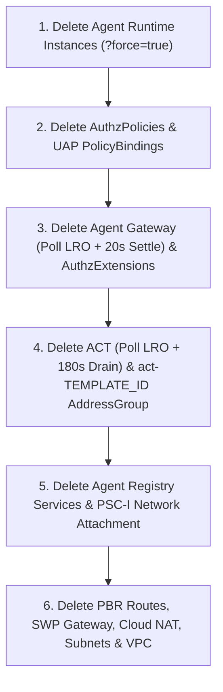

# ADK Agent Runtime Packaging, Identity Token Exchange, Observability and Day-2 Operations

This reference details configuring Python Agent Development Kit (ADK) agents for
**Agent Runtime in Gemini platform** (`reasoningEngines`), configuring **Agent
Identity (`AGENT_IDENTITY`)**, **Third-Party IdP Token Exchange (`ext_proc` +
STS)**, **Data Residency, Distributed W3C Trace Correlation and BigQuery Cost
Governance**, and **Day-2 Lifecycle Operations**.

--------------------------------------------------------------------------------

## Table of Contents

-   [1. End-to-End ADK Packaging and Runtime Architecture Overview](#1-end-to-end-adk-packaging-and-runtime-architecture-overview): Lines 27-44
-   [2. Python Packaging and Artifact Preparation](#2-python-packaging-and-artifact-preparation): Lines 45-120
-   [3. Conflict Teardown and Active Session Deletion (`?force=true`)](#3-conflict-teardown-and-active-session-deletion-forcetrue): Lines 121-137
-   [4. `CreateReasoningEngine` REST and Python SDK Specification](#4-createreasoningengine-rest-and-python-sdk-specification): Lines 138-224
-   [5. End-to-End Validation Queries](#5-end-to-end-validation-queries): Lines 225-242
-   [6. Third-Party IdP Token Exchange (`ext_proc` / STS) and Agent Identity Auth Manager](#6-third-party-idp-token-exchange-ext_proc-sts-and-agent-identity-auth-manager): Lines 243-300
-   [7. Data Residency, Regional Endpoints, Sovereign Cloud and Global Anycast Failover](#7-data-residency-regional-endpoints-sovereign-cloud-and-global-anycast-failover): Lines 301-355
-   [8. Day-2 Operations: Updating Agent Connectivity Templates In-Place and Control-Plane Mutex Locks](#8-day-2-operations-updating-agent-connectivity-templates-in-place-and-control-plane-mutex-locks): Lines 356-388
-   [9. Avoiding Dangling Reference Locks on ACT Deletion (`FROM_AGENT_GATEWAY*`)](#9-avoiding-dangling-reference-locks-on-act-deletion-from_agent_gateway): Lines 389-405
-   [10. Teardown and Clean Recreation Lifecycle](#10-teardown-and-clean-recreation-lifecycle): Lines 406-454
-   [11. Egress NAT Reflection and Cloud Run Ingress Routing Behavior](#11-egress-nat-reflection-and-cloud-run-ingress-routing-behavior): Lines 455-478

--------------------------------------------------------------------------------

## 1. End-to-End ADK Packaging and Runtime Architecture Overview

```text
+-----------------------------------------------------------------------------------------+
| GCS Artifact Contract: gs://${PROJECT_ID}-${REGION}/agent_artifacts/                    |
|   • agent_engine.pkl (cloudpickle protocol=4) | dependencies.tar.gz | requirements.txt  |
+--------------------------------------------+--------------------------------------------+
                                             | (REST CreateReasoningEngine / ADK SDK)
                                             v
+-----------------------------------------------------------------------------------------+
| Agent Runtime Container (reasoningEngines)                                              |
|   • identityType: AGENT_IDENTITY (SPIFFE PrincipalSet / Principal X.509 SVID)           |
|   • agentGateway: projects/${PROJECT_NUMBER}/locations/${REGION}/agentGateways/${ID}    |
+--------------------------------------------+--------------------------------------------+
```

--------------------------------------------------------------------------------

## 2. Python Packaging and Artifact Preparation

### 2.1 Model Version and Regional Availability Configuration

Always verify the target model's supported regions in official documentation
(`https://docs.cloud.google.com/gemini-enterprise-agent-platform/models/gemini/{model_version}.md.txt`):

-   **Global Endpoint Models (such as `gemini-2.5-pro` via `global`)**:
    -   When targeting the `global`, `us`, or `eu` endpoint rather than a
        standalone regional endpoint, instantiate
        `Gemini(model="gemini-2.5-pro", client_kwargs={"location": "global",
        "http_options": {"api_transport": "rest"}})` and set
        `GOOGLE_CLOUD_LOCATION="global"`, `VERTEXAI_LOCATION="global"`, and
        `GOOGLE_GENAI_API_TRANSPORT="rest"` in `deploymentSpec.env` (using REST
        transport guarantees `:generateContent` / `:streamGenerateContent` calls
        emit `application/json` so inline SGP and Model Armor `CONTENT_AUTHZ`
        extensions inspect 100% of LLM payloads).
    -   Ensure `aiplatform.googleapis.com`, `aiplatform.mtls.googleapis.com`,
        `us-aiplatform.googleapis.com`, `us-aiplatform.mtls.googleapis.com`, and
        `aiplatform.us.rep.googleapis.com` are registered in the `googleapis`
        Agent Registry service with `protocol_binding = "HTTP_JSON"`.
-   **Regional Models (such as `gemini-2.5-flash` in `us-central1`)**:
    -   Set `location="us-central1"` in `client_kwargs` and
        `deploymentSpec.env`, and include
        `us-central1-aiplatform.googleapis.com`,
        `us-central1-aiplatform.mtls.googleapis.com`, and
        `aiplatform.us-central1.rep.googleapis.com` in `googleapis` when the
        runtime is hosted in another region.

### 2.2 GCS Package Artifact Contract and Staging Bucket Integrity Hardening

The Agent Runtime reconstructs the agent from three Cloud Storage objects
(`packageSpec`):

1.  **`pickleObjectGcsUri` (`agent_engine.pkl`)**: Serialized with
    `cloudpickle.dump(agent_instance, f, protocol=4)` (protocol 4 guarantees
    compatibility with the container's Python 3.11 runtime).
2.  **`dependencyFilesGcsUri` (`dependencies.tar.gz`)**: Gzipped tarball
    containing local Python source modules.
3.  **`requirementsGcsUri` (`requirements.txt`)**: Pinned runtime dependencies
    (`google-adk>=1.17.0,<2.0.0`, `google-cloud-aiplatform[agent_engines,adk]>=1.90.0,<2.0.0`,
    `cloudpickle>=3.0.0,<4.0.0`, `httpx>=0.27.0,<1.0.0`, `opentelemetry-api==1.37.0`,
    `opentelemetry-sdk==1.37.0`, `opentelemetry-exporter-gcp-trace==1.11.0`).
4.  **Staging Bucket Integrity and Service Agent Read Access (`cloudpickle`
    Supply-Chain Guard)**: Because `cloudpickle` deserialization executes code
    at container startup, configure the staging bucket with
    `uniform_bucket_level_access = true`, `public_access_prevention =
    "enforced"`, and `versioning { enabled = true }`, restrict
    `roles/storage.objectAdmin` strictly to the CI/CD build service account,
    verify object `crc32c` / `md5Hash` checksums on upload, and grant read-only
    `roles/storage.objectViewer` on `gs://${PROJECT_ID}-${REGION}` to both
    `service-${PROJECT_NUMBER}@gcp-sa-aiplatform.iam.gserviceaccount.com` and
    `service-${PROJECT_NUMBER}@gcp-sa-aiplatform-re.iam.gserviceaccount.com`.

### 2.3 Multi-Agent ADK Orchestration, Deterministic Pre-Model Callbacks and Grounded Retrieval

When designing regulated multi-agent systems (such as supervisor-to-specialist
topologies with domain triage, grounded vector/SQL retrieval, and policy review):

1.  **Deterministic Pre-Model Short-Circuiting (`before_model_callback`)**:
    Never rely solely on probabilistic LLM prompts for mandatory safety
    escalations or encoded prompt-injection filtering. Attach a deterministic
    `before_model_callback` on the root `LlmAgent` that runs the 3-step
    pre-sanitization normalization pipeline (`references/governance_security_policies.md`
    Section 9.4) and evaluates deterministic escalation rules (returning an
    immediate `LlmResponse` short-circuit before invoking Gemini or specialist
    sub-agents when a high-risk condition is triggered).
2.  **Supervisor and Specialist Sub-Agent Hierarchy**: Compose specialist
    `LlmAgent` instances (`sub_agents=[retrieval_specialist, compliance_specialist]`)
    under the root orchestrator `LlmAgent`, scoping MCP toolsets per specialist
    so only the retrieval specialist holds read-only MCP/database tools and
    every synthesized response includes verifiable source citations (`source_id`,
    `document_uri`) from the retrieved corpus.

--------------------------------------------------------------------------------

## 3. Conflict Teardown and Active Session Deletion (`?force=true`)

A consumer project's regional Agent Runtime tenant project (`*-tp`) can only
bond to **one** Agent Gateway per region (multiple `ReasoningEngine` instances
in the same project/region can share that gateway, or use separate spoke
projects if distinct gateways are required).

> [!IMPORTANT] **Active Session Deletion Invariant (`?force=true`)**: Calling
> `DELETE` on an Agent Runtime instance that has existing conversations or child
> `sessions` fails with `HTTP 400 FAILED_PRECONDITION: The ReasoningEngine ...
> contains child resources: sessions`. Always append **`?force=true`** (`DELETE
> https://${REGION}-aiplatform.googleapis.com/v1/${RE_NAME}?force=true`) and
> poll the resulting LRO until `done: true` (see Section 10 for the complete CLI
> teardown script).

--------------------------------------------------------------------------------

## 4. `CreateReasoningEngine` REST and Python SDK Specification

### 4.1 REST Specification (`reasoningEngines`)

```json
{
  "displayName": "adk-enterprise-agent",
  "description": "ADK Agent with governed egress via Agent Gateway and AGENT_IDENTITY",
  "spec": {
    "identityType": "AGENT_IDENTITY",
    "agentFramework": "google-adk",
    "classMethods": [
      {"name": "async_create_session", "apiMode": "async", "parameters": {"type": "object", "properties": {"user_id": {"type": "string"}}}},
      {"name": "query", "apiMode": "", "parameters": {"type": "object", "properties": {"message": {"type": "string"}}}},
      {"name": "stream_query", "apiMode": "stream", "parameters": {"type": "object", "properties": {"message": {"type": "string"}, "user_id": {"type": "string"}, "session_id": {"type": "string"}}}}
    ],
    "packageSpec": {
      "pickleObjectGcsUri": "gs://${PROJECT_ID}-${REGION}/agent_artifacts/agent_engine.pkl",
      "dependencyFilesGcsUri": "gs://${PROJECT_ID}-${REGION}/agent_artifacts/dependencies.tar.gz",
      "requirementsGcsUri": "gs://${PROJECT_ID}-${REGION}/agent_artifacts/requirements.txt",
      "pythonVersion": "3.11"
    },
    "deploymentSpec": {
      "env": [
        {"name": "GOOGLE_CLOUD_AGENT_ENGINE_ENABLE_TELEMETRY", "value": "true"},
        {"name": "GOOGLE_CLOUD_LOCATION", "value": "global"},
        {"name": "VERTEXAI_LOCATION", "value": "global"},
        {"name": "GOOGLE_GENAI_USE_ENTERPRISE", "value": "1"},
        {"name": "GOOGLE_GENAI_API_TRANSPORT", "value": "rest"},
        {"name": "OTEL_SERVICE_NAME", "value": "adk-enterprise-agent"},
        {"name": "ADK_CAPTURE_MESSAGE_CONTENT_IN_SPANS", "value": "false"},
        {"name": "GOOGLE_API_PREVENT_AGENT_TOKEN_SHARING_FOR_GCP_SERVICES", "value": "False"}
      ],
      "agentGatewayConfig": {
        "agentToAnywhereConfig": {
          "agentGateway": "projects/${PROJECT_NUMBER}/locations/${REGION}/agentGateways/${GATEWAY_ID}"
        }
      }
    }
  }
}
```

Submit via `POST
https://${REGION}-aiplatform.googleapis.com/v1/projects/${PROJECT_NUMBER}/locations/${REGION}/reasoningEngines`
and poll the returned operation URL until `.done == true`.

### 4.2 Python SDK Deployment (`client.agent_engines.create`)

When binding a Runtime Spoke `ReasoningEngine` to a Governance Hub
`AgentGateway`, both resources must reside in the **exact same region** and use
**numeric `uint64` project numbers** (`AGW_PROJECT_NUMBER`); grant
`(networkservices.agentGateways.get, networkservices.agentGateways.use,
networkservices.operations.get)` (or `roles/networkservices.admin`) to the
deployer and `gcp-sa-aiplatform`, and `roles/compute.networkUser` on
`act-${TEMPLATE_ID}` to `gcp-sa-aiplatform-re` (see
`references/topologies_and_project_layouts.md` Section 3.1):

```python
remote_agent = client.agent_engines.create(
    agent=local_agent,
    config={
        "agent_gateway_config": {
            "agent_to_anywhere_config": {
                "agent_gateway": f"projects/{AGW_PROJECT_NUMBER}/locations/{REGION}/agentGateways/{GATEWAY_ID}"
            },
        },
        "identity_type": "AGENT_IDENTITY",
        "env_vars": {
            "GOOGLE_API_PREVENT_AGENT_TOKEN_SHARING_FOR_GCP_SERVICES": "False",
        },
    },
)
```

> [!CAUTION] **Token-Sharing Boundary (`GOOGLE_API_PREVENT_AGENT_TOKEN_SHARING_FOR_GCP_SERVICES="False"`)**:
> Setting `GOOGLE_API_PREVENT_AGENT_TOKEN_SHARING_FOR_GCP_SERVICES="False"` is
> required so the Agent Runtime container can present its platform token across
> a cross-project Agent Gateway (`AGW_PROJECT_ID`) to registered Google APIs
> (`googleapis`). Never pass raw Google Cloud platform access tokens to external
> 3P or untrusted MCP servers; enforce UAP Policy V2 host/resource scoping and
> use Agent Identity Auth Manager (`AuthProvider`) or `X-Serverless-Authorization`
> scoped OIDC ID tokens (`references/egress_routing_and_swp.md` Section 5) for
> downstream MCP tool authentication.

--------------------------------------------------------------------------------

## 5. End-to-End Validation Queries

```bash
# 5.1 Session Creation (:query with async_create_session)
curl -s -X POST "https://${REGION}-aiplatform.googleapis.com/v1/${RE_NAME}:query" \
  -H "Authorization: Bearer $(gcloud auth print-access-token)" \
  -H "Content-Type: application/json" \
  -d '{"classMethod": "async_create_session", "input": {"user_id": "test-user"}}' | jq .

# 5.2 Streaming Query Execution (:streamQuery NDJSON)
curl -N -X POST "https://${REGION}-aiplatform.googleapis.com/v1/${RE_NAME}:streamQuery" \
  -H "Authorization: Bearer $(gcloud auth print-access-token)" \
  -H "Content-Type: application/json" \
  -d '{"input": {"message": "Verify governed tool connectivity", "user_id": "test-user"}}'
```

--------------------------------------------------------------------------------

## 6. Third-Party IdP Token Exchange (`ext_proc` / STS) and Agent Identity Auth Manager

### 6.1 External IdP (EntraID, Ping, Okta) to Google Cloud Token Swap (`ext_proc`)

1.  **Workforce Identity Federation and Security Token Service (STS)**: Configure
    a Workforce Identity Pool and Provider (`WorkforcePool`,
    `WorkforcePoolProvider`) mapped to the corporate
    EntraID/Okta/Ping OIDC issuer and JWKS URI.
2.  **Envoy `ext_proc` Service Extension Callout**: Attach a Service Extension
    (`LbTrafficExtension`) on the ingress ALB that intercepts `Authorization:
    Bearer <IdP_JWT>`, calls `https://sts.googleapis.com/v1/token`
    (`urn:ietf:params:oauth:grant-type:token-exchange`), and swaps the corporate
    token for a short-lived Google Cloud STS token (see
    `references/ingress_patterns_and_rewrites.md` Section 7 for the complete
    `LbTrafficExtension` YAML and Python `ext_proc` implementation).
3.  **Multi-Agent 3LO Token Propagation**: Propagate end-user 3-legged OAuth
    (3LO) context across Agent2Agent (A2A) calls via Agent Identity Auth Manager
    rather than falling back to ambient service account privileges.

### 6.2 Agent Identity Auth Manager and X.509 SPIFFE Attestation

1.  **Enable Auth Manager APIs and Add to VPC-SC Perimeter `restricted_services`**:
    Run `gcloud services enable aiplatform.googleapis.com
    agentidentity.googleapis.com agentidentitycredentials.googleapis.com` and
    explicitly add both **`agentidentity.googleapis.com`** and
    **`agentidentitycredentials.googleapis.com`** to the **VPC-SC perimeter
    `restricted_services`** list so outbound credential brokering is governed by
    the perimeter.
2.  **Configure `AuthProvider`**: Create a managed `AuthProvider` (`2LO` client
    credentials, `3LO` user consent flow, or vaulted API key) in Auth Manager
    (scoping `workloadIds` and IAM access strictly to the agent's `principal://`
    URI; never hardcode OAuth client secrets or static API keys in Python code
    or container environment variables) and reference it in the Agent Registry
    `AuthProviderBinding` or ADK MCP tool specification so Agent Gateway injects
    outbound `Authorization` headers over the wire:

```bash
export PROJECT_ID="gov-hub-proj" PROJECT_NUMBER="111111111111" REGION="us-central1"
export ORG_ID="999999999999" ENGINE_ID="5555555555555555555" AUTH_PROVIDER_ID="downstream-api-oauth"
AGENT_PRINCIPAL="principal://agents.global.org-${ORG_ID}.system.id.goog/resources/aiplatform/projects/${PROJECT_NUMBER}/locations/${REGION}/reasoningEngines/${ENGINE_ID}"

curl -s -X POST "https://agentidentity.googleapis.com/v1/projects/${PROJECT_ID}/locations/${REGION}/authProviders?authProviderId=${AUTH_PROVIDER_ID}" \
  -H "Authorization: Bearer $(gcloud auth print-access-token)" -H "Content-Type: application/json" \
  -d "{\"description\":\"Managed outbound OAuth provider for agent tool calls\",\"authProviderTypeParams\":{\"twoLeggedOauth\":{\"clientId\":\"${OAUTH_CLIENT_ID}\",\"clientSecret\":\"${OAUTH_CLIENT_SECRET}\",\"tokenUrl\":\"https://idp.example.com/oauth2/v2.0/token\"}},\"allowedScopes\":[\"https://api.internal.example.com/.default\"],\"workloadIds\":[\"${AGENT_PRINCIPAL}\"]}"
```

3.  **SPIFFE X.509 URI vs. IAM Principal Translation Format**:
    -   **X.509 Certificate SAN (SPIFFE URI)**:
        `spiffe://agents.global.org-${ORG_ID}.system.id.goog/resources/aiplatform/projects/${PROJECT_NUMBER}/locations/${REGION}/reasoningEngines/${ENGINE_ID}`
    -   **Google Cloud IAM and UAP Policy V2 Principal Format**:
        `principal://agents.global.org-${ORG_ID}.system.id.goog/resources/aiplatform/projects/${PROJECT_NUMBER}/locations/${REGION}/reasoningEngines/${ENGINE_ID}`
        (always use the full
        `system.id.goog/resources/aiplatform/projects/${PROJECT_NUMBER}/locations/${REGION}/reasoningEngines/${ENGINE_ID}`
        path with numeric `PROJECT_NUMBER`, never a shortened
        `vertex/reasoning-engine/<name>` slug).

--------------------------------------------------------------------------------

## 7. Data Residency, Regional Endpoints, Sovereign Cloud and Global Anycast Failover

### 7.1 Regional Sovereignty, Air-Gapped GDC/TPC and Global Anycast Failover

1.  **Sovereign Data Residency (APRA, MAS, GDPR, EU)**: Align the Agent Runtime
    region, Agent Gateway region, and Model Armor callout endpoint
    (`modelarmor.${REGION}.rep.googleapis.com:443`) within the mandated
    sovereign boundary.
2.  **Google Distributed Cloud (GDC) Air-Gapped and Trusted Partner Cloud (TPC)**:
    Where global `agentregistry.googleapis.com` is unavailable, deploy the
    **Two-Tier Regional Internal ALB + Next-Hop SWP + Local Envoy `ext_proc`**
    pattern inside the sovereign VPC perimeter with Private CA `TrustConfig`
    roots.
3.  **Multi-Region Active/Active and Global Anycast Routing**: Front regional
    Tier-2 Internal ALBs (each routing to a co-located regional Agent Runtime +
    Egress Agent Gateway stack in `us-central1` and `us-east4`) with a
    single **Tier-1 Global External ALB** using a global anycast IP and
    health-checked Cross-Region PSC NEG failover.
4.  **Spanner and Data-Plane Service Account Impersonation**: Grant the agent
    principal `roles/iam.serviceAccountTokenCreator` on a dedicated IAM Service
    Account holding `roles/spanner.databaseUser`.

### 7.2 Observability, BigQuery `dry_run` Cost Guard and Data-Tier Governance

1.  **Privacy-Preserving W3C Trace Propagation**: Set
    `ADK_CAPTURE_MESSAGE_CONTENT_IN_SPANS="false"` in `deploymentSpec.env` so
    OpenTelemetry W3C `traceparent` spans correlate latency across Ingress,
    Agent Runtime, Agent Gateway, and MCP tool hops in Cloud Trace without
    recording raw user prompts or PII/PHI in span attributes.
2.  **BigQuery Pre-Execution `dry_run` Cost and Read-Only Guard**: When agents
    query `bigquery.googleapis.com/mcp` or analytical SQL tools, execute a
    pre-flight `QueryJobConfig(dry_run=True, use_query_cache=False)` check to
    verify `statement_type == "SELECT"` and enforce a `maximum_bytes_billed`
    ceiling with caller attribution labels before running the query:

```python
from google.cloud import bigquery

def run_governed_query(client: bigquery.Client, sql: str, max_bytes: int, caller: str) -> list[dict]:
  dry_job = client.query(sql, job_config=bigquery.QueryJobConfig(dry_run=True, use_query_cache=False))
  if dry_job.statement_type != "SELECT" or (dry_job.total_bytes_processed or 0) > max_bytes:
    raise PermissionError("Blocked non-SELECT or over-budget BigQuery query")
  job_cfg = bigquery.QueryJobConfig(maximum_bytes_billed=max_bytes, labels={"caller": caller})
  return [dict(row) for row in client.query(sql, job_config=job_cfg).result()]
```

3.  **Cloud SQL (`pgvector`) and Spanner Tool Spoke Access**: Place database
    backends inside the Tool Spoke (`MCP_PROJECT_ID`), connect via Private
    Service Connect (PSC) endpoints, and authenticate using IAM database
    authentication (`roles/cloudsql.instanceUser` /
    `roles/spanner.databaseUser`) via short-lived SA impersonation rather than
    static database passwords.

--------------------------------------------------------------------------------

## 8. Day-2 Operations: Updating Agent Connectivity Templates In-Place and Control-Plane Mutex Locks

### 8.1 In-Place PATCH via `updateMask=agentConnectivityTemplate`

Never use legacy `update_mask=traffic_select,network_config` or destroy/recreate
an active Agent Gateway. Grant `roles/compute.networkUser`
(`networksecurity.addressGroups.use`, `networksecurity.addressGroups.get`) on
the new ACT's auto-created `addressGroups/act-${NEW_TEMPLATE_ID}` via the
Network Security v1 `:getIamPolicy` / `:setIamPolicy` REST API first (see
`references/topologies_and_project_layouts.md` Section 3.1), then submit an
in-place `PATCH` with `updateMask=agentConnectivityTemplate`:

```bash
PATCH_RESP=$(curl -s -X PATCH \
  "https://networkservices.googleapis.com/v1/projects/${PROJECT_NUMBER}/locations/${REGION}/agentGateways/${GATEWAY_ID}?updateMask=agentConnectivityTemplate" \
  -H "Authorization: Bearer $(gcloud auth print-access-token)" \
  -H "X-Goog-User-Project: ${PROJECT_ID}" \
  -H "Content-Type: application/json" \
  -d "{\"name\":\"projects/${PROJECT_NUMBER}/locations/${REGION}/agentGateways/${GATEWAY_ID}\",\"agentConnectivityTemplate\":\"projects/${PROJECT_NUMBER}/locations/${REGION}/agentConnectivityTemplates/${NEW_TEMPLATE_ID}\"}")
OP_NAME=$(echo "${PATCH_RESP}" | jq -r '.name')
gcloud network-services operations wait "${OP_NAME}" --location="${REGION}" --project="${PROJECT_ID}"
```

### 8.2 Handling Control-Plane Resource Mutation Mutex Locks (`HTTP 409 ABORTED`)

The Network Services control plane enforces a per-resource mutex lock (`HTTP 409 ABORTED:
unable to queue the operation; an operation is already in progress`). Before
queueing sequential mutations, list active operations at
`https://networkservices.googleapis.com/v1/projects/${PROJECT_NUMBER}/locations/${REGION}/operations`
and poll until `done: true`.

--------------------------------------------------------------------------------

## 9. Avoiding Dangling Reference Locks on ACT Deletion (`FROM_AGENT_GATEWAY*`)

Deleting an ACT immediately after issuing an Agent Gateway `DELETE` fails with
`HTTP 400 FAILED_PRECONDITION: Resource ... is already being used by resource(s)
.../agentGateways/...` because Network Services retains an internal
`FROM_AGENT_GATEWAY<ID>` lock until the gateway deletion LRO and Agent Runtime
`DeprovisionAgentGatewayBinding` workflow settle:

1.  **Delete `ReasoningEngine` First with `?force=true`** and poll its LRO to
    completion.
2.  **Wait for Agent Gateway Deletion LRO + 20s Settle Window** (`sleep 20`
    cooldown) before calling `DELETE` on the parent ACT.
3.  **Wait 180s After ACT Deletion** (`sleep 180` cooldown) before deleting the
    PSC-I Network Attachment so tenant router NICs detach cleanly.

--------------------------------------------------------------------------------

## 10. Teardown and Clean Recreation Lifecycle



### 10.1 Complete Reverse-Dependency CLI Teardown Script

```bash
# 1. Force-delete active Agent Runtime instance (drops child sessions cleanly) and poll LRO
RE_DEL_RESP=$(curl -s -X DELETE \
  "https://${REGION}-aiplatform.googleapis.com/v1/projects/${PROJECT_NUMBER}/locations/${REGION}/reasoningEngines/${RE_ID}?force=true" \
  -H "Authorization: Bearer $(gcloud auth print-access-token)" \
  -H "X-Goog-User-Project: ${PROJECT_ID}")
RE_OP=$(echo "${RE_DEL_RESP}" | jq -r '.name // empty')
while [[ -n "${RE_OP}" ]]; do
  OP_JSON=$(curl -s -X GET "https://${REGION}-aiplatform.googleapis.com/v1/${RE_OP}" \
    -H "Authorization: Bearer $(gcloud auth print-access-token)" -H "X-Goog-User-Project: ${PROJECT_ID}")
  [[ "$(echo "${OP_JSON}" | jq -r '.done // false')" == "true" ]] && break
  sleep 10
done

# 2. Delete AuthzPolicies, Agent Gateway (poll LRO + 20s control-plane settle), and AuthzExtensions
gcloud network-security authz-policies delete "${AUTHZ_POLICY_NAME}" --location="${REGION}" --project="${PROJECT_ID}" --quiet
GW_OP=$(curl -s -X DELETE \
  "https://networkservices.googleapis.com/v1/projects/${PROJECT_NUMBER}/locations/${REGION}/agentGateways/${GATEWAY_ID}" \
  -H "Authorization: Bearer $(gcloud auth print-access-token)" -H "X-Goog-User-Project: ${PROJECT_ID}" | jq -r '.name')
gcloud network-services operations wait "${GW_OP}" --location="${REGION}" --project="${PROJECT_ID}"
gcloud service-extensions authz-extensions delete "${AUTHZ_EXT_NAME}" --location="${REGION}" --project="${PROJECT_ID}" --quiet
sleep 20

# 3. Delete ACT (poll LRO + 180s PSC-I NIC drain), auto-created addressGroup, Registry & Network Attachment
ACT_OP=$(curl -s -X DELETE \
  "https://networkservices.googleapis.com/v1/projects/${PROJECT_NUMBER}/locations/${REGION}/agentConnectivityTemplates/${TEMPLATE_ID}" \
  -H "Authorization: Bearer $(gcloud auth print-access-token)" -H "X-Goog-User-Project: ${PROJECT_ID}" | jq -r '.name')
gcloud network-services operations wait "${ACT_OP}" --location="${REGION}" --project="${PROJECT_ID}"
gcloud network-security address-groups delete "act-${TEMPLATE_ID}" --location="${REGION}" --project="${PROJECT_ID}" --quiet || true
sleep 180
gcloud agent-registry services delete "googleapis" --location="${REGION}" --project="${PROJECT_ID}" --quiet
gcloud compute network-attachments delete "${ATTACHMENT_NAME}" --region="${REGION}" --project="${PROJECT_ID}" --quiet
```

--------------------------------------------------------------------------------

## 11. Egress NAT Reflection and Cloud Run Ingress Routing Behavior

### 11.1 Cloud NAT vs Cloud Run Ingress Routing Behavior

> [!IMPORTANT] **Internal Google Cloud Ingress Routing Behavior**: When an Agent
> Gateway or Compute Engine instance in Google Cloud calls a default Cloud Run
> domain (`*.run.app`), Google Cloud routes traffic internally to the Cloud Run
> ingress proxy, **bypassing Cloud NAT** and setting `X-Forwarded-For: 0.0.0.0`.
> To verify that outbound traffic reflects the Cloud NAT static external IP
> (`STATIC_NAT_IP`), test queries must target an external non-Google service
> (such as `https://api.ipify.org`) as part of the 3-phase verification runbook
> (`references/topologies_and_project_layouts.md` Section 10):
> 1.  **Control-Plane Readiness**: Verify via `gcloud ... describe` that the
>     Agent Gateway state is `ACTIVE`, the PSC-I Network Attachment endpoint is
>     `ACCEPTED`, and the consolidated `googleapis` service is registered in
>     Agent Registry.
> 2.  **Outbound TLS Peer and External NAT Probe**: Verify that the agent
>     container's outbound TLS connection terminates at `240.0.0.2` (`Agent
>     Gateway TLS Inspection CA`) and an external reflector probe
>     (`https://api.ipify.org`) returns the consumer Cloud NAT IP.
> 3.  **Security Probes and Cloud Audit Log Receipts**: Execute positive and
>     negative security probes and verify server-side Cloud Audit Log deny
>     receipts (`protoPayload.status.code=7` on `iap.googleapis.com` and
>     `modelarmor.googleapis.com`).
