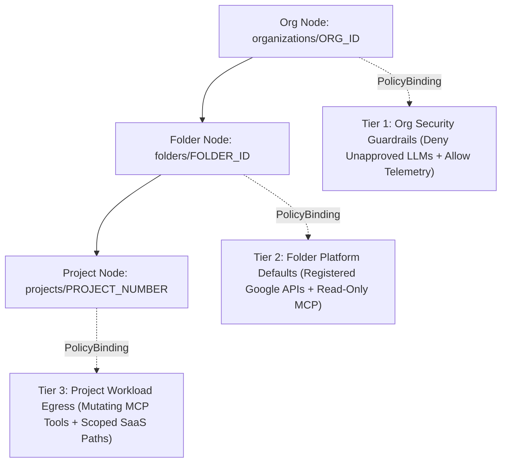

# Enterprise Governance, Security Policies, and Token Injection

This reference details the security, authorization, and sanitization stack for
**Gemini platform**, including the 3-Tier Unified Access Policy
(UAP / Policy V2) framework, Common Expression Language (CEL) attribute
specifications, Semantic Governance Policies (SGP), and Model Armor.

--------------------------------------------------------------------------------

## Table of Contents

-   [1. Unified Access Policy (UAP / Policy V2) Multi-Tier Architecture](#1-unified-access-policy-uap-policy-v2-multi-tier-architecture): Lines 24-50
-   [2. Complete UAP CEL Attribute Reference](#2-complete-uap-cel-attribute-reference): Lines 51-114
-   [3. The 3-Tier Implementation Framework](#3-the-3-tier-implementation-framework): Lines 115-223
-   [4. Operational Anti-Patterns and Governance Pitfalls](#4-operational-anti-patterns-and-governance-pitfalls): Lines 224-279
-   [5. Deployment Commands and Verification Protocol](#5-deployment-commands-and-verification-protocol): Lines 280-300
-   [6. Semantic Governance Policy (SGP) Engine](#6-semantic-governance-policy-sgp-engine): Lines 301-348
-   [7. Inline Model Armor Content Authorization (`CONTENT_AUTHZ`)](#7-inline-model-armor-content-authorization-content_authz): Lines 349-369
-   [8. Credential Isolation and Token Injection (Auth Manager)](#8-credential-isolation-and-token-injection-auth-manager): Lines 370-375
-   [9. Advanced Model Armor Enterprise Governance Patterns](#9-advanced-model-armor-enterprise-governance-patterns): Lines 376-468

--------------------------------------------------------------------------------

## 1. Unified Access Policy (UAP / Policy V2) Multi-Tier Architecture

To govern agent egress at enterprise scale, the platform utilizes **IAM Policy
V2 (UAP)** attached to Resource Manager nodes (Organizations, Folders, and
Projects) rather than legacy shadow resources.



### 1.1 Multi-Tier Traversal and Evaluation Mechanics

1.  **Gateway Interception and Registry Classification**: The Envoy proxy
    intercepts connections at `240.0.0.2:443`; IAP checks Agent Registry and
    sets `destination.is_registered = true` (`agent_registry` attributes) or
    `false` (`unregistered` attributes).
2.  **Hierarchical Policy Check (`Project -> Folder -> Organization`)**: `DENY`
    has absolute precedence across the hierarchy (returning HTTP 403 / gRPC
    `PERMISSION_DENIED`); `ALLOW` is additive, and unmatched requests are denied
    by default.

--------------------------------------------------------------------------------

## 2. Complete UAP CEL Attribute Reference

All evaluation attributes operate within the `iap.googleapis.com` namespace,
rooted at `destination`. Wrap each CEL clause in parentheses (`((...) &&
(...))`) so the Google Cloud console UI renders UAP rules interactively. High-level
policy specs sometimes reference shorthand `request.toolName`, which maps to
`destination.agent_registry.mcp_server.tool.name` in UAP Policy V2 and
`api.getAttribute('iap.googleapis.com/mcp.toolName', '')` in IAP V1 (for example,
`api.getAttribute('iap.googleapis.com/mcp.toolName', '') == '' ||
api.getAttribute('iap.googleapis.com/mcp.toolName', '') == 'search_docs'`).

### 2.1 Registered Destinations (`destination.is_registered == true`)

-   **`destination.is_registered`** (`Boolean`: `==`, `!=`): Must be evaluated
    before referencing `agent_registry` subfields.
-   **`destination.agent_registry.resource_type`** (`String`: `==`, `!=`, `in`):
    `'ENDPOINT'`, `'MCP_SERVER'`, `'AGENT'`, `'SKILL'`.
-   **`destination.agent_registry.location` and `.project_id`** (`String`: `==`,
    `!=`, `in`): Registry region (`'global'`, `'us-central1'`) and hosting
    Google Cloud project ID.
-   **`destination.agent_registry.endpoint.name`** (`String`: `==`, `!=`, `in` —
    note: `.startsWith()`, `.endsWith()`, and `.contains()` are only supported
    on `destination.unregistered.host` and `destination.unregistered.path` in
    UAP Policy V2): `'googleapis'` or
    `projects/{p}/locations/{l}/endpoints/{name}`.
-   **`destination.agent_registry.mcp_server.name`** (`String`: `==`, `!=`, `in`
    — use exact match `==` or `in`, or pair with
    `destination.agent_registry.project_id == '{p}'`):
    `projects/{p}/locations/{l}/mcpServers/{name}`.
-   **`destination.agent_registry.mcp_server.method`** (`String`: `==`, `!=`,
    `in`): `'tools'`, `'prompts'`, `'resources'`.
-   **`destination.agent_registry.mcp_server.tool.name`** (`String`: `==`, `!=`,
    `in`): Specific tool identifier (`'execute_query'`, or `''` during
    `initialize` / `tools/list`).
-   **`destination.agent_registry.mcp_server.tool.annotations.*`** (`Boolean`:
    `==`, `!=`): `.read_only_hint`, `.destructive_hint`, `.idempotent_hint`, and
    `.open_world_hint`.
-   **`destination.agent_registry.mcp_server.prompt.name` and `.resource.name`**
    (`String`: `==`, `!=`, `in`): Prompt or resource identifier when `method ==
    'prompts'` or `'resources'`.
-   **`destination.agent_registry.agent.name`** (`String`: `==`, `!=`, `in`):
    Target agent resource name in Agent2Agent protocol (A2A) calls.
-   **`request.auth.claims["agent.googleapis.com/agent_id"]`** (`String`: `==`,
    `!=`, `in`): Calling Agent Identity resource ID claim for source-agent
    condition scoping.

### 2.2 Unregistered Destinations (`destination.is_registered == false`)

-   **`destination.unregistered.host`** (`String`: `==`, `!=`, `in`,
    `.startsWith()`, `.endsWith()`, `.contains()`): Target FQDN
    (`'bigquery.googleapis.com'`, `'api.github.com'`).
-   **`destination.unregistered.path`** (`String`: `==`, `!=`, `in`,
    `.startsWith()`, `.endsWith()`, `.contains()`): URL/RPC path
    (`'/v1/projects/...'`).
-   **`destination.unregistered.method`** (`String`: `==`, `!=`, `in`): HTTP
    verb (`'GET'`, `'POST'`, `'PUT'`, `'DELETE'`).

> [!IMPORTANT] **Tool Annotations Unavailable on Unregistered Endpoints**:
> Unregistered endpoints have null `agent_registry` structs. Attributes like
> `read_only_hint` and `destructive_hint` are **only populated for registered
> Agent Registry resources**.

--------------------------------------------------------------------------------

## 3. The 3-Tier Implementation Framework

> [!IMPORTANT] **UAP Permission FQDN**: The required UAP operation permission
> string is the fully qualified
> **`"iap.googleapis.com/resources.egressViaIAP"`** (never `"egress.connect"`).

### 3.1 Tier 1: Security Admin Implementation (Organization Scope)

Target: `//cloudresourcemanager.googleapis.com/organizations/${ORG_ID}`

```json
{
  "name": "organizations/${ORG_ID}/locations/global/accessPolicies/org-security-guardrails",
  "displayName": "Organization Security Guardrails",
  "details": {"rules": [
    {
      "description": "ALLOW essential telemetry and logging endpoints required for agent startup",
      "effect": "ALLOW",
      "principals": ["principalSet://agents.global.org-${ORG_ID}.system.id.goog/*"],
      "operation": {"permissions": ["iap.googleapis.com/resources.egressViaIAP"]},
      "conditions": {"iap.googleapis.com": {"title": "allow_essential_telemetry", "expression": "(destination.is_registered == false) && (destination.unregistered.host in ['telemetry.mtls.googleapis.com', 'trace.mtls.googleapis.com', 'logging.googleapis.com', 'monitoring.googleapis.com', 'cloudtrace.googleapis.com', 'telemetry.googleapis.com'])"}}
    },
    {
      "description": "DENY unapproved public LLM endpoints across unregistered hosts",
      "effect": "DENY",
      "principals": ["principalSet://agents.global.org-${ORG_ID}.system.id.goog/*"],
      "operation": {"permissions": ["iap.googleapis.com/resources.egressViaIAP"]},
      "conditions": {"iap.googleapis.com": {"title": "deny_denylisted_llms", "expression": "(destination.is_registered == false) && (destination.unregistered.host in ['api.openai.com', 'api.anthropic.com', 'api.cohere.ai'] || destination.unregistered.host.endsWith('.openai.com') || destination.unregistered.host.endsWith('.anthropic.com') || destination.unregistered.host.endsWith('.cohere.ai'))"}}
    }
  ]}
}
```

> [!IMPORTANT] **UAP CEL String Function Scope and Defense-in-Depth Against Spoke
> Shadow Registration**: In UAP Policy V2, `.startsWith()`, `.endsWith()`, and
> `.contains()` are supported **only** on `destination.unregistered.host` and
> `destination.unregistered.path` (`destination.agent_registry.endpoint.name`
> only supports `==`, `!=`, and `in`). To prevent a spoke project from
> registering a denylisted external LLM host in Agent Registry to flip
> `destination.is_registered` to `true`, enforce a 3-layer block: (1) the Tier 1
> UAP `DENY` rule in Section 3.1, (2) a domain-denylist check in the multi-project
> catalog federator (`references/registry_and_federation.md` Section 5.1) that
> rejects unapproved external LLM hosts, and (3) a priority-10 SWP TLS SNI
> `DENY` rule (`references/egress_routing_and_swp.md` Section 3).

### 3.2 Tier 2: Platform Admin Implementation (Folder Scope)

Target: `//cloudresourcemanager.googleapis.com/folders/${FOLDER_ID}`

```json
{
  "name": "folders/${FOLDER_ID}/locations/global/accessPolicies/folder-platform-defaults",
  "displayName": "Folder Platform Defaults",
  "details": {"rules": [
    {
      "description": "ALLOW registered Google APIs endpoint",
      "effect": "ALLOW",
      "principals": ["principalSet://agents.global.org-${ORG_ID}.system.id.goog/attribute.platform/aiplatform"],
      "operation": {"permissions": ["iap.googleapis.com/resources.egressViaIAP"]},
      "conditions": {"iap.googleapis.com": {"title": "allow_registered_googleapis", "expression": "(destination.is_registered == true) && (destination.agent_registry.resource_type == 'ENDPOINT') && (destination.agent_registry.endpoint.name in ['googleapis', 'projects/${AGW_PROJECT_ID}/locations/${REGION}/endpoints/googleapis', 'projects/${AGW_PROJECT_NUMBER}/locations/${REGION}/endpoints/googleapis'])"}}
    },
    {
      "description": "ALLOW read-only corporate MCP tools across central tools project (with empty tool.name discovery guard)",
      "effect": "ALLOW",
      "principals": ["principalSet://agents.global.org-${ORG_ID}.system.id.goog/attribute.platform/aiplatform"],
      "operation": {"permissions": ["iap.googleapis.com/resources.egressViaIAP"]},
      "conditions": {"iap.googleapis.com": {"title": "allow_readonly_corp_mcp_tools", "expression": "(destination.is_registered == true) && (destination.agent_registry.resource_type == 'MCP_SERVER') && (destination.agent_registry.project_id == '${TOOLS_PROJECT_ID}') && (destination.agent_registry.mcp_server.method == 'tools') && (destination.agent_registry.mcp_server.tool.name == '' || destination.agent_registry.mcp_server.tool.annotations.read_only_hint == true)"}}
    }
  ]}
}
```

### 3.3 Tier 3: Agent Developer Implementation (Project Scope)

Target: `//cloudresourcemanager.googleapis.com/projects/${PROJECT_NUMBER}`

```json
{
  "name": "projects/${PROJECT_NUMBER}/locations/global/accessPolicies/project-agent-egress",
  "displayName": "Project-Scope Agent Egress Rules",
  "etag": "W/\"proj-etag\"",
  "details": {"rules": [
    {
      "description": "Allow specific Reasoning Engine to invoke mutating tool on registered MCP server",
      "effect": "ALLOW",
      "principals": ["principal://agents.global.org-${ORG_ID}.system.id.goog/resources/aiplatform/projects/${PROJECT_NUMBER}/locations/${REGION}/reasoningEngines/${ENGINE_ID}"],
      "operation": {"permissions": ["iap.googleapis.com/resources.egressViaIAP"]},
      "conditions": {"iap.googleapis.com": {"title": "allow_mcp_mutating_tool", "expression": "(destination.is_registered == true) && (destination.agent_registry.resource_type == 'MCP_SERVER') && (destination.agent_registry.mcp_server.name == 'projects/${TOOLS_PROJECT_ID}/locations/${REGION}/mcpServers/${MCP_SERVER_NAME}') && (destination.agent_registry.mcp_server.method == 'tools') && (destination.agent_registry.mcp_server.tool.name == '' || destination.agent_registry.mcp_server.tool.name == '${TOOL_NAME}')"}}
    },
    {
      "description": "Allow specific Reasoning Engine constrained read/create access to external REST API",
      "effect": "ALLOW",
      "principals": ["principal://agents.global.org-${ORG_ID}.system.id.goog/resources/aiplatform/projects/${PROJECT_NUMBER}/locations/${REGION}/reasoningEngines/${ENGINE_ID}"],
      "operation": {"permissions": ["iap.googleapis.com/resources.egressViaIAP"]},
      "conditions": {"iap.googleapis.com": {"title": "allow_external_rest_api", "expression": "(destination.is_registered == false) && (destination.unregistered.host == 'api.example.com') && ((destination.unregistered.path == '/v1/records') || (destination.unregistered.path == '/v1/records.json') || (destination.unregistered.path.startsWith('/v1/records?')) || (destination.unregistered.path.startsWith('/v1/records.json?'))) && (destination.unregistered.method in ['GET', 'POST'])"}}
    }
  ]}
}
```

> [!NOTE] **Path Boundary, `.json` Endpoints and Query Parameter Normalization**:
> Combine exact match (`== '/v1/records' || == '/v1/records.json'`) and query
> parameter initiation (`.startsWith('/v1/records?') ||
> .startsWith('/v1/records.json?')`) with explicit HTTP method scoping (`['GET',
> 'POST']`) to prevent path extension exploits (`/v1/records_export`) or
> unauthorized subpath mutations (`PUT /v1/records/{id}/merge`).

--------------------------------------------------------------------------------

## 4. Operational Anti-Patterns and Governance Pitfalls

1.  **Missing Empty `toolName` Check in CEL**: MCP session discovery
    (`initialize` / `tools/list`) fails with HTTP 403 because `tool.name`
    evaluates to `""`. Always include
    `destination.agent_registry.mcp_server.tool.name == ''` alongside
    `read_only_hint == true` or specific tool names in UAP V2 and IAP V1
    (`api.getAttribute('iap.googleapis.com/mcp.toolName', '') == '' ||
    api.getAttribute('iap.googleapis.com/mcp.toolName', '') == '{tool}'`).
2.  **CEL Null Dereference on Non-Tool MCP Methods**: Calling `prompts/list` or
    `resources/read` returns HTTP 500 because `tool` struct is null. Prepend
    `(destination.agent_registry.mcp_server.method == 'tools')` before
    dereferencing `tool.*`.
3.  **Unqualified Tool Name or Org Google API Wildcard**: Confused deputy risk
    across MCP servers or ambient cross-project API access. Qualify with exact
    `mcp_server.name ==
    'projects/{tools_project_id}/locations/{region}/mcpServers/{name}'` (or
    `project_id`) and folder-scoped `endpoints/googleapis`.
4.  **Blanket Org Unregistered `DENY` (`is_registered == false`)**: Agent
    Runtime containers crash on startup when reaching
    `telemetry.mtls.googleapis.com`. Rely on built-in default-deny; use `DENY`
    strictly for blocklisted external hosts (`api.openai.com`,
    `api.anthropic.com`).
5.  **Org Policy Blocker (`disableAccessPolicyBinding`)**: `gcloud iam
    policy-bindings create` fails with `CUSTOM_ORG_POLICY_VIOLATION`. Override
    `constraints/iam.managed.disableAccessPolicyBinding` (`enforce: false`) on
    the target node and wait 30–60s.
6.  **UAP Policy Destruction Race Condition**: Deleting `AccessPolicy` fails
    with `400 FAILED_PRECONDITION` due to active binding. Delete `PolicyBinding`
    first and poll `GET` until HTTP 404 before deleting `AccessPolicy`.
7.  **Setting `iamEnforcementMode` or `loadBalancingScheme`, or `>4` Policies**:
    Control plane rejects `iamEnforcementMode: "ENFORCE"`, rejects
    `loadBalancingScheme` on `AgentGateway`, and caps at 4 `CUSTOM` policies.
    Omit `iamEnforcementMode` and `loadBalancingScheme` on
    `AgentGateway`-targeted `AuthzPolicy`/`AuthzExtension`; attach at most **4
    `CUSTOM` `AuthzPolicy`** resources.
8.  **Agent Registry IAM Binding Target Mismatch**: Binding IAM to the friendly
    MCP service name or using `roles/iap.tunnelResourceAccessor` fails
    authorization. Extract `.registryResource` UUID (`gcloud agent-registry
    services describe`) and grant `roles/iap.egressor`.
9.  **Trailing Dot on `AuthzExtension.service` or Unfiltered gRPC**:
    `AuthzExtension` rejects trailing dots (`failed to parse the service URL`),
    and `CONTENT_AUTHZ` crashes binary Spanner/OTLP gRPC streams. Strip the
    trailing dot (`mcp.internal.example.com`), exclude `application/grpc` in `when`
    CEL, and set `GOOGLE_GENAI_API_TRANSPORT="rest"`.
10. **Model Armor Skipped Detector Fail-Open or Admin Region Mismatch**: Skipped
    detectors fail open by default; creating templates outside `us-central1`
    fails where regional control planes are unprovisioned. Administer templates
    in `us-central1` (`ignorePartialInvocationFailures = false`, the default on
    `templates create` and enforced via
    `--no-template-metadata-ignore-partial-invocation-failures` on `templates
    update`), call `modelarmor.{region}.rep.googleapis.com:443`, enable Floor
    Settings, and halt on `EXECUTION_SKIPPED`.

--------------------------------------------------------------------------------

## 5. Deployment Commands and Verification Protocol

```bash
# 1. Extract the .details.rules array and create the Access Policy
jq '.details.rules' folder_platform_defaults.json > folder_platform_defaults_rules.json
gcloud iam access-policies create "${POLICY_ID}" --folder="${FOLDER_ID}" --location="global" \
  --display-name="Folder Platform Defaults" --details-rules="./folder_platform_defaults_rules.json"

# 2. Bind Access Policy to Resource Manager node (must use numeric //cloudresourcemanager.googleapis.com/... URI and lowercase --policy-kind="access")
gcloud iam policy-bindings create "${BINDING_ID}" --folder="${FOLDER_ID}" --location="global" \
  --target-resource="//cloudresourcemanager.googleapis.com/folders/${FOLDER_ID}" --policy-kind="access" \
  --policy="folders/${FOLDER_ID}/locations/global/accessPolicies/${POLICY_ID}"
```

Query Cloud Audit Logs (`resource.type="audited_resource" AND
resource.labels.service="iap.googleapis.com" AND
protoPayload.metadata.iapPolicyVersion="V2" AND protoPayload.status.code=7`) to
verify Policy V2 `ALLOWED` or `PERMISSION_DENIED` (`status.code=7`) evaluations.

--------------------------------------------------------------------------------

## 6. Semantic Governance Policy (SGP) Engine

The Semantic Governance Policy (SGP) engine intercepts `:generateContent` and
`:streamGenerateContent` payloads against natural-language compliance rules:

-   **The Trailing Dot Trap**: Cloud DNS records
    (`agw-prod-gateway.sgp-us-central1.internal.example.com.`) include a trailing dot,
    whereas `AuthzExtension` rejects trailing dots on `service` / `authority`
    with `failed to parse the service URL`; always strip the trailing dot
    (`agw-prod-gateway.sgp-us-central1.internal.example.com`).
-   **Excluding Binary gRPC and Enforcing REST Transport on Gemini API Calls**:
    The `when` CEL expression **must exclude `application/grpc`** so binary
    HTTP/2 gRPC streams are not parsed as JSON. Register binary gRPC services
    such as Spanner (`spanner.googleapis.com`) and OTLP
    (`telemetry.mtls.googleapis.com`) with `protocolBinding: GRPC`, using
    Service Account impersonation (`roles/iam.serviceAccountTokenCreator` +
    `roles/spanner.databaseUser`) for Spanner data-plane calls
    (`references/egress_routing_and_swp.md` Section 4). To
    prevent a workload from switching Gemini API calls to gRPC to bypass
    `CONTENT_AUTHZ`, configure ADK / `google-genai` clients with REST transport
    (`http_options={"api_transport": "rest"}` or
    `GOOGLE_GENAI_API_TRANSPORT="rest"`) and register all
    `aiplatform*.googleapis.com` interfaces in Agent Registry strictly with
    `protocol_binding = "HTTP_JSON"` (never `GRPC`) so Agent Gateway's Envoy
    HTTP/2 router rejects gRPC
    `/google.cloud.aiplatform.*.PredictionService/GenerateContent` paths:

```yaml
name: projects/${PROJECT_NUMBER}/locations/${REGION}/authzPolicies/sgp-content-authz-policy
target:
  # Omit loadBalancingScheme when targeting an AgentGateway (only valid for Load Balancers)
  resources: ["projects/${PROJECT_NUMBER}/locations/${REGION}/agentGateways/${GATEWAY_ID}"]
action: CUSTOM
customProvider:
  authzExtension:
    # Bind sgp-content-authz-ext (Section 6) or ma-content-authz-ext (Section 7)
    resources: ["projects/${PROJECT_NUMBER}/locations/${REGION}/authzExtensions/sgp-content-authz-ext"]
policyProfile: CONTENT_AUTHZ
httpRules:
  - to:
      operations:
        - paths: [{prefix: "/"}]
    # Agent Gateway rejects Content-Type: application/grpc on HTTP_JSON-registered aiplatform endpoints at the Envoy protocol layer; exclude gRPC on non-REST Spanner/OTLP streams:
    when: "(!('content-type' in request.headers) || !request.headers['content-type'].lowerAscii().startsWith('application/grpc')) && (request.path.endsWith(':generateContent') || request.path.contains(':generateContent?') || request.path.endsWith(':streamGenerateContent') || request.path.contains(':streamGenerateContent?'))"
```

--------------------------------------------------------------------------------

## 7. Inline Model Armor Content Authorization (`CONTENT_AUTHZ`)

Model Armor enforces a **Control-Plane vs. Regional Data-Plane Endpoint Split**:
-   **Control-Plane Template Administration (`us-central1`)**: Administer (`create` / `update`) Model Armor templates via the **`us-central1` control-plane endpoint** (`projects/${PROJECT_ID}/locations/us-central1/templates/${MA_TEMPLATE_NAME}`), because regional template control planes outside `us-central1` may be unprovisioned.
-   **Inline `CONTENT_AUTHZ` Regional Data-Plane Callout (`modelarmor.${REGION}.rep.googleapis.com:443`)**: Bind an `AuthzPolicy` with **`policyProfile: CONTENT_AUTHZ`** and `action: CUSTOM` (using the gRPC-excluding `when` CEL rule from Section 6) to the `ma-content-authz-ext` `AuthzExtension` targeting the **regional data-plane endpoint `modelarmor.${REGION}.rep.googleapis.com:443`** (`failOpen: false`), and grant `roles/modelarmor.user`, `roles/modelarmor.calloutUser`, and `roles/serviceusage.serviceUsageConsumer` to `service-${PROJECT_NUMBER}@gcp-sa-dep.iam.gserviceaccount.com`:

```yaml
name: projects/${PROJECT_NUMBER}/locations/${REGION}/authzExtensions/ma-content-authz-ext
# Omit loadBalancingScheme when binding to an AgentGateway (bind via an AuthzPolicy with policyProfile: CONTENT_AUTHZ)
authority: "modelarmor.${REGION}.rep.googleapis.com"
service: "modelarmor.${REGION}.rep.googleapis.com:443"
timeout: 1s
failOpen: false
metadata:
  model_armor_settings: >-
    [{"request_template_id":"projects/${PROJECT_ID}/locations/${MA_TEMPLATE_REGION:-us-central1}/templates/${MA_TEMPLATE_NAME}",
      "response_template_id":"projects/${PROJECT_ID}/locations/${MA_TEMPLATE_REGION:-us-central1}/templates/${MA_TEMPLATE_NAME}"}]
```

--------------------------------------------------------------------------------

## 8. Credential Isolation and Token Injection (Auth Manager)

Orchestrate over-the-wire token injection via Agent Identity Auth Manager (`AuthProvider` for `3LO` user OAuth consent and `2LO` vaulted API keys/client credentials) and `ext_proc` + STS token exchange (`references/agent_runtime_and_identity.md` Section 6.2; `references/ingress_patterns_and_rewrites.md` Section 7.2).

--------------------------------------------------------------------------------

## 9. Advanced Model Armor Enterprise Governance Patterns

### 9.1 Fail-Closed on Skipped Detection (`Floor Settings`, `ignorePartialInvocationFailures = false` and `CONTENT_AUTHZ` Callout)

By default, if an individual Model Armor detector is skipped (`UnsupportedContentContext`, oversized binary payload, detector timeout, or quota exhaustion), the request may fail open. Regulated enterprise deployments require strict **Fail-Closed** enforcement across three layers:

-   **1. Global/Project Floor Settings and `us-central1` Template (`ignorePartialInvocationFailures = false`)**: Configure Model Armor Floor Settings (`projects/${PROJECT_ID}/locations/global/floorSetting`) with `enableFloorSettingEnforcement = true`, `integratedServices = ["AI_PLATFORM"]`, `aiPlatformFloorSetting.inspectAndBlock = true`, and `aiPlatformFloorSetting.enableCloudLogging = true`, paired with a Template administered in **`us-central1`** specifying `ignorePartialInvocationFailures = false` (the default when omitting `--template-metadata-ignore-partial-invocation-failures` on `templates create`, or set explicitly via `--no-template-metadata-ignore-partial-invocation-failures` on `templates update`), `enforcementType = "INSPECT_AND_BLOCK"`, `piAndJailbreakFilterSettings` (`ENABLED`, `MEDIUM_AND_ABOVE`), `maliciousUriFilterSettings` (`ENABLED`), and `sdpSettings` (`ENABLED`).
-   **2. Inline Agent Gateway `CONTENT_AUTHZ` Regional Data-Plane Callout (`modelarmor.${REGION}.rep.googleapis.com:443`)**: Attach an `AuthzPolicy` with **`policyProfile: CONTENT_AUTHZ`** (`action: CUSTOM`) bound to an `AuthzExtension` (`failOpen: false`, Section 7) that invokes the **regional `modelarmor.${REGION}.rep.googleapis.com:443` data-plane endpoint** while referencing the template administered in `us-central1`.
-   **3. Application PEP Layer (`EXECUTION_SKIPPED` Rejection)**: Halt generation whenever `invocationResult` is `PARTIAL` or `FAILURE`, or any detector reports `executionState == "EXECUTION_SKIPPED"`.

```bash
# 1. Create strict fail-closed Model Armor template in ${MA_TEMPLATE_REGION:-us-central1}
# (Omit --template-metadata-ignore-partial-invocation-failures on create so ignorePartialInvocationFailures defaults to false; use --no-template-metadata-ignore-partial-invocation-failures on templates update)
gcloud model-armor templates create "${MA_TEMPLATE_NAME}" \
  --project="${PROJECT_ID}" --location="${MA_TEMPLATE_REGION:-us-central1}" \
  --pi-and-jailbreak-filter-settings-enforcement=enabled \
  --pi-and-jailbreak-filter-settings-confidence-level=medium-and-above \
  --malicious-uri-filter-settings-enforcement=enabled \
  --rai-settings-filters="filterType=DANGEROUS,confidenceLevel=MEDIUM_AND_ABOVE" \
  --basic-config-filter-enforcement=enabled \
  --template-metadata-log-operations \
  --template-metadata-log-sanitize-operations

# 2. Enforce GA v1 Floor Settings
curl -s -X PATCH \
  "https://modelarmor.googleapis.com/v1/projects/${PROJECT_ID}/locations/global/floorSetting?updateMask=enableFloorSettingEnforcement,integratedServices,aiPlatformFloorSetting.inspectAndBlock,aiPlatformFloorSetting.enableCloudLogging,filterConfig" \
  -H "Authorization: Bearer $(gcloud auth print-access-token)" \
  -H "Content-Type: application/json" \
  -d '{"enableFloorSettingEnforcement":true,"integratedServices":["AI_PLATFORM"],"aiPlatformFloorSetting":{"inspectAndBlock":true,"enableCloudLogging":true},"filterConfig":{"piAndJailbreakFilterSettings":{"filterEnforcement":"ENABLED","confidenceLevel":"MEDIUM_AND_ABOVE"}}}'
```

### 9.2 Asymmetric Prompt vs. Response Policies and Per-User-Group / Per-Agent Overrides

-   **Asymmetric Input vs. Output Templates**: Configure `policyProfile:
    CONTENT_AUTHZ` and pass distinct `request_template_id` and
    `response_template_id` inside `AuthzExtension.metadata.model_armor_settings`
    (such as `DEIDENTIFY` / mask on input vs `BLOCK` on output).
-   **Per-User-Group and Per-Agent Dynamic Template Routing**: Bind
    workload-specific `AuthzPolicy` rules matching
    `agent.googleapis.com/agent_id` or `request.auth.claims['groups']` to route
    privileged agents vs. general workforce agents to dedicated Model Armor
    templates.

### 9.3 Multi-Protocol, MCP and Streamed Response (SSE) Payload Sanitization

-   **Streamed Server-Sent Events (SSE) Chunk Windowing**: Buffer
    `:streamGenerateContent` SSE chunks into sliding semantic windows (such as a
    64-token overlap) in the ADK `after_model_callback` or Envoy `ext_proc`
    (`STREAMED` body mode) and flush when `end_of_stream == true` so split
    PII/PHI spans across chunk boundaries are caught.
-   **Custom Multi-Protocol and Binary MCP Traffic**: Invoke the Model Armor REST
    API (`sanitizeUserPrompt` / `sanitizeModelResponse`) directly from the ADK
    runtime callbacks (`before_model_callback`, `after_model_callback`,
    `before_tool_callback`) rather than applying proxy-level JSON SHIM parsing
    to custom MCP wire shapes.
-   **Intermediate Thinking Token Exclusion (`part.thought == true`)**: Filter
    out internal reasoning parts (`part.thought == true`) before calling Model
    Armor sanitization to avoid false-positive blocks and TTFT latency spikes.

### 9.4 Base64, Hex, Obfuscated and Multilingual Prompt Injection Defense

To prevent Base64, URL-encoded, `0x`-hex, or Unicode homoglyph payloads from
evading single-pass scanners, enforce a **3-step pre-sanitization normalization
pipeline** in `before_model_callback` prior to `sanitizeUserPrompt`:

1.  **Unicode NFKC and URL-Decode**: Apply `unicodedata.normalize("NFKC",
    urllib.parse.unquote(prompt))` with a `32,768`-character cap.
2.  **Bounded Recursive Base64 and `0x`-Hex Unpacking (`max_depth = 3`)**: Extract
    Base64 and `0x`/`\x`-hex spans, decode UTF-8 text, and append
    `[DECODED_SPAN: ...]` to the inspection buffer.
3.  **Fail-Closed Binary and Skipped-Detector Rejection**: Reject any payload
    decoding to non-UTF-8 binary bytes or control characters, then invoke
    `SanitizeUserPromptRequest` and fail closed on `MATCH_FOUND`, `PARTIAL`,
    `FAILURE`, or `EXECUTION_SKIPPED`:

```python
import unicodedata, urllib.parse
from google.cloud import modelarmor_v1

def sanitize_prompt_fail_closed(client: modelarmor_v1.ModelArmorClient, template_name: str, raw_prompt: str) -> None:
  normalized = unicodedata.normalize("NFKC", urllib.parse.unquote(raw_prompt[:32768]))
  resp = client.sanitize_user_prompt(
      request=modelarmor_v1.SanitizeUserPromptRequest(
          name=template_name, user_prompt_data=modelarmor_v1.DataItem(text=normalized)
      )
  )
  sr = resp.sanitization_result
  if sr.filter_match_state == modelarmor_v1.FilterMatchState.MATCH_FOUND or sr.invocation_result in (
      modelarmor_v1.InvocationResult.PARTIAL,
      modelarmor_v1.InvocationResult.FAILURE,
  ):
    raise PermissionError("Blocked by Model Armor fail-closed policy")
```
