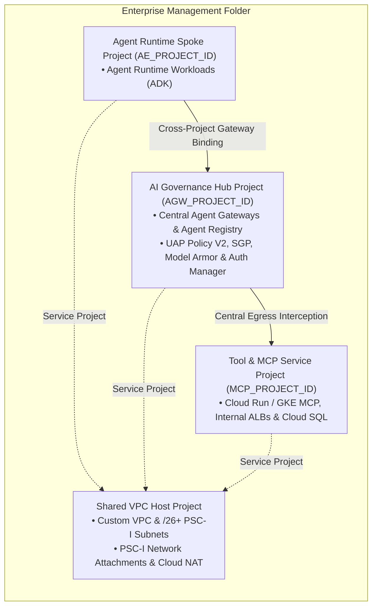

# Enterprise Topologies, Consumer Infrastructure, and IAM Bootstrap

This reference details production-proven resource hierarchies, consumer
networking provisioning, Shared VPC attachment models, VPC Service Controls
(VPC-SC) perimeters, custom/peered and non-RFC 1918 (PUPI) routing, and the
complete Google-managed Service Agent and Agent Identity IAM bootstrap matrix for
**Gemini platform**.

--------------------------------------------------------------------------------

## Table of Contents

-   [1. The 4-Tier Enterprise Project Architecture](#1-the-4-tier-enterprise-project-architecture): Lines 26-62
-   [2. Consumer Infrastructure Provisioning and API Enablement](#2-consumer-infrastructure-provisioning-and-api-enablement): Lines 63-138
-   [3. Cross-Project Agent Runtime and Agent Gateway Architecture](#3-cross-project-agent-runtime-and-agent-gateway-architecture): Lines 139-206
-   [4. Shared VPC Network Attachment and DNS Peering Models](#4-shared-vpc-network-attachment-and-dns-peering-models): Lines 207-227
-   [5. Complete Google-Managed Service Agent and Identity IAM Bootstrap Matrix](#5-complete-google-managed-service-agent-and-identity-iam-bootstrap-matrix): Lines 228-265
-   [6. Architectural Constraints and Platform Invariants](#6-architectural-constraints-and-platform-invariants): Lines 266-282
-   [7. VPC Service Controls (VPC-SC) Perimeter Design](#7-vpc-service-controls-vpc-sc-perimeter-design): Lines 283-387
-   [8. Agent Runtime Multi-Tenancy, Management Boundary, and Regional Colocation](#8-agent-runtime-multi-tenancy-management-boundary-and-regional-colocation): Lines 388-405
-   [9. Custom, Peered, and Non-RFC 1918 (`PUPI`) Enterprise Routing](#9-custom-peered-and-non-rfc-1918-pupi-enterprise-routing): Lines 406-445
-   [10. Post-Deployment Verification and Cloud Audit Log Validation](#10-post-deployment-verification-and-cloud-audit-log-validation): Lines 446-482

--------------------------------------------------------------------------------

## 1. The 4-Tier Enterprise Project Architecture

Enterprise deployments separate concerns across four dedicated Google Cloud
project tiers under an Organizational Management Folder:



-   **Tier 1 — Shared VPC Host (`HOST_PROJECT_ID`, Central NetOps)**: Custom VPC
    (`10.10.0.0/16` or enterprise PUPI supernet), PSC-I subnets (`/26+`),
    Proxy-Only Subnets, Cloud NAT, Private Cloud DNS.
-   **Tier 2 — Central Governance Hub (`AGW_PROJECT_ID`, Central SecOps)**:
    Agent Gateways, Global/Regional Agent Registries, UAP Policy V2, Model Armor
    Floor Settings and Templates, SGP, Auth Manager.
-   **Tier 3 — Agent Runtime Spokes (`AE_PROJECT_ID`, AI Engineering)**: Agent
    Runtime (`reasoningEngines`), ADK Agent artifacts, staging Cloud Storage
    buckets (`10.30.0.0/16`).
-   **Tier 4 — Tool and MCP Service Producers (`MCP_PROJECT_ID`, API and Tool
    Teams)**: Cloud Run / GKE MCP servers, Regional Internal ALBs, Apigee X
    Private proxies, Spanner / BigQuery / Cloud SQL (`10.40.0.0/16`).

--------------------------------------------------------------------------------

## 2. Consumer Infrastructure Provisioning and API Enablement

### 2.1 API Enablement Matrix

```bash
gcloud services enable \
  compute.googleapis.com dns.googleapis.com networkservices.googleapis.com \
  networksecurity.googleapis.com aiplatform.googleapis.com modelarmor.googleapis.com \
  agentregistry.googleapis.com iap.googleapis.com cloudresourcemanager.googleapis.com \
  iamcredentials.googleapis.com storage.googleapis.com networkconnectivity.googleapis.com \
  cloudtrace.googleapis.com certificatemanager.googleapis.com \
  --project="${PROJECT_ID}" --quiet
```

### 2.2 Custom VPC, PSC-I Subnet (`/26` Minimum), and Network Attachment

> [!IMPORTANT] **The `/26` Subnet Sizing and Reserved CIDR Invariant**: 1. Size
> the PSC-I subnet to **at least `/26` (64 IPs)** with `purpose = "PRIVATE"`
> (never `PRIVATE_SERVICE_CONNECT` or `REGIONAL_MANAGED_PROXY`) and
> `private_ip_google_access = true`. Legacy `/28` or `/29` sandbox subnets cause
> IP exhaustion and gateway provisioning failures. 2. **Reserved Agent Gateway
> Ranges**: Never allocate consumer VPC or PSC-I subnets overlapping
> **`10.0.0.0/24`**, **`10.0.1.0/24`**, or **`10.0.2.0/24`** (`10.10.1.0/26` or
> `10.20.1.0/26` is recommended).

```bash
gcloud compute networks create "${VPC_NAME}" --subnet-mode=custom --project="${PROJECT_ID}" --quiet
gcloud compute networks subnets create "${PSCI_SUBNET_NAME}" \
  --network="${VPC_NAME}" --region="${REGION}" --range="${PSCI_SUBNET_RANGE}" \
  --stack-type=IPV4_ONLY --enable-private-ip-google-access --project="${PROJECT_ID}" --quiet
gcloud compute network-attachments create "${ATTACHMENT_NAME}" \
  --region="${REGION}" --subnets="${PSCI_SUBNET_NAME}" \
  --connection-preference=ACCEPT_AUTOMATIC --project="${PROJECT_ID}" --quiet
gcloud compute firewall-rules create "${VPC_NAME}-allow-internal" \
  --network="${VPC_NAME}" --allow=tcp:443,tcp:8080 --source-ranges="${PSCI_SUBNET_RANGE}" \
  --project="${PROJECT_ID}" --quiet
```

### 2.3 Deterministic Egress: Static IP, Cloud Router, and Cloud NAT

-   **Mandatory Dual Endpoint Types (`ENDPOINT_TYPE_VM,ENDPOINT_TYPE_SWG`)**:
    Always configure Cloud NAT with
    `--endpoint-types=ENDPOINT_TYPE_VM,ENDPOINT_TYPE_SWG` (the Agent Gateway
    control plane validates that `ENDPOINT_TYPE_SWG` is present on Cloud NAT
    even when Secure Web Proxy is not deployed).
-   **Direct Cloud NAT Subnet Scoping vs. Next-Hop SWP + PBR**: Scope Direct
    Cloud NAT explicitly to the PSC-I subnet via
    `--nat-custom-subnet-ip-ranges="${PSCI_SUBNET_NAME}"` so multi-subnet Shared
    VPCs do not indiscriminately SNAT other subnets
    (`--nat-all-subnet-ip-ranges` is only suitable in dedicated single-subnet
    VPCs). When using Next-Hop SWP + PBR, use `LIST_OF_SUBNETWORKS` and
    **exclude the PSC-I subnet** from manual Cloud NAT so `swg-autogen-nat`
    handles SNAT without conflict.

```bash
gcloud compute addresses create "${STATIC_IP_NAME}" --region="${REGION}" --project="${PROJECT_ID}" --quiet
gcloud compute routers create "${ROUTER_NAME}" --network="${VPC_NAME}" --region="${REGION}" --project="${PROJECT_ID}" --quiet
# Agent Gateway control plane validates that ENDPOINT_TYPE_SWG is present on the NAT even when SWP is not deployed
gcloud compute routers nats create "${NAT_NAME}" \
  --router="${ROUTER_NAME}" --region="${REGION}" \
  --nat-external-ip-pool="${STATIC_IP_NAME}" --nat-custom-subnet-ip-ranges="${PSCI_SUBNET_NAME}" \
  --enable-logging --endpoint-types=ENDPOINT_TYPE_VM,ENDPOINT_TYPE_SWG \
  --project="${PROJECT_ID}" --quiet
```

### 2.4 Private Cloud DNS and Model Armor Template (`us-central1`)

```bash
gcloud dns managed-zones create "${DNS_ZONE_NAME}" \
  --dns-name="${PEERING_DOMAIN}" --visibility=private --networks="${VPC_NAME}" --project="${PROJECT_ID}" --quiet
gcloud model-armor templates create "${MA_TEMPLATE_NAME}" --location="us-central1" \
  --pi-and-jailbreak-filter-settings-enforcement=enabled --malicious-uri-filter-settings-enforcement=enabled --project="${PROJECT_ID}" --quiet
```

--------------------------------------------------------------------------------

## 3. Cross-Project Agent Runtime and Agent Gateway Architecture

### 3.1 Cross-Project Service Agent, Deploying Caller and AddressGroup IAM Requirements

1.  **Same-Region Colocation**: Both the Spoke `ReasoningEngine` and Hub
    `AgentGateway` must reside in the exact same Google Cloud region and use
    numeric `uint64` project numbers.
2.  **Cross-Project Gateway Get/Use Permissions
    (`networkservices.agentGateways.get`,
    `networkservices.agentGateways.use`)**: Both Spoke
    `service-${AE_PROJECT_NUMBER}@gcp-sa-aiplatform.iam.gserviceaccount.com` and
    the deploying caller require `networkservices.agentGateways.get`,
    `networkservices.agentGateways.use`, and `networkservices.operations.get` in
    `AGW_PROJECT_ID` (via a least-privilege custom IAM role or
    `roles/networkservices.admin`).
3.  **ACT AddressGroup `roles/compute.networkUser` Binding**: After creating the
    ACT, grant `roles/compute.networkUser` (`networksecurity.addressGroups.use`,
    `networksecurity.addressGroups.get`, `networksecurity.addressGroups.list`)
    on the server-managed `act-${TEMPLATE_ID}` AddressGroup to Spoke
    `service-${AE_PROJECT_NUMBER}@gcp-sa-aiplatform-re.iam.gserviceaccount.com`.
4.  **Cross-Project Token Sharing Variable**: Set
    `GOOGLE_API_PREVENT_AGENT_TOKEN_SHARING_FOR_GCP_SERVICES="False"` in
    `deploymentSpec.env` when a Spoke `ReasoningEngine` binds to a dedicated
    central Hub `AgentGateway` across projects (with `AGENT_IDENTITY` SPIFFE
    SVIDs and UAP `principal://` rules enforcing per-agent isolation at the
    Gateway); keep `"True"` if untrusted multi-tenant agents share a project
    without `principal://` UAP scoping.

```bash
gcloud compute network-attachments create "${ATTACHMENT_NAME}" --project="${AGW_PROJECT_ID}" \
  --region="${REGION}" --connection-preference="ACCEPT_AUTOMATIC" \
  --subnets="projects/${HOST_PROJECT_ID}/regions/${REGION}/subnetworks/${PSCI_SUBNET_NAME}"
gcloud iam roles create agw_cross_project_binder --project="${AGW_PROJECT_ID}" \
  --title="Cross-Project Agent Gateway Binder" \
  --permissions="networkservices.agentGateways.get,networkservices.agentGateways.use,networkservices.operations.get" --stage="GA"
for MEMBER in "serviceAccount:service-${AE_PROJECT_NUMBER}@gcp-sa-aiplatform.iam.gserviceaccount.com" "user:${DEPLOYER_EMAIL}"; do
  gcloud projects add-iam-policy-binding "${AGW_PROJECT_ID}" --member="${MEMBER}" --role="projects/${AGW_PROJECT_ID}/roles/agw_cross_project_binder"
done
# Run AFTER creating the AgentConnectivityTemplate (which auto-provisions addressGroups/act-${TEMPLATE_ID})
ETAG=$(curl -s "https://networksecurity.googleapis.com/v1/projects/${AGW_PROJECT_ID}/locations/${REGION}/addressGroups/act-${TEMPLATE_ID}:getIamPolicy?options.requestedPolicyVersion=3" \
  -H "Authorization: Bearer $(gcloud auth print-access-token)" | jq -r '.etag // empty')
curl -s -X POST "https://networksecurity.googleapis.com/v1/projects/${AGW_PROJECT_ID}/locations/${REGION}/addressGroups/act-${TEMPLATE_ID}:setIamPolicy" \
  -H "Authorization: Bearer $(gcloud auth print-access-token)" -H "Content-Type: application/json" \
  -d "{\"policy\":{\"version\":3,\"etag\":\"${ETAG}\",\"bindings\":[{\"role\":\"roles/compute.networkUser\",\"members\":[\"serviceAccount:service-${AE_PROJECT_NUMBER}@gcp-sa-aiplatform-re.iam.gserviceaccount.com\"]}]}}"
export AGENT_PRINCIPAL_SET="principalSet://agents.global.org-${ORG_ID}.system.id.goog/attribute.platformContainer/aiplatform/projects/${AE_PROJECT_NUMBER}"
export AGENT_PRINCIPAL="principal://agents.global.org-${ORG_ID}.system.id.goog/resources/aiplatform/projects/${AE_PROJECT_NUMBER}/locations/${REGION}/reasoningEngines/${RE_ID}"
gcloud projects add-iam-policy-binding "${AGW_PROJECT_ID}" --member="${AGENT_PRINCIPAL_SET}" --role="roles/agentregistry.viewer"
gcloud run services add-iam-policy-binding "${MCP_SERVICE}" --project="${MCP_PROJECT_ID}" --region="${REGION}" \
  --member="${AGENT_PRINCIPAL}" --role="roles/run.invoker"
```

Attach Tier-1 (`--endpoint="${GOOGLEAPIS_UUID}"`) and Tier-2
(`--mcp-server="${MCP_UUID}"`) `roles/iap.egressor` bindings using the
server-generated UUID commands in `references/registry_and_federation.md`
Section 2.4.

### 3.2 Cross-Project Agent Runtime Deployment (Python SDK)

Deploy the `AgentEngine` instance in `AE_PROJECT_ID` using the canonical
`client.agent_engines.create(...)` specification in
`references/agent_runtime_and_identity.md` Section 4.2, setting `agent_gateway`
to
`f"projects/{AGW_PROJECT_NUMBER}/locations/{REGION}/agentGateways/{AGENT_GATEWAY_NAME}"`
(numeric `AGW_PROJECT_NUMBER`), `"identity_type": "AGENT_IDENTITY"`, and
`"GOOGLE_API_PREVENT_AGENT_TOKEN_SHARING_FOR_GCP_SERVICES": "False"`.

--------------------------------------------------------------------------------

## 4. Shared VPC Network Attachment and DNS Peering Models

-   **Model 1 (Recommended — Network Attachment in Governance Project)**: The
    `/26+` PSC-I subnet is defined in `HOST_PROJECT_ID`, and the Network
    Attachment is created in `AGW_PROJECT_ID` referencing the host subnet.
-   **Model 2 (Network Attachment in Host Project)**: Both the PSC-I subnet and
    Network Attachment are created in `HOST_PROJECT_ID`.

-   **Provisioning Identity (CI/CD) on Host Project**: Grant
    `roles/compute.networkViewer`, `roles/dns.reader`, and
    `roles/compute.networkUser` to validate host networks, subnets, and private
    DNS zones and create the PSC-I attachment.

-   **Gateway and Network Google-Managed Service Agents (`gcp-sa-networkservices`,
    `gcp-sa-agentgateway`, `gcp-sa-dep`) on Host Project**: Grant
    `roles/compute.networkUser` on the PSC-I subnet and `roles/dns.peer` on the
    Host Project so tenant proxy NICs attach and peer with private DNS zones
    (preventing gateway provisioning failures).

--------------------------------------------------------------------------------

## 5. Complete Google-Managed Service Agent and Identity IAM Bootstrap Matrix

```bash
export PROJECT_NUMBER=$(gcloud projects describe "${PROJECT_ID}" --format="value(projectNumber)")
export ORG_ID=$(gcloud projects get-ancestors "${PROJECT_ID}" --format="value(id)" | tail -n 1)
export AGENT_PRINCIPAL_SET="principalSet://agents.global.org-${ORG_ID}.system.id.goog/attribute.platformContainer/aiplatform/projects/${PROJECT_NUMBER}"

# 5.1 Subnet NetworkUser & DNS Peer for NetworkServices, AgentGateway, and DEP Service Agents
for SA_SUFFIX in "gcp-sa-networkservices" "gcp-sa-agentgateway" "gcp-sa-dep"; do
  SA="serviceAccount:service-${PROJECT_NUMBER}@${SA_SUFFIX}.iam.gserviceaccount.com"
  gcloud compute networks subnets add-iam-policy-binding "${PSCI_SUBNET_NAME}" \
    --region="${REGION}" --member="${SA}" --role="roles/compute.networkUser" --project="${HOST_PROJECT_ID:-$PROJECT_ID}" --quiet
  gcloud projects add-iam-policy-binding "${HOST_PROJECT_ID:-$PROJECT_ID}" \
    --member="${SA}" --role="roles/dns.peer" --condition=None --quiet
done

# 5.2 Model Armor Callout Grants for Service Extensions Service Agent (gcp-sa-dep)
DEP_SA="serviceAccount:service-${PROJECT_NUMBER}@gcp-sa-dep.iam.gserviceaccount.com"
for ROLE in "roles/modelarmor.user" "roles/modelarmor.calloutUser" "roles/serviceusage.serviceUsageConsumer"; do
  gcloud projects add-iam-policy-binding "${PROJECT_ID}" --member="${DEP_SA}" --role="${ROLE}" --condition=None --quiet
done

# 5.3 Agent PrincipalSet Baseline Roles (scoped strictly to the Runtime Spoke project; roles/browser is required so the ADK SDK resolves project_number -> project_id on startup; also grant roles/agentregistry.viewer on AGW_PROJECT_ID in cross-project topologies)
for ROLE in "roles/browser" "roles/aiplatform.expressUser" "roles/serviceusage.serviceUsageConsumer" "roles/logging.logWriter" "roles/monitoring.metricWriter" "roles/agentregistry.viewer"; do
  gcloud projects add-iam-policy-binding "${PROJECT_ID}" --member="${AGENT_PRINCIPAL_SET}" --role="${ROLE}" --condition=None --quiet
done

# 5.4 AI Platform & Reasoning Engine Service Agent Grants
gcloud projects add-iam-policy-binding "${PROJECT_ID}" \
  --member="serviceAccount:service-${PROJECT_NUMBER}@gcp-sa-aiplatform.iam.gserviceaccount.com" \
  --role="roles/networkservices.admin" --condition=None --quiet
for ROLE in "roles/aiplatform.reasoningEngineServiceAgent" "roles/aiplatform.user" "roles/logging.logWriter" "roles/monitoring.metricWriter" "roles/telemetry.tracesWriter"; do
  gcloud projects add-iam-policy-binding "${PROJECT_ID}" --member="serviceAccount:service-${PROJECT_NUMBER}@gcp-sa-aiplatform-re.iam.gserviceaccount.com" --role="${ROLE}" --condition=None --quiet
done
```

--------------------------------------------------------------------------------

## 6. Architectural Constraints and Platform Invariants

1.  **Gateway and Registry Project Co-location**: Agent Gateway and Agent
    Registry **must reside in the exact same project** (`AGW_PROJECT_ID`).
2.  **Folder-Level Governance Scoping via Principal Access Boundary (PAB)**:
    Because `attribute.platformContainer/aiplatform/folders/FOLDER_NUMBER` is
    **not** an indexed attribute in IAM SPIFFE `principalSet://` evaluation,
    enforce folder-level isolation via **Principal Access Boundary (PAB)**
    policies attached to
    `//cloudresourcemanager.googleapis.com/folders/${FOLDER_NUMBER}` or
    folder-level UAP Policy V2 bindings.
3.  **Private DNS Peering Rules**: Suffixes must end with a trailing dot
    (`internal.example.com.`, `example.com.`). **Never use root wildcard (`.`) or
    `googleapis.com.`**.

--------------------------------------------------------------------------------

## 7. VPC Service Controls (VPC-SC) Perimeter Design

### 7.1 Single-Project vs. Multi-Project VPC-SC Perimeter Behavior (`ALL_TRAFFIC` Native Support)

-   **Single-Project Deployments (Native VPC-SC Support)**: Single-project Gemini platform deployments work **natively inside a VPC-SC perimeter** out of the box—requiring zero custom cross-project VPC-SC ingress rules—when the Agent Connectivity Template (ACT) sets **`vpcEgress: ALL_TRAFFIC`** and the Agent Registry registers the **consolidated `googleapis` service** (routing 100% of control/data-plane and Google API traffic through the governed `240.0.0.2:443` VIP inside the perimeter). By contrast, multi-project Hub-and-Spoke deployments (`HOST`, `GOV`, `AGENT`, `MCP`) require the explicit cross-project VPC-SC ingress rules in Section 7.2.
-   **Perimeter `restricted_services` Catalog**: Include `aiplatform.googleapis.com`, `networkservices.googleapis.com`, `networksecurity.googleapis.com`, `agentregistry.googleapis.com`, `agentidentity.googleapis.com`, `agentidentitycredentials.googleapis.com`, `iamcredentials.googleapis.com`, `modelarmor.googleapis.com`, `iap.googleapis.com`, `compute.googleapis.com`, `dns.googleapis.com`, `run.googleapis.com`, `sqladmin.googleapis.com`, `spanner.googleapis.com`, `secretmanager.googleapis.com`, `bigquery.googleapis.com`, and `storage.googleapis.com` in `restricted_services`.
-   **In-Perimeter BigQuery Cost and Query Governance**: For agents querying BigQuery inside the perimeter, enforce a pre-execution `QueryJobConfig(dry_run=True)` byte-scan check verifying `statement_type == "SELECT"` and `maximum_bytes_billed` with caller attribution labels (`references/agent_runtime_and_identity.md` Section 7.2).

### 7.2 Multi-Project / Cross-Perimeter VPC-SC Ingress Reference Categories

When enclosing multi-project tiers (`HOST_PROJECT_NUMBER`, `GOV_PROJECT_NUMBER`,
`AGENT_PROJECT_NUMBER`, and `MCP_PROJECT_NUMBER` Tool Spoke — or a collapsed
Hub + Spoke layout) across strict or segmented VPC-SC perimeters, configure
ingress rules covering these principal categories:

1.  **Category 1 — Operator Access Level (`accessLevels/enterprise_admin_access`)**:
    Target `compute`, `networkservices`, `networksecurity`, `aiplatform`,
    `agentregistry`, `iap`, `modelarmor`, `run`, `sqladmin`, `spanner`,
    `storage` across `HOST`, `GOV`, `AGENT`, and `MCP` projects for scoped CI/CD
    and operator administration.
2.  **Category 2 —
    `serviceAccount:service-${GOV_PROJECT_NUMBER}@gcp-sa-agentgateway.iam.gserviceaccount.com`**:
    Target `compute`, `dns`, `networkservices`, `agentregistry`, `run` on
    `HOST`, `GOV`, and `MCP` projects to attach PSC-I NICs, peer DNS, and reach
    Tool Spoke services.
3.  **Category 3 —
    `serviceAccount:service-${GOV_PROJECT_NUMBER}@gcp-sa-networkservices.iam.gserviceaccount.com`**:
    Target `compute`, `dns`, `networksecurity` on `HOST` and `GOV` projects to
    manage `act-*` address groups and attachments.
4.  **Category 4 —
    `serviceAccount:service-${AGENT_PROJECT_NUMBER}@gcp-sa-aiplatform.iam.gserviceaccount.com`**:
    Target `networkservices`, `aiplatform`, `storage` on `GOV` and `AGENT`
    projects to validate cross-project `agentGateways.get`.
5.  **Category 5 —
    `serviceAccount:service-${AGENT_PROJECT_NUMBER}@gcp-sa-aiplatform-re.iam.gserviceaccount.com`**:
    Target `networksecurity`, `aiplatform`, `agentregistry`, `iap`, `storage`,
    `run` on `GOV`, `AGENT`, and `MCP` projects to read `act-${TEMPLATE_ID}`
    addressGroup (`roles/compute.networkUser`), staging buckets, and Tool Spoke
    services.
6.  **Category 6 —
    `principal://agents.global.org-${ORG_ID}.system.id.goog/resources/aiplatform/projects/${AGENT_PROJECT_NUMBER}/locations/${REGION}/reasoningEngines/${ENGINE_ID}`**
    (or `principalSet://...` plus the impersonated data-plane SA
    `serviceAccount:${DATA_PLANE_SA_EMAIL}`): Target `aiplatform`,
    `agentregistry`, `iap`, `agentidentity`, `agentidentitycredentials`,
    `iamcredentials`, `run`, `sqladmin`, `spanner`, `secretmanager`, `bigquery`,
    `cloudtrace`, `logging`, `monitoring` across `GOV`, `AGENT`, and `MCP`
    (`MCP_PROJECT_NUMBER`) projects for attested `AGENT_IDENTITY` SPIFFE calls
    and SA-impersonated Spanner/Cloud Run calls.
7.  **Category 7 —
    `serviceAccount:service-${GOV_PROJECT_NUMBER}@gcp-sa-dep.iam.gserviceaccount.com`**:
    Target `modelarmor.googleapis.com` and `serviceusage.googleapis.com` on
    `GOV` project for inline Service Extensions (`ext_proc`) Model Armor
    `SanitizeUserPrompt` / `SanitizeModelResponse` callouts.

```yaml
# Excerpt: Cross-Project Service Agents, SPIFFE Workload & Model Armor VPC-SC Ingress Rules
- ingressFrom:
    identities:
      - "serviceAccount:service-${GOV_PROJECT_NUMBER}@gcp-sa-agentgateway.iam.gserviceaccount.com"
      - "serviceAccount:service-${GOV_PROJECT_NUMBER}@gcp-sa-networkservices.iam.gserviceaccount.com"
  ingressTo:
    operations:
      - {serviceName: compute.googleapis.com, methodSelectors: [{method: "*"}]}
      - {serviceName: dns.googleapis.com, methodSelectors: [{method: "*"}]}
      - {serviceName: networkservices.googleapis.com, methodSelectors: [{method: "*"}]}
      - {serviceName: networksecurity.googleapis.com, methodSelectors: [{method: "*"}]}
    resources: ["projects/${GOV_PROJECT_NUMBER}", "projects/${HOST_PROJECT_NUMBER}"]
- ingressFrom:
    identities:
      - "serviceAccount:service-${AGENT_PROJECT_NUMBER}@gcp-sa-aiplatform.iam.gserviceaccount.com"
      - "serviceAccount:service-${AGENT_PROJECT_NUMBER}@gcp-sa-aiplatform-re.iam.gserviceaccount.com"
  ingressTo:
    operations:
      - {serviceName: networkservices.googleapis.com, methodSelectors: [{method: "*"}]}
      - {serviceName: networksecurity.googleapis.com, methodSelectors: [{method: "*"}]}
      - {serviceName: agentregistry.googleapis.com, methodSelectors: [{method: "*"}]}
      - {serviceName: iap.googleapis.com, methodSelectors: [{method: "*"}]}
      - {serviceName: storage.googleapis.com, methodSelectors: [{method: "*"}]}
    resources: ["projects/${AGENT_PROJECT_NUMBER}", "projects/${GOV_PROJECT_NUMBER}"]
- ingressFrom:
    identities:
      - "principal://agents.global.org-${ORG_ID}.system.id.goog/resources/aiplatform/projects/${AGENT_PROJECT_NUMBER}/locations/${REGION}/reasoningEngines/${ENGINE_ID}"
  ingressTo:
    operations:
      - {serviceName: iamcredentials.googleapis.com, methodSelectors: [{method: "*"}]}
      - {serviceName: run.googleapis.com, methodSelectors: [{method: "*"}]}
    resources: ["projects/${GOV_PROJECT_NUMBER}", "projects/${AGENT_PROJECT_NUMBER}", "projects/${MCP_PROJECT_NUMBER}"]
- ingressFrom:
    identities: ["serviceAccount:${DATA_PLANE_SA_EMAIL}"]
  ingressTo:
    operations:
      - {serviceName: spanner.googleapis.com, methodSelectors: [{method: "*"}]}
      - {serviceName: sqladmin.googleapis.com, methodSelectors: [{method: "*"}]}
    resources: ["projects/${GOV_PROJECT_NUMBER}", "projects/${MCP_PROJECT_NUMBER}"]
- ingressFrom:
    identities: ["serviceAccount:service-${GOV_PROJECT_NUMBER}@gcp-sa-dep.iam.gserviceaccount.com"]
  ingressTo:
    operations:
      - {serviceName: modelarmor.googleapis.com, methodSelectors: [{method: "*"}]}
      - {serviceName: serviceusage.googleapis.com, methodSelectors: [{method: "*"}]}
    resources: ["projects/${GOV_PROJECT_NUMBER}"]
```

--------------------------------------------------------------------------------

## 8. Agent Runtime Multi-Tenancy, Management Boundary, and Regional Colocation

1.  **One Bonded Agent Gateway Per Consumer Project / Region**: Agent Runtime
    provisions one shared tenant project (`*-tp`) per consumer project/region.
    Reuse the same Agent Gateway across `ReasoningEngine` instances in that
    project/region, or separate workloads into distinct spoke projects.
2.  **App Management Folder Capability and Boundary Configuration**: To enable
    cross-project Agent Registry discovery across an enterprise management
    folder or spoke project boundary, enable the `app-management` folder
    capability and attach the App Hub boundary:

```bash
gcloud resource-manager capabilities update "folders/${ENTERPRISE_FOLDER_ID}/capabilities/app-management" --enable
gcloud apphub boundary update --project="${AGW_PROJECT_ID}" --location=global --crm-node="projects/${AE_PROJECT_ID}"
```

--------------------------------------------------------------------------------

## 9. Custom, Peered, and Non-RFC 1918 (`PUPI`) Enterprise Routing

Enterprises routing across peered VPCs, Cloud Interconnect/VPN, or **Privately
Used Public IP (`PUPI`)** blocks outside RFC 1918 (such as `198.51.100.0/24`) must
align ACT egress mode, VPC peering route exchange, and PBR priorities:

1.  **Why `PRIVATE_RANGES_ONLY` Drops Non-RFC 1918 Internal Space**:
    `PRIVATE_RANGES_ONLY` only routes strict RFC 1918 (`10.0.0.0/8`,
    `172.16.0.0/12`, `192.168.0.0/16`) and CGNAT (`100.64.0.0/10`) to the
    consumer VPC, treating non-RFC 1918 internal/PUPI space as external public
    IP space. Always set `vpcEgress = ALL_TRAFFIC` on the ACT with Private DNS
    peering (`dnsPeeringConfig` ending with a trailing dot, such as
    `internal.example.com.`), and configure the PSC-I subnet with
    `--stack-type=IPV4_ONLY` (`protocolVersion = "IPV4"`) so IPv6 traffic cannot
    bypass PBR or SWP rules (never allow default Cloud NAT to SNAT internal PUPI
    traffic to the public internet).
2.  **Multi-VPC Custom Route Peering and PBR Bypass Commands**:

```bash
export GOV_PROJECT_ID="gov-hub-proj" HOST_VPC="enterprise-shared-vpc" GOV_VPC="${HOST_VPC}"
export SPOKE_PROJECT_ID="mcp-spoke-proj" SPOKE_VPC="spoke-pupi-vpc"
export PSCI_SUBNET_CIDR="10.20.1.0/26" CUSTOM_INTERNAL_CIDR="198.51.100.0/24"

# 1. Create bilateral VPC Peerings with custom route & public-IP (PUPI) subnet route export/import enabled
gcloud compute networks peerings create "peering-gov-to-spoke" --project="${GOV_PROJECT_ID}" \
  --network="${GOV_VPC}" --peer-project="${SPOKE_PROJECT_ID}" --peer-network="${SPOKE_VPC}" \
  --export-custom-routes --import-custom-routes --export-subnet-routes-with-public-ip --import-subnet-routes-with-public-ip
gcloud compute networks peerings create "peering-spoke-to-gov" --project="${SPOKE_PROJECT_ID}" \
  --network="${SPOKE_VPC}" --peer-project="${GOV_PROJECT_ID}" --peer-network="${GOV_VPC}" \
  --export-custom-routes --import-custom-routes --export-subnet-routes-with-public-ip --import-subnet-routes-with-public-ip

# 2. Bypass Next-Hop SWP for custom/peered/PUPI internal destinations (pair with priority 50 for RFC 1918)
gcloud network-connectivity policy-based-routes create "pbr-bypass-custom-internal" \
  --project="${GOV_PROJECT_ID}" --network="projects/${GOV_PROJECT_ID}/global/networks/${GOV_VPC}" \
  --source-range="${PSCI_SUBNET_CIDR}" --destination-range="${CUSTOM_INTERNAL_CIDR}" \
  --ip-protocol=ALL --next-hop-other-routes=DEFAULT_ROUTING --priority=51
```

--------------------------------------------------------------------------------

## 10. Post-Deployment Verification and Cloud Audit Log Validation

Validate production deployments across three phases—combining control-plane
resource inspection, data-plane connectivity probes, and Cloud Audit Log
verification:

1.  **Phase 1 — Control-Plane Configuration Audit (`gcloud ... describe --format=json`)**:
    -   **Agent Gateway and Consolidated `googleapis` Registry Readiness**: Confirm the **Agent Gateway state is `ACTIVE`** (`state == "ACTIVE"`, with `<= 2` numeric registries attached) and that the **consolidated `googleapis` service** (`8` Google APIs FQDNs) is registered in Agent Registry (`gcloud agent-registry services describe googleapis --location=${REGION}`).
    -   **PSC-I Network Attachment and Cloud NAT Readiness**: Confirm the PSC-I subnet is `/26+` `PRIVATE` (`IPV4_ONLY`, `privateIpGoogleAccess == true`), the **Network Attachment has an `ACCEPTED` endpoint** (`connectionPreference == "ACCEPT_AUTOMATIC"`), `act-${TEMPLATE_ID}` grants `roles/compute.networkUser`, Cloud NAT sets `ENDPOINT_TYPE_VM,ENDPOINT_TYPE_SWG`, VPC peerings export/import custom and public-IP subnet routes (when applicable), and PBR `priority: 50..53` bypasses precede `priority: 100`.
    -   **Policy and Guardrail Readiness**: Confirm ACT sets `vpcEgress == "ALL_TRAFFIC"`, `roles/iap.egressor` is bound to the `registryResource` UUID, IAP `AuthzExtension` sets `failOpen == false` and `iapPolicyVersion == "V2"` (`<= 4` `CUSTOM` `AuthzPolicy` resources attached), and Model Armor Floor Settings and Templates enforce fail-closed inspection.
2.  **Phase 2 — Functional Data-Plane Traffic Verification**: Execute `:query`
    and `:streamQuery` probes (`references/agent_runtime_and_identity.md` §5) to
    confirm that the agent container connects to the local Agent Gateway VIP
    (`240.0.0.2` with `Agent Gateway TLS Inspection CA`) and that downstream
    backends observe requests arriving from the consumer PSC-I subnet CIDR (or
    static Cloud NAT IP for external endpoints such as `https://api.ipify.org`;
    never use an internal `*.run.app` endpoint to verify Cloud NAT IPs because
    Google Cloud routes `*.run.app` internally to the Cloud Run ingress proxy
    with `X-Forwarded-For: 0.0.0.0`, bypassing Cloud NAT — see
    `references/agent_runtime_and_identity.md` Section 11.1).
3.  **Phase 3 — Security Policy and Audit Log Validation**: Trigger negative
    security probes (unregistered external LLM domain `https://api.openai.com`,
    unauthorized mutating MCP tool, plaintext `http://:80`, and prompt injection
    payloads) and verify server-side Cloud Audit Log deny receipts
    (`protoPayload.status.code=7`):

```bash
# Phase 1: Verify ACTIVE Agent Gateway state, ACCEPTED PSC-I Network Attachment endpoint & consolidated googleapis Registry service
gcloud network-services agent-gateways describe "${GATEWAY_ID}" --location="${REGION}" --project="${GOV_PROJECT_ID}" --format="value(state)"
gcloud compute network-attachments describe "${ATTACHMENT_NAME}" --region="${REGION}" --project="${HOST_PROJECT_ID}" --format="json(connectionEndpoints)"
gcloud agent-registry services describe "googleapis" --location="${REGION}" --project="${GOV_PROJECT_ID}"

# Phase 3: Verify server-side Cloud Audit Log deny receipts (protoPayload.status.code=7) for negative security probes
gcloud logging read \
  '(resource.type="audited_resource" OR resource.type="agent_gateway") AND (resource.labels.service="iap.googleapis.com" OR resource.labels.service="modelarmor.googleapis.com") AND protoPayload.status.code=7' \
  --project="${GOV_PROJECT_ID}" --freshness=10m --limit=10 --format=json
```
