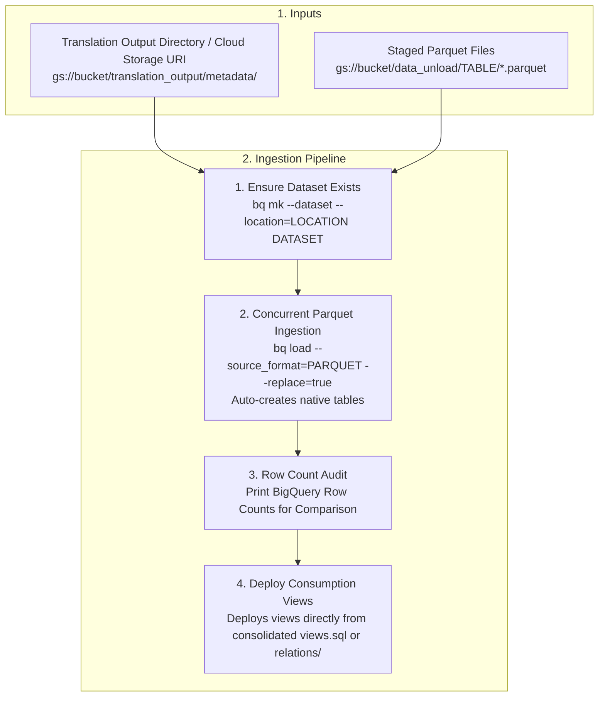

# BigQuery Migration Data Loader

This skill coordinates the automated provisioning of BigQuery datasets, direct
ingestion of staged Parquet files into native BigQuery tables by using the
`bq load` command, and automated view deployment directly from BigQuery
Migration Service (BQMS) translation output directories (local or Cloud
Storage).

## Usage attribution

**MUST READ**: Before executing any `gcloud`, REST API, or MCP command, you
MUST read and follow the instructions in
[Usage Attribution](references/attribution.md).

## Before you begin

1.  **Google Cloud CLI, project, and location setup**: Install the
    [Google Cloud CLI](https://cloud.google.com/sdk/docs/install) (including
    the `gcloud` and `bq` command-line tools), confirm that your Google Cloud
    project has an active Cloud Billing account attached, and configure the
    target project and default Compute Engine region:

    ```bash
    gcloud config set project PROJECT_ID
    gcloud config set compute/region REGION
    ```

    `gcloud config set compute/region` sets the default Compute Engine region;
    the `bq` CLI does not read `compute/region` and defaults to `US` unless
    `--location` is passed on `bq` commands or set in `~/.bigqueryrc` (or
    configured through a project or organization `default_location`). BigQuery
    is retiring the *multi-region* designation—including `US` and `EU` in the
    single-regions list colocated with `us-central1` and `europe-west4`, with no
    change to existing data residency (see
    [BigQuery locations](https://cloud.google.com/bigquery/docs/locations))—so
    always pass an explicit `--location` on `bq` commands that matches your
    staged Cloud Storage bucket, as described in step 5 (check regional
    service availability at
    [Google Cloud locations](https://cloud.google.com/about/locations)).

2.  **Enable the APIs**: Ask the user before enabling APIs, then enable the
    BigQuery and Cloud Storage APIs (`bigquery.googleapis.com` and
    `storage.googleapis.com`):

    ```bash
    gcloud services enable bigquery.googleapis.com storage.googleapis.com
    ```

3.  **Authentication and required IAM roles**: Authenticate with `gcloud auth
    login` and `gcloud auth application-default login` (or set
    `GOOGLE_APPLICATION_CREDENTIALS` for service account authentication). Verify
    that your identity or service account has the required IAM roles on each
    resource:

    *   Grant **BigQuery Job User** (`roles/bigquery.jobUser`) on the target
        Google Cloud project.
    *   Grant **BigQuery Data Editor** (`roles/bigquery.dataEditor`) on the
        target Google Cloud project (to create new datasets with `bq mk`) or on
        an existing target dataset (to create or overwrite tables and views).
    *   Grant **Storage Object Viewer** (`roles/storage.objectViewer`) on the
        Cloud Storage bucket holding staged Parquet files and translation
        metadata.

4.  **Python environment**: Ask the user for confirmation before installing
    Python packages, then install PyYAML in a virtual environment:

    ```bash
    pip install pyyaml==6.0.2
    ```

5.  **Location, cost, and cleanup**: Use the location of your staged Cloud
    Storage bucket for the dataset and every `bq` command: the bucket's region
    for a regional bucket, or `US` or `EU` for a `US` or `EU` multi-region
    bucket. Default to `us-central1` only when you also choose the bucket
    location. Loading from a bucket in a different location incurs data
    transfer charges (see
    [BigQuery locations](https://cloud.google.com/bigquery/docs/locations)).
    Review
    [Google Cloud pricing](https://cloud.google.com/pricing) before loading
    large datasets or running audit queries. Ask the user for confirmation
    before deleting temporary staged Parquet files
    (`gcloud storage rm -r gs://BUCKET/EXPORT_PREFIX`) or test datasets
    (`bq rm -r -f PROJECT_ID:DATASET_ID`) when no longer needed.

--------------------------------------------------------------------------------

## 1. Loader workflow overview

The following diagram illustrates the four-stage ingestion and view deployment
pipeline:



--------------------------------------------------------------------------------

## 2. Direct translation output ingestion

> [!TIP] **Migration workflow context**: Before running the loader, translate
> source schemas and views into GoogleSQL by using the
> `bigquery-migration-sql-translator` skill and stage exported source table
> Parquet files in Cloud Storage. After loading tables and deploying views,
> compare row counts and data aggregates against the source database.

The data loader directly consumes BQMS translation output directories (the
`--translation-metadata-dir` flag):

*   **Zero-DDL native ingestion**: Table schemas are inferred and created
    automatically from staged Parquet files during `bq load`. Inferred types
    follow the Parquet types, not the translated DDL: naive source timestamps
    (no time zone) load as `TIMESTAMP` instead of `DATETIME`, and
    `STRING(n)` and `NUMERIC(p, s)` parameters are dropped (see Step 2 in
    Section 3).
*   **Automated object discovery**: Base tables and views are auto-discovered
    directly from the translation output metadata. Pass the BQMS `metadata/`
    directory (or its parent), which contains `config/DATABASE/SCHEMA/*.yaml`
    files whose `sourceName` names each object (table configs also set
    `externalTableName` or `externalTableDdlPath`; the others are views) and
    view DDL in `relations/db_DATABASE/schema_SCHEMA/VIEW.sql` (or a single
    `views.sql`).
*   **Automated view deployment**: Translated views are deployed directly into
    the target dataset with source references rewritten to the target BigQuery
    project and dataset. Plain `CREATE VIEW` statements are deployed as
    `CREATE OR REPLACE VIEW` so that reruns don't fail on existing views.
*   **Flexible Parquet path resolution**: Under the `--parquet-base-uri`
    (`BASE_URI`) flag, the loader automatically checks schema-scoped
    subfolders (`BASE_URI/SCHEMA/TABLE/*.parquet`) first if present and falls
    back to flat table paths (`BASE_URI/TABLE/*.parquet`). For example,
    `gcloud storage cp -r LOCAL_DIR/SCHEMA gs://BUCKET/data_unload/` stages a
    local schema folder of table subfolders under `data_unload/SCHEMA/`.
*   **Single target dataset**: All discovered schemas load into one
    `--dataset` by table or view name. If tables or views from different
    source databases or schemas share a name, the loader stops before creating
    the dataset and lists the conflicting objects; load each schema into its
    own dataset instead.

--------------------------------------------------------------------------------

## 3. CLI execution interface (`bq load`)

### Step 1: Provision the target dataset

Set the shell variables for your environment, and then create the target
dataset if it doesn't already exist:

```bash
PROJECT_ID="PROJECT_ID"
DATASET_ID="DATASET_ID"
LOCATION="LOCATION"
TABLE_NAME="TABLE_NAME"
BUCKET="BUCKET"
PREFIX="data_unload"

bq show --dataset --project_id=${PROJECT_ID} ${DATASET_ID} >/dev/null 2>&1 || \
bq mk --dataset --project_id=${PROJECT_ID} --location=${LOCATION} ${DATASET_ID}
```

Replace the following:

*   `PROJECT_ID`: the target Google Cloud project ID.
*   `DATASET_ID`: the target BigQuery dataset ID.
*   `LOCATION`: the BigQuery location for the dataset and load jobs (for
    example, `us-central1`).
*   `TABLE_NAME`: the name of the table to load.
*   `BUCKET`: the name of the Cloud Storage bucket that holds the staged
    Parquet files.

### Step 2: Ingest Parquet tables (auto-creates native table schema)

Pass `--decimal_target_types=NUMERIC --decimal_target_types=BIGNUMERIC
--decimal_target_types=STRING` so BigQuery selects the smallest compatible type
(`NUMERIC` → `BIGNUMERIC` → `STRING`) based on each Parquet `DECIMAL(p, s)`
column's precision and scale: columns with `p - s <= 29, s <= 9` map to
`NUMERIC`, columns with `p - s <= 38, s <= 38` (such as `DECIMAL(38, 10)`) widen
to `BIGNUMERIC`, and larger `DECIMAL256` precisions or scales fall back to
`STRING`:

```bash
bq load \
    --project_id=${PROJECT_ID} \
    --location=${LOCATION} \
    --source_format=PARQUET \
    --replace=true \
    --decimal_target_types=NUMERIC \
    --decimal_target_types=BIGNUMERIC \
    --decimal_target_types=STRING \
    ${DATASET_ID}.${TABLE_NAME} \
    "gs://${BUCKET}/${PREFIX}/${TABLE_NAME}/*.parquet"
```

The `--replace=true` flag overwrites the destination table, including its
schema, with the schema inferred from the Parquet files. If you pre-created
tables from translated BQMS DDL statements to preserve target types such as
`JSON`, `INTERVAL`, or `RANGE`, either run `TRUNCATE TABLE` and then load with
`--replace=false` (so that reruns stay idempotent and don't duplicate rows), or
keep `--replace=true` and pass an explicit `--schema`. If you use the loader
template with native `JSON` columns, also set
`_WRAP_JSON_QUERY_WITH_PARSE_JSON = False` in the copied script: by default it
wraps `JSON_QUERY()` calls in `SAFE.PARSE_JSON()` for `JSON` source columns that
Parquet loads as `STRING`, which fails on native `JSON` columns.

Parquet `TIMESTAMP` columns always load as BigQuery `TIMESTAMP`, including
naive timestamps (`isAdjustedToUTC=false`, such as source `TIMESTAMP WITHOUT
TIME ZONE` columns) that the translated DDL maps to `DATETIME`; the wall-clock
values are kept and read as UTC. To restore `DATETIME` after loading, rewrite
those columns with `DATETIME(column)`, which converts at UTC by default:

```sql
CREATE OR REPLACE TABLE `PROJECT_ID.DATASET_ID.TABLE_NAME` AS
SELECT * REPLACE (DATETIME(created_at) AS created_at)
FROM `PROJECT_ID.DATASET_ID.TABLE_NAME`;
```

### Step 3: Run a row-count audit

Count the rows in the loaded table so that you can compare the result with the
source table:

```bash
bq query \
    --project_id=${PROJECT_ID} \
    --location=${LOCATION} \
    --use_legacy_sql=false \
    "SELECT '${TABLE_NAME}' AS table_name, count(*) AS row_count FROM \`${PROJECT_ID}\`.\`${DATASET_ID}\`.\`${TABLE_NAME}\`;"
```

--------------------------------------------------------------------------------

## 4. Automated loader asset template (`assets/bq_loader_template.py`)

This skill provides an [automated BigQuery loader template][loader_template]
(`assets/bq_loader_template.py`) for dataset creation, concurrent Parquet
loading, direct view deployment, and table row-count auditing.

### Agent workflow: Copy, conditionally customize, and execute

1.  **Copy the asset template**: Always instruct the user to copy the
    [automated BigQuery loader template][loader_template]
    (`assets/bq_loader_template.py`) from this skill's directory (`SKILL_DIR`)
    into their working directory (`./bq_loader.py`) by using the `cp`
    command—never write, synthesize, or inline a custom Python loader script
    from scratch, and never paste or re-type the template contents into the
    response. The template already handles quote-aware SQL splitting,
    destination name collision checks, chunked row-count audits, and
    multi-pass view retries, which a rewritten script would likely miss.
    `SKILL_DIR` is the directory containing this `SKILL.md`:

    ```bash
    cp SKILL_DIR/assets/bq_loader_template.py ./bq_loader.py
    ```

2.  **Conditionally customize extension points**: Run the copy as-is. Modify it
    only if one of the following applies (prefer editing the marked `#
    CUSTOMIZE:` sections; `# DEFAULT SCAFFOLDING` sections can be kept unchanged
    unless deeper orchestration adjustments are needed):

    *   **Schema overrides and partitioning (`# CUSTOMIZE: Schema Overrides &
        Partitioning`)**: Add custom `bq load` flags (such as
        `--time_partitioning_field`, `--clustering_fields`, or explicit schema
        JSON files) inside `load_parquet_table()`.
    *   **Custom view rewriting (`# CUSTOMIZE: Custom View Rewriting &
        Deployment`)**: Adjust view SQL regular expressions, cross-project
        dataset mapping rules, or retry bounds in `_rewrite_view_sql()` and
        `deploy_views()`. Set `_WRAP_JSON_QUERY_WITH_PARSE_JSON = False` if you
        pre-created tables with native `JSON` columns.
    *   **Connection and CLI wrapper (`# CUSTOMIZE: Connection & CLI
        Wrapper`)**:
        Pass custom `bq` CLI flags (for example, `--default_kms_key` in
        `ensure_dataset()`, or `--destination_kms_key` and `--reservation_id` in
        `load_parquet_table()` and `execute_sql()`).
    *   **Post-load auditing (`# CUSTOMIZE: Post-Load Auditing`)**: Extend
        `audit_row_counts()` with custom data integrity or column-level checksum
        queries.

3.  **Execute the script in your working directory**: Run the copied script
    against a Cloud Storage URI or a local translation output folder:

    ```bash
    # Direct from a Cloud Storage translation_output URI with concurrency:
    python3 ./bq_loader.py \
        --project "PROJECT_ID" \
        --dataset "DATASET_ID" \
        --location "LOCATION" \
        --translation-metadata-dir "gs://BUCKET/translation_output/metadata/" \
        --parquet-base-uri "gs://BUCKET/data_unload/" \
        --concurrency 8

    # Using local translation output folder:
    python3 ./bq_loader.py \
        --project "PROJECT_ID" \
        --dataset "DATASET_ID" \
        --location "LOCATION" \
        --translation-metadata-dir "TRANSLATION_OUTPUT/metadata" \
        --parquet-base-uri "gs://BUCKET/data_unload/" \
        --concurrency 4
    ```

    When a view depends on another view, the first batch and first pass print
    `bq` errors such as `Not found: Table ...` for the dependent view. These
    errors are expected if the run ends with
    `All N views successfully deployed across M passes.`

### Arguments

*   `--project` *(Required)*: Google Cloud project ID.
*   `--dataset` *(Required)*: Target BigQuery dataset name.
*   `--parquet-base-uri` *(Required)*: Base Cloud Storage URI containing table
    Parquet subfolders (`gs://BUCKET/path/`).
*   `--translation-metadata-dir` *(Required)*: Local folder or Cloud Storage URI
    to translation output metadata directory. Auto-discovers tables and views.
*   `--location` *(Optional, Default: `us-central1`)*: Target BigQuery location.
*   `--concurrency` *(Optional, Default: `4`)*: Number of parallel workers for
    concurrent `bq load` operations.

[loader_template]: assets/bq_loader_template.py
