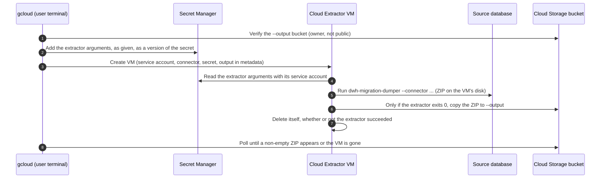

# Cloud Extraction (Cloud Extractor)

`--run-mode=cloud` runs the extractor on a temporary Compute Engine VM, the
**BigQuery Migration Cloud Extractor**. Nothing is installed locally. The
extractor arguments, including the password, reach the VM through a Secret
Manager secret.

## Contents

-   [How It Works](#how-it-works): Lines 19-64
-   [Prerequisites](#prerequisites): Lines 65-155
-   [Cloud Flags](#cloud-flags): Lines 156-173
-   [Credentials](#credentials): Lines 174-191
-   [Recipes](#recipes): Lines 192-296
-   [Monitoring](#monitoring): Lines 297-329
-   [Cleanup](#cleanup): Lines 330-386
-   [Troubleshooting](#troubleshooting): Lines 387-401

## How It Works



The command waits (typically 10 to 20 minutes) and prints `Artifact Path:
gs://... (N bytes)` when the ZIP arrives. If the VM finishes without uploading
one, the command fails with `Extraction finished, but no non-empty artifact was
found`. It also prints a `gcloud logging read` command for the VM's errors, but
only when it finds error entries; otherwise query the logs by VM name (see
[Monitoring](#monitoring)).

> [!WARNING]
> The command takes the first non-empty `.zip` under `--output` as the result,
> without checking when it was written, and looks for it before it checks the
> VM. Give every run an `--output` prefix with no `.zip` in it, such as
> `gs://{bucket}/snowflake_metadata/{run_label}/`. With an older archive there,
> the command prints `Extraction complete` for that archive right away while
> the new VM is still starting, and deleting the secret then breaks the real
> run.

> [!IMPORTANT]
> Cloud mode has no partial results. The VM uploads the ZIP only
> when the extractor exits 0, and the extractor exits 1 if any required task
> fails, even one with a harmless fallback. When a source is known to fail some
> tasks (for example older-catalog queries on a newer PostgreSQL), run it
> locally instead; local mode keeps the partial ZIP. To see why a cloud run
> uploaded nothing, read the VM's logs: run the `gcloud logging read` command
> it printed, or query by VM name (see [Monitoring](#monitoring)).

## Prerequisites

1.  **A project ID** (not the numeric project number), passed with `--project`
    or set with `gcloud config set project`.
2.  **A zone** (optional). `--zone` falls back to the `compute/zone` property,
    then to `us-central1-a`. All regional resources (the subnet, the
    startup-script bucket, and the secret's replica) use the zone's region.
3.  **APIs**. Enable them up front, or when the command reports a disabled API:

    ```bash
    gcloud services enable compute.googleapis.com secretmanager.googleapis.com \
        storage.googleapis.com logging.googleapis.com --project="{project_id}"
    ```

4.  **A destination bucket** that is not public and is owned by the current
    project, or by the project passed with `--expected-owner`:

    ```bash
    gcloud storage buckets create "gs://{bucket}" --project="{project_id}" \
        --location="{region}" --uniform-bucket-level-access
    ```

5.  **Permissions for the caller**:

    *   To create the VM and the secret, for example Compute Admin
        (`roles/compute.admin`) and Secret Manager Admin
        (`roles/secretmanager.admin`).
    *   To verify the `--output` bucket: `storage.buckets.list` on the owner
        project (for example `roles/storage.bucketViewer`), plus
        `storage.buckets.getIamPolicy` on the bucket (`roles/storage.admin`)
        unless public access prevention is enforced on it.
    *   With a prepared `--gce-service-account`: Service Account User
        (`roles/iam.serviceAccountUser`) on that account. The account itself
        needs, at minimum: Secret Manager Secret Accessor
        (`roles/secretmanager.secretAccessor`) on the project, or with an IAM
        condition on the `bqms-extractor-creds-` secret name prefix, to read
        the extractor arguments (each run's secret is new and is created just
        before the VM starts, so it cannot be granted on the secret in
        advance); permission to create objects in the `--output`
        bucket (for example `roles/storage.objectUser` on the bucket); Logs
        Writer (`roles/logging.logWriter`), so the `gcloud logging read`
        command shows the VM's output; and Compute Instance Admin (v1)
        (`roles/compute.instanceAdmin.v1`), so the VM can delete itself (if it
        cannot, delete it as in [Cleanup](#cleanup)). For `bigquery` and
        `bigquery-logs`, the extractor on the VM authenticates as this
        account, so it also needs BigQuery Metadata Viewer
        (`roles/bigquery.metadataViewer`) on the source projects, plus
        `bigquery.jobs.listAll` (for example BigQuery Resource Viewer,
        `roles/bigquery.resourceViewer`) for `bigquery-logs`.
    *   Without `--gce-service-account`: Service Account Admin
        (`roles/iam.serviceAccountAdmin`) and Project IAM Admin
        (`roles/resourcemanager.projectIamAdmin`). Every such run creates or
        reuses `bqms-cloud-extractor@{project_id}.iam.gserviceaccount.com`,
        grants the caller (or `--service-account-user`)
        `roles/iam.serviceAccountUser` on it, and grants it these nine project
        roles: `roles/editor`, `roles/compute.admin`,
        `roles/storage.objectAdmin`, `roles/secretmanager.secretAccessor`,
        `roles/cloudkms.cryptoKeyDecrypter`, `roles/logging.logWriter`,
        `roles/logging.viewer`, `roles/errorreporting.writer`, and
        `roles/monitoring.metricWriter`.

    The command asks before it creates the default account, but without a
    terminal gcloud takes the default answer (yes), and `--quiet` does the
    same. Show the user these roles and get explicit approval before you omit
    `--gce-service-account`; otherwise ask for a prepared service account.

6.  **A network path from the VM to the database.** The VM runs on the `default`
    network and subnet with an external IP unless you pass `--network`,
    `--subnet`, or `--no-address`. The database must accept connections from the
    VM (add its egress range to the database allowlist or network policy). To
    reach a database over Cloud VPN or Cloud Interconnect, pass the
    `--network` and `--subnet` that have that connectivity. The VM also needs
    internet egress: its startup script is downloaded from Cloud Storage, it
    downloads the extractor release from `github.com`, and it reads Secret
    Manager, writes to Cloud Storage and Cloud Logging, and deletes itself
    through the Compute Engine API. Keep the external IP, or with
    `--no-address` make sure Cloud NAT serves the subnet; a route to the
    database alone is not enough. Without egress the VM never runs the
    extractor or deletes itself and the command keeps polling: check
    `get-serial-port-output` (see [Monitoring](#monitoring)), then delete the
    VM.
    `localhost`, `127.0.0.1`, and private addresses outside the VPC are never
    reachable. If the user gives one, do not use `--run-mode=cloud`: ask for an
    address the VM can reach, or run locally.

7.  **A connector with a bundled driver**: `snowflake*`, `redshift*`,
    `bigquery*`, `postgresql`, `greenplum*`, or `hiveql`. The VM has no vendor
    JDBC drivers and cannot read a local `--driver` path, so Teradata, Oracle,
    SQL Server, MySQL, Netezza, and Vertica must run locally; see the
    [local extraction guide](local_extraction.md).

## Cloud Flags

These gcloud flags are only accepted with `--run-mode=cloud`; the command
rejects them in local mode.

Flag                       | Meaning
:------------------------- | :------
`--zone`                   | VM zone. Defaults to the `compute/zone` property, then `us-central1-a`.
`--secret`                 | Secret Manager secret that passes the extractor arguments to the VM, as a name or `projects/{project_id}/secrets/{name}`. Optional: without it the command creates `bqms-extractor-creds-run-EPOCH_SECONDS` and prints its name. A secret the command creates is labeled `goog-bqms-extractor-run-id=run-EPOCH_SECONDS`; for an existing secret it adds a new version.
`--gce-instance`           | VM name (default `cloud-extractor-EPOCH_SECONDS`).
`--gce-service-account`    | VM service account (default `bqms-cloud-extractor@{project_id}.iam.gserviceaccount.com`).
`--service-account-user`   | User to grant `roles/iam.serviceAccountUser` on the VM service account.
`--network`, `--subnet`    | VPC network and subnet for the VM (default `default`).
`--no-address`             | Give the VM no external IP. It then needs Cloud NAT for internet and Google API access (see [Prerequisites](#prerequisites)); a VPN or Interconnect route alone is not enough.

Everything after `--` is stored in the secret exactly as given and passed to the
extractor on the VM.

## Credentials

The VM has none of your local files, so an extractor `@FILE` response file, or a
`--driver` path, fails there. Pass the password as `--password` after `--`, read
from a file only the user can read so it is never typed. Ask the user to
create the file in their own terminal (with `DB_PASSWORD` set there) and share
only its path; never ask for the password in the chat. The command stops
instead of writing an empty file when `DB_PASSWORD` is unset:

```bash
: "${DB_PASSWORD:?DB_PASSWORD is not set}" && umask 077 && printf '%s' "${DB_PASSWORD}" > ./db_password
```

and end the extractor arguments with `--password="$(cat ./db_password)"`. The
value is stored in the run's secret (delete it after the run; see
[Cleanup](#cleanup)) and is visible in this machine's process list while gcloud
runs. Use the user's existing password file in place if they have one.

## Recipes

Pick a new run label for every run, for example the date and time, for the
secret name and the `--output` folder, so each run starts from an empty prefix
(see [How It Works](#how-it-works)). Naming the secret yourself makes cleanup
unambiguous; leaving `--secret` out also works (see [Cleanup](#cleanup)). Do
not point `--secret` at a secret that already exists: the command only adds a
version to it, and the cleanup below would delete its earlier versions too.

### Snowflake catalog metadata

```bash
gcloud alpha bq migration metadata extract \
    --connector=snowflake \
    --output="gs://{bucket}/snowflake_metadata/{run_label}/" \
    --run-mode=cloud \
    --project="{project_id}" \
    --zone="{zone}" \
    --secret="bqms-extractor-creds-{run_label}" \
    -- \
    --host="{account_identifier}.snowflakecomputing.com" \
    --user="{db_user}" \
    --database="{db_name}" \
    --warehouse="{db_warehouse}" \
    --role="{db_role}" \
    --password="$(cat ./db_password)"
```

For Migration Assessment, pass `--assessment` and omit `--database` and
`--schema`. Then check the result and delete the secret, which still holds the
password:
`gcloud secrets delete bqms-extractor-creds-{run_label} --project={project_id}
--quiet`.

### Snowflake query logs

```bash
gcloud alpha bq migration query-logs extract \
    --connector=snowflake-logs \
    --output="gs://{bucket}/snowflake_logs/{run_label}/" \
    --run-mode=cloud \
    --project="{project_id}" \
    --zone="{zone}" \
    --secret="bqms-extractor-creds-{run_label}" \
    -- \
    --host="{account_identifier}.snowflakecomputing.com" \
    --user="{db_user}" \
    --warehouse="{db_warehouse}" \
    --role="{db_role}" \
    --query-log-start="2026-09-01" \
    --query-log-end="2026-10-01" \
    --password="$(cat ./db_password)"
```

Then check the result and delete the secret, which still holds the password:
`gcloud secrets delete bqms-extractor-creds-{run_label} --project={project_id}
--quiet`.

### Amazon Redshift metadata

```bash
gcloud alpha bq migration metadata extract \
    --connector=redshift \
    --output="gs://{bucket}/redshift_metadata/{run_label}/" \
    --run-mode=cloud \
    --project="{project_id}" \
    --zone="{zone}" \
    --secret="bqms-extractor-creds-{run_label}" \
    -- \
    --host="{cluster_name}.{xyz}.{region}.redshift.amazonaws.com" \
    --port=5439 \
    --database="{db_name}" \
    --user="{db_user}" \
    --password="$(cat ./db_password)"
```

Then check the result and delete the secret, which still holds the password:
`gcloud secrets delete bqms-extractor-creds-{run_label} --project={project_id}
--quiet`.

### Database reachable only through an existing VPC

```bash
gcloud alpha bq migration metadata extract \
    --connector=postgresql \
    --output="gs://{bucket}/postgres_metadata/{run_label}/" \
    --run-mode=cloud \
    --project="{project_id}" \
    --zone="{zone}" \
    --secret="bqms-extractor-creds-{run_label}" \
    --network="{vpc}" \
    --subnet="{subnet}" \
    --no-address \
    -- \
    --host="{private_ip}" \
    --port=5432 \
    --database="{db_name}" \
    --user="{db_user}" \
    --password="$(cat ./db_password)"
```

Then check the result and delete the secret, which still holds the password:
`gcloud secrets delete bqms-extractor-creds-{run_label} --project={project_id}
--quiet`.

## Monitoring

The command prints an `Instance Link:` to the VM in the Google Cloud Console and
polls until the ZIP appears or the VM is gone. Pass `--quiet` to read-only
`gcloud` commands so a disabled API fails fast instead of prompting to enable
it. To watch the extractor while it runs:

```bash
gcloud compute instances describe "{instance_name}" --zone="{zone}" \
    --project="{project_id}" --format="value(id,status)" --quiet

gcloud compute instances get-serial-port-output "{instance_name}" \
    --zone="{zone}" --project="{project_id}" | tail -n 40

gcloud logging read \
    'resource.type="gce_instance" AND resource.labels.instance_id="{instance_id}"' \
    --project="{project_id}" --limit=200 --format="value(jsonPayload.message,textPayload)"
```

After the VM deletes itself, `describe` no longer returns its ID, and the
extract command prints a `gcloud logging read` command only when it finds error
entries. Query the logs by the VM name from the `Instance Link:` line instead:

```bash
gcloud logging read \
    'resource.type="gce_instance" AND labels."compute.googleapis.com/resource_name"="{instance_name}"' \
    --project="{project_id}" --limit=200 --format="value(jsonPayload.message,textPayload)"
```

The VM writes the ZIP to its own disk and copies it to `--output` only at the
end, so nothing appears in the bucket while the extractor runs. `describe`
returning "not found" after the run means the VM has deleted itself.

## Cleanup

The run's secret **stays** after the run and still contains the database
password. It is written before the VM starts and before any database connection,
so delete it after **every** run, including failed, aborted, or interrupted
ones: right after the result checks in SKILL.md Section 6, or as soon as a
failed run has stopped.

If you passed `--secret` with a name new to this run:

```bash
gcloud secrets delete "bqms-extractor-creds-{run_label}" \
    --project="{project_id}" --quiet
```

If you did not, use the name the command printed (`Creating secret ...`), or
find the secrets the command created by their label:

```bash
gcloud secrets list --project="{project_id}" --quiet \
    --filter="labels.goog-bqms-extractor-run-id:*" \
    --format="value(name,labels)"
```

Delete only secrets created for the run. If the user had you pass an existing
secret, do not delete it. Before the extract command, record its newest
version:

```bash
gcloud secrets versions list "{secret}" --project="{project_id}" --quiet \
    --sort-by="~createTime" --limit=1 --format="value(name.basename())"
```

After the run, run the same command again. The run added a version only if
the command printed `Adding version to secret` and the newest version number is
now higher than the one you recorded; if it is unchanged (for example because
the run failed at the bucket check or service account setup), the run added
nothing, so destroy nothing. Otherwise, with the user's confirmation of that
exact version, destroy only it:

```bash
gcloud secrets versions destroy "{version}" --secret="{secret}" \
    --project="{project_id}" --quiet
```

The VM deletes itself when the extractor finishes, whether or not it succeeded.
If it is still listed long after the run, delete it too:

```bash
gcloud compute instances list --project="{project_id}" --quiet \
    --filter="labels.goog-bqms-extractor-run-id:*"
gcloud compute instances delete "{instance_name}" --zone="{zone}" \
    --project="{project_id}" --quiet
```

Delete `db_password` if you created it; leave a file the user supplied in place.

## Troubleshooting

Symptom                                                      | Cause and fix
:----------------------------------------------------------- | :------------
`Invalid choice: 'migration'` or unknown command             | Use the alpha track (`gcloud alpha bq migration ...`). If that still fails, ask the user, then update the Google Cloud CLI (`gcloud components update`, or upgrade the `google-cloud-cli` package with `apt` or `yum` if gcloud was installed that way).
`unrecognized arguments: --host=...`                         | Database flags go after `--`.
`Connector '...' is a query-logs connector` (or the reverse) | Use `query-logs extract` for `*-logs` connectors and `metadata extract` for the rest.
`Extraction finished, but no non-empty artifact was found`   | The extractor on the VM exited non-zero (any failed required task, a bad credential, an unreachable host, or an `@FILE`/`--driver` path that only exists locally), so the VM uploaded nothing. Read the VM's logs (the printed `gcloud logging read` command, or the query by VM name in [Monitoring](#monitoring)) to see why, fix it, and rerun, or run locally to keep a partial ZIP.
`Extraction complete` right away, for an older ZIP           | `--output` already held a `.zip`, so the command reported it while the new VM was still running. Wait until the VM is gone (`describe` returns "not found"), check the prefix for the new archive, then delete the secret. Use an empty prefix next time.
The command keeps polling and the VM stays `RUNNING`         | The VM cannot reach the internet or Google APIs (for example `--no-address` without Cloud NAT). Check `get-serial-port-output`, delete the VM, fix egress, and rerun.
`FileNotFoundException` for a `.yaml` file in the VM logs    | An `@FILE` response file was passed in cloud mode. Pass `--password="$(cat ./db_password)"` instead (see [Credentials](#credentials)).
`Permission denied` reading the secret on the VM             | The service account lacks `roles/secretmanager.secretAccessor`, or IAM has not propagated yet (wait a minute and rerun).
`gcloud` calls fail with a numeric project                   | Use the project ID, not the project number.
Connection timeouts in the VM logs                           | The database does not accept connections from the VM. Allowlist the VM's egress, or run in a VPC with connectivity (`--network`, `--subnet`).
Vendor-driver connector fails in cloud mode                  | The VM has no vendor JDBC drivers. Run it with `--run-mode=local`.
