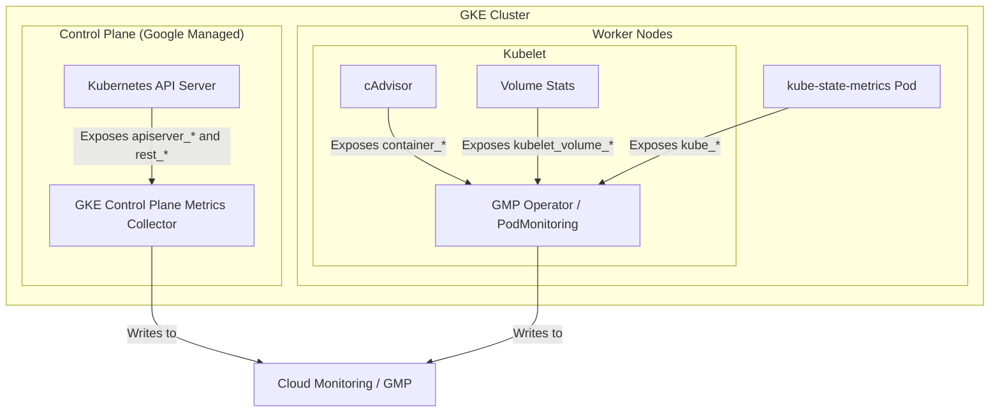

# Configure GKE Telemetry Prerequisites for Alerting Policies

This document details the Google Kubernetes Engine (GKE) and Google Cloud
configurations required to support the 16 critical alerting policies defined in
the reference catalog. It provides cluster operators with the setup commands,
configuration parameters, and verification queries to ensure telemetry flows
correctly for each alert.

# Table of Contents

- [Review the Telemetry Ingestion Architecture](#review-the-telemetry-ingestion-architecture): Lines 35-60
- [Verify Prerequisites by Alert](#verify-prerequisites-by-alert): Lines 61-86
- [Configure GKE Control Plane Metrics](#configure-gke-control-plane-metrics): Lines 87-119
  - [Enable Control Plane Metrics](#enable-control-plane-metrics): Lines 94-109
  - [Verify Control Plane Metrics](#verify-control-plane-metrics): Lines 110-119
- [Configure Kube State Metrics](#configure-kube-state-metrics): Lines 120-176
  - [Configure KSM Scraping](#configure-ksm-scraping): Lines 136-166
  - [Apply the PodMonitoring Allowlist Target](#apply-the-podmonitoring-allowlist-target): Lines 142-166
  - [Verify KSM Deployment](#verify-ksm-deployment): Lines 167-176
- [Configure Kubelet and cAdvisor Metrics](#configure-kubelet-and-cadvisor-metrics): Lines 177-218
  - [Define Container Resource Limits for Saturation Alerts](#define-container-resource-limits-for-saturation-alerts): Lines 183-218
  - [Identify Containers Missing Limits](#identify-containers-missing-limits): Lines 193-218
- [Configure Volume and Storage Telemetry](#configure-volume-and-storage-telemetry): Lines 219-238
  - [Verify CSI Driver Requirements](#verify-csi-driver-requirements): Lines 224-231
  - [Verify Volume Telemetry](#verify-volume-telemetry): Lines 232-238

> [!IMPORTANT] **Mandatory Kubernetes and GKE Alerting Guardrails**:
> * **Direct Response**: Read `references/kubernetes_*.md` and respond directly. Do not search the workspace for additional files before answering. **Do NOT search the codebase for external Terraform modules or extra reference files, and do NOT write `.tf` files to disk unless the user explicitly specifies a target file path.**
> * **Tier 2 KSM Permission Guardrail (`kube_*` state metrics)**: For any Tier 2 `kube-state-metrics (KSM)` alert (`kube_deployment_*`, `kube_statefulset_*`, `kube_daemonset_*`, `kube_cronjob_*`, `kube_job_*`, `kube_persistentvolume_*`, `kube_pod_status_phase`, `kube_pod_container_resource_limits`), **do NOT assume KSM is enabled or write or apply any Terraform files**. At the very top of your response, you MUST: (a) alert the user that the policy requires `kube-state-metrics (KSM)`, (b) explain that KSM incurs billable Managed Service for Prometheus (GMP) sample ingestion costs (see [Cloud Monitoring pricing](https://cloud.google.com/products/observability/pricing)), (c) **ask the user a direct question in second-person asking for explicit permission** (literally include: **"Do you grant explicit permission to enable and ingest kube-state-metrics (KSM) in your cluster for this alert?"**), and (d) recommend a filtered `PodMonitoring` allowlist (`metricRelabeling` with `action: keep`) that keeps only the required metrics.
> * **Tier 1 Native Metrics (Zero KSM Surcharge)**: For native cAdvisor, Kubelet, or Control Plane metrics (`container_memory_working_set_bytes`, `container_spec_memory_limit_bytes`, `kube_pod_container_status_restarts_total`, `kubernetes.io/container/restart_count`, `kube_node_status_condition`, `kubelet_volume_stats_available_bytes`, `apiserver_*`, `rest_client_*`), explicitly state that the metric is a **Tier 1 native/standard metric with zero KSM cost surcharge** (a **Tier 1 Kubelet/cAdvisor metric that does not require kube-state-metrics** or a **Tier 1 Control Plane metric with zero KSM cost surcharge**), explain that container resource limits (`resources.limits`) must be defined in pod specs for saturation alerts to resolve, and provide a clear plain-English explanation of the alert and thresholds.
> * **Mandatory Terraform Variables and `user_labels`**: Every Kubernetes Terraform HCL configuration MUST define `variable "project_id"`, `variable "cluster_name"`, and `variable "namespace"` (`var.project_id`, `${var.cluster_name}`, `${var.namespace}`) and include `user_labels = { "created-with-google-skill" = "cloud-monitoring-alert-configuration" }` in every `google_monitoring_alert_policy` resource.

---

## Review the Telemetry Ingestion Architecture

The following diagram illustrates how metrics for each alert category are
scraped from the cluster and ingested into Cloud Monitoring and Google Cloud Managed
Service for Prometheus (GMP).



---

## Verify Prerequisites by Alert

This table lists the GKE and Google Cloud prerequisites and configuration
requirements for each of the 16 critical alerts.

| Alert Name | Cost Tier | Required Metrics | GKE Cluster Requirement | Workload or Resource Requirement |
| :--- | :--- | :--- | :--- | :--- |
| **Kubernetes Node not ready** | Tier 1 (Native) | `kube_node_status_condition` | System Monitoring Enabled | GKE Nodes running standard Kubelet |
| **Kubernetes Node memory pressure** | Tier 1 (Native) | `kube_node_status_condition` | System Monitoring Enabled | GKE Nodes running standard Kubelet |
| **Kubernetes Node disk pressure** | Tier 1 (Native) | `kube_node_status_condition` | System Monitoring Enabled | GKE Nodes running standard Kubelet |
| **Kubernetes Node network unavailable** | Tier 1 (Native) | `kube_node_status_condition` | System Monitoring Enabled | GKE Nodes running standard Kubelet |
| **Kubernetes Volume full in four days** | Tier 1 (Native) | `kubelet_volume_stats_available_bytes` | System Monitoring Enabled | Pods with attached volumes (CSI Driver supported) |
| **Kubernetes API server errors** | Tier 1 (Native) | `apiserver_request_total` | Control Plane Metrics Enabled | GKE control plane active |
| **Kubernetes API client errors** | Tier 1 (Native) | `rest_client_requests_total` | Control Plane Metrics Enabled | API Clients communicating with API Server |
| **Kubernetes client certificate expires soon** | Tier 1 (Native) | `apiserver_client_certificate_expiration_seconds_count` | Control Plane Metrics Enabled | Client certificate authentication enabled |
| **Kubernetes CronJob failing** | Tier 2 (KSM) | `kube_cronjob_status_*`, `kube_cronjob_spec_*` | `kube-state-metrics` Scraped | Active CronJobs in cluster |
| **Kubernetes PersistentVolume error** | Tier 2 (KSM) | `kube_persistentvolume_status_phase` | `kube-state-metrics` Scraped | PersistentVolume resources configured |
| **Kubernetes StatefulSet down** | Tier 2 (KSM) | `kube_statefulset_*` | `kube-state-metrics` Scraped | StatefulSets deployed |
| **Kubernetes Pod not healthy** | Tier 2 (KSM) | `kube_pod_status_phase` | `kube-state-metrics` Scraped | Pods running in target namespaces |
| **Kubernetes Deployment generation mismatch** | Tier 2 (KSM) | `kube_deployment_*` | `kube-state-metrics` Scraped | Deployments deployed |
| **Kubernetes StatefulSet generation mismatch** | Tier 2 (KSM) | `kube_statefulset_*` | `kube-state-metrics` Scraped | StatefulSets deployed |
| **Kubernetes DaemonSet misscheduled** | Tier 2 (KSM) | `kube_daemonset_*` | `kube-state-metrics` Scraped | DaemonSets deployed |
| **Kubernetes Job slow completion** | Tier 2 (KSM) | `kube_job_*` | `kube-state-metrics` Scraped | Jobs deployed |

---

## Configure GKE Control Plane Metrics

The control plane alerts (`KubernetesAPIServerErrors`,
`KubernetesAPIClientErrors`, and `KubernetesClientCertificateExpiresSoon`) use a
**Tier 1 Control Plane metric with zero KSM cost surcharge** and require API
server and API client telemetry.

### Enable Control Plane Metrics

By default, GKE control plane metrics are not scraped. Enable them in the GKE
cluster configuration using `gcloud`:

```bash
gcloud container clusters update CLUSTER_NAME \
    --zone=COMPUTE_ZONE \
    --monitoring=SYSTEM,API_SERVER,CONTROLLER_MANAGER,SCHEDULER
```

*   **API_SERVER**: Exposes API server request volumes, error rates, and client
    request metrics.
*   **CONTROLLER_MANAGER and SCHEDULER**: Exposes scheduler queue metrics and
    controller manager execution states.

### Verify Control Plane Metrics

Verify that API server telemetry flows to Cloud Monitoring:

```promql
sum(rate(apiserver_request_total[5m])) by (code)
```

---

## Configure Kube State Metrics

All workload, replica mismatch, DaemonSet, StatefulSet, Job, CronJob, Pod phase,
and PersistentVolume alerts require cluster state metrics (`kube_*` metrics)
from `kube-state-metrics (KSM)`.

> [!IMPORTANT] **Mandatory Explicit Permission Guardrail**: Before assuming or
> enabling KSM ingestion, you **MUST** alert the user that the alert requires
> `kube-state-metrics (KSM)`, explain that KSM incurs billable Managed Service
> for Prometheus (GMP) sample ingestion costs (see [Cloud Monitoring pricing](https://cloud.google.com/products/observability/pricing)),
> and **ask the user a direct question for explicit permission**:
> **"Do you grant explicit permission to enable and ingest kube-state-metrics (KSM) in your cluster for this alert?"**
> Do **NOT** write `.tf` files to disk prior to receiving user permission; present
> the `PodMonitoring` allowlist and any Terraform HCL strictly as a conditional
> configuration to use **if KSM is approved**.

### Configure KSM Scraping

If the user approves KSM ingestion, deploy the `kube-state-metrics` service in
the cluster and configure a filtered `PodMonitoring` resource (GMP) to scrape
only the required metrics.

#### Apply the PodMonitoring Allowlist Target

To control costs, apply a filtered `PodMonitoring` specification that keeps only
the metrics required for these 16 critical alerts. Place this manifest in
`kube-system`:

```yaml
apiVersion: monitoring.googleapis.com/v1
kind: PodMonitoring
metadata:
  name: kube-state-metrics-filtered
  namespace: kube-system
spec:
  selector:
    matchLabels:
      app.kubernetes.io/name: kube-state-metrics
  endpoints:
  - port: http-metrics
    interval: 60s
    metricRelabeling:
    - action: keep
      sourceLabels: [__name__]
      regex: "^(kube_node_status_condition|kube_pod_status_phase|kube_pod_container_status_restarts_total|kube_deployment_spec_replicas|kube_deployment_status_replicas_available|kube_statefulset_replicas|kube_statefulset_status_replicas_ready|kube_statefulset_status_replicas|kube_deployment_status_observed_generation|kube_deployment_metadata_generation|kube_statefulset_status_observed_generation|kube_statefulset_metadata_generation|kube_daemonset_status_number_misscheduled|kube_cronjob_status_last_schedule_time|kube_cronjob_status_last_successful_time|kube_cronjob_status_active|kube_cronjob_spec_suspend|kube_persistentvolume_status_phase|kube_job_spec_completions|kube_job_status_succeeded|kube_job_status_failed)$"
```

### Verify KSM Deployment

Confirm that KSM is deployed and active:

```promql
up{job="kube-state-metrics"} == 1
```

---

## Configure Kubelet and cAdvisor Metrics

System metrics such as container memory usage and CPU duty cycles are exposed
natively by the Kubelet on each node as a **Tier 1 Kubelet/cAdvisor metric that
does not require kube-state-metrics**.

### Define Container Resource Limits for Saturation Alerts

Saturation alerts (such as non-KSM memory alerts) compare active usage against
container resource limits (`container_spec_memory_limit_bytes` and
`container_spec_cpu_quota`).

> [!WARNING] **The Resource Limit Gotcha**: If a pod or container does not have
> explicit limits defined in its deployment specification, these metrics return
> `NaN` or default values, causing the alert policy to **fail to resolve**.

#### Identify Containers Missing Limits

Run the following verification query to find pods that fail to resolve in
saturation alerting policies:

```promql
# Find containers missing memory limits
container_memory_working_set_bytes{container!=""}
  unless on (pod, container)
container_spec_memory_limit_bytes > 0
```

Ensure all workloads define a limit in their manifest:

```yaml
spec:
  containers:
  - name: my-app
    resources:
      limits:
        memory: "512Mi"
        cpu: "1000m"
```

---

## Configure Volume and Storage Telemetry

The volume alert (`KubernetesVolumeFullInFourDays`) relies on
`kubelet_volume_stats_available_bytes`.

### Verify CSI Driver Requirements

1.  Configure the storage class for the PersistentVolume (PV) to use a CSI
    driver that supports **Volume Stats** (such as the GKE Persistent Disk CSI
    Driver `pd.csi.storage.gke.io`).
2.  Local SSDs or HostPath volumes do not report volume capacity and
    availability statistics consistently.

### Verify Volume Telemetry

Confirm volume statistics are reporting:

```promql
kubelet_volume_stats_available_bytes > 0
```
