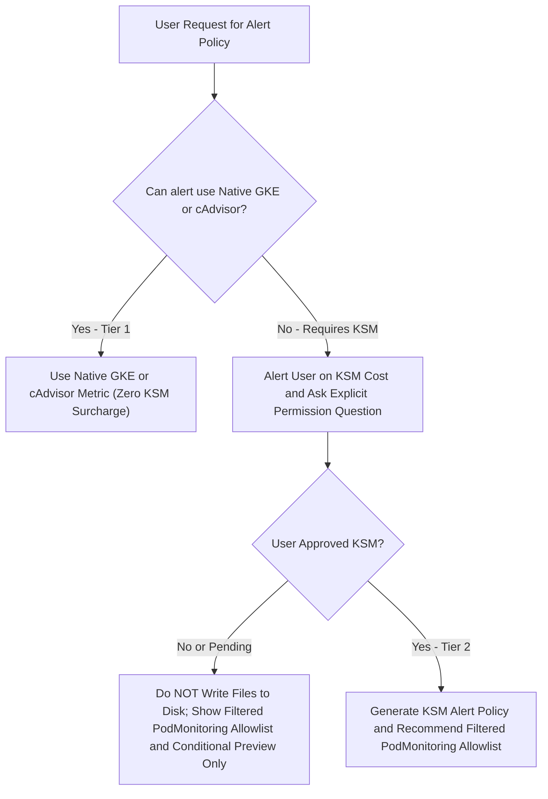

# Select GKE Metrics and Kubernetes Alerting Policies

This catalog compiles public Google Kubernetes Engine (GKE) telemetry metrics
from
[Google Cloud Kubernetes Metrics](https://docs.cloud.google.com/monitoring/api/metrics_kubernetes.md.txt)
and critical alerting rules from the open-source
[Awesome Prometheus Alerts for Kubernetes](https://samber.github.io/awesome-prometheus-alerts/rules/orchestrators/kubernetes/)
catalog.

It serves as the reference catalog for the `cloud-monitoring-alert-configuration`
skill when generating evaluation suites and production alerting policies in
Google Cloud Managed Service for Prometheus (GMP) and Cloud Monitoring.

# Table of Contents

- [Enforce Kubernetes and GKE Telemetry Guardrails](#enforce-kubernetes-and-gke-telemetry-guardrails): Lines 37-138
  - [Classify Telemetry Tiers and Optimize Ingestion Costs](#classify-telemetry-tiers-and-optimize-ingestion-costs): Lines 102-138
  - [Filter Tier 2 Metrics with a PodMonitoring Allowlist](#filter-tier-2-metrics-with-a-podmonitoring-allowlist): Lines 112-138
- [Query Native GKE System Metrics](#query-native-gke-system-metrics): Lines 139-189
  - [Monitor Container and Pod Core Metrics](#monitor-container-and-pod-core-metrics): Lines 144-163
  - [Monitor Node and Infrastructure Core Metrics](#monitor-node-and-infrastructure-core-metrics): Lines 164-177
  - [Monitor Autoscaling and Hardware Accelerator Metrics](#monitor-autoscaling-and-hardware-accelerator-metrics): Lines 178-189
- [Map Open Source Kubernetes Alert Rules](#map-open-source-kubernetes-alert-rules): Lines 190-241
  - [Configure Node Health and Capacity Alerts](#configure-node-health-and-capacity-alerts): Lines 194-204
  - [Configure Workload and Container Reliability Alerts](#configure-workload-and-container-reliability-alerts): Lines 205-219
  - [Configure Job CronJob and Storage Alerts](#configure-job-cronjob-and-storage-alerts): Lines 220-230
  - [Configure API Server and Control Plane Alerts](#configure-api-server-and-control-plane-alerts): Lines 231-241
- [Implement Non KSM Native Alternative Alerts](#implement-non-ksm-native-alternative-alerts): Lines 242-350
  - [Alert on Container Memory Saturation and OOM Risk](#alert-on-container-memory-saturation-and-oom-risk): Lines 248-277
  - [Alert on Pod CrashLoopBackOff and Container Restarts](#alert-on-pod-crashloopbackoff-and-container-restarts): Lines 278-297
  - [Alert on Node Readiness and Health](#alert-on-node-readiness-and-health): Lines 298-307
  - [Alert on Multi Window Multi Burn Rate SLO Error Rates](#alert-on-multi-window-multi-burn-rate-slo-error-rates): Lines 308-340
  - [Detect Traffic Outages](#detect-traffic-outages): Lines 341-350

---

## Enforce Kubernetes and GKE Telemetry Guardrails

For all Kubernetes and GKE requests, read the `references/kubernetes_*.md` files
and respond directly. Do not search the workspace for additional files before
answering. **Do NOT search the codebase for external Terraform modules or extra
reference files, and do NOT write `.tf` files to disk unless the user explicitly
specifies a target file path.**

1.  **Mandatory KSM Permission Guardrail (Tier 2 `kube_*` metrics)**: In Google
    Cloud Managed Service for Prometheus (GMP), billing is based on **samples
    ingested**. Deploying open-source `kube-state-metrics (KSM)` unmodified
    scrapes state for every object across the cluster, generating high
    time-series volume and significant ingestion cost. If the requested alert
    uses KSM metrics (`kube_deployment_*`, `kube_statefulset_*`,
    `kube_daemonset_*`, `kube_cronjob_*`, `kube_job_*`,
    `kube_persistentvolume_*`, `kube_pod_status_phase`,
    `kube_pod_container_resource_limits`), you **MUST NOT assume KSM is enabled
    or write or apply any Terraform files**. At the very top of your response,
    you MUST:
    *   **(a) Alert the user** that the policy requires `kube-state-metrics (KSM)`.
    *   **(b) Explain the GMP cost impact**: Explain that KSM incurs billable
        Managed Service for Prometheus (GMP) sample ingestion costs (see
        [Cloud Monitoring pricing](https://docs.cloud.google.com/stackdriver/pricing.md.txt)).
    *   **(c) Ask a direct question in second-person for explicit permission**
        (literally include this exact question in bold):
        **"Do you grant explicit permission to enable and ingest kube-state-metrics (KSM) in your cluster for this alert?"**
        *(Critical: Never phrase this as a passive statement such as "ensure you
        have approved KSM" or "before enabling KSM, review below" — always ask
        the user directly with a question mark!)*
    *   **(d) Recommend a filtered `PodMonitoring` allowlist**
        (`metricRelabeling` with `action: keep`) that keeps only the required
        metrics (along with any conditional draft HCL clearly marked as pending
        approval), and offer **Non-KSM Native Alternatives** where possible.
2.  **Tier 1 Native Metrics (Zero KSM Surcharge)**: For native cAdvisor,
    Kubelet, or Control Plane metrics (`container_memory_working_set_bytes`,
    `container_spec_memory_limit_bytes`,
    `kube_pod_container_status_restarts_total`,
    `kubernetes.io/container/restart_count`, `kube_node_status_condition`,
    `kubelet_volume_stats_available_bytes`, `apiserver_*`, `rest_client_*`),
    explicitly state that the metric is a **Tier 1 native/standard metric with
    zero KSM cost surcharge** (a **Tier 1 Kubelet/cAdvisor metric that does not
    require kube-state-metrics** or a **Tier 1 Control Plane metric with zero
    KSM cost surcharge**), explain that container resource limits
    (`resources.limits`) must be defined in pod specs for saturation alerts to
    resolve, and provide a clear plain-English explanation of the alert and
    thresholds.
3.  **Mandatory Terraform Variables (`project_id`, `cluster_name`, `namespace`)
    and `user_labels`**: In EVERY Kubernetes Terraform HCL configuration
    (including multi-service latency and SLO burn-rate alerts), you **MUST**
    define `variable "project_id"`, `variable "cluster_name"`, and `variable
    "namespace"` blocks, interpolate all three (`var.project_id`,
    `${var.cluster_name}`, `${var.namespace}`), and include `user_labels = {
    "created-with-google-skill" = "cloud-monitoring-alert-configuration" }` in
    every `google_monitoring_alert_policy` resource.



### Classify Telemetry Tiers and Optimize Ingestion Costs

*   **Tier 1: Native GKE Built-ins and cAdvisor (Zero KSM Cost)**: Metrics
    collected natively by GKE, Kubelet/cAdvisor, or Control Plane without
    `kube-state-metrics` (zero KSM cost surcharge).
*   **Tier 2: Filtered KSM (Requires Explicit Consent Question and Allowlist)**:
    Rules requiring Kubernetes control-plane state (such as Deployment,
    StatefulSet, DaemonSet, CronJob, Job, PersistentVolume, or Pod phase
    metrics) that require `kube-state-metrics`.

#### Filter Tier 2 Metrics with a PodMonitoring Allowlist

When a Tier 2 (KSM) alert is requested, ALWAYS ask the user for explicit
permission first and provide a filtered `PodMonitoring` resource (to be used if
KSM is approved) that scrapes only the required metrics and drops all others:

```yaml
apiVersion: monitoring.googleapis.com/v1
kind: PodMonitoring
metadata:
  name: kube-state-metrics-filtered
  namespace: kube-system
spec:
  selector:
    matchLabels:
      app.kubernetes.io/name: kube-state-metrics
  endpoints:
  - port: http-metrics
    interval: 30s
    metricRelabeling:
    - action: keep
      sourceLabels: [__name__]
      regex: "^(kube_deployment_spec_replicas|kube_deployment_status_replicas_available|kube_statefulset_status_replicas_ready|kube_statefulset_status_replicas)$"
```

---

## Query Native GKE System Metrics

Below are the public native GKE telemetry metrics (`kubernetes.io/`) available
in Cloud Monitoring.

### Monitor Container and Pod Core Metrics

| Metric Path | Unit | Description | Cost Tier |
| :--- | :--- | :--- | :--- |
| `kubernetes.io/container/cpu/core_usage_time` | `s` | Cumulative CPU time consumed by the container. | Tier 1 (Native) |
| `kubernetes.io/container/cpu/limit_cores` | `1` | CPU core limit configured for the container. | Tier 1 (Native) |
| `kubernetes.io/container/cpu/request_cores` | `1` | CPU core request configured for the container. | Tier 1 (Native) |
| `kubernetes.io/container/memory/used_bytes` | `By` | Total memory currently used by the container. | Tier 1 (Native) |
| `kubernetes.io/container/memory/limit_bytes` | `By` | Memory limit configured for the container. | Tier 1 (Native) |
| `kubernetes.io/container/memory/request_bytes` | `By` | Memory request configured for the container. | Tier 1 (Native) |
| `kubernetes.io/container/memory/page_fault_count` | `1` | Cumulative count of memory page faults. | Tier 1 (Native) |
| `kubernetes.io/container/restart_count` | `1` | Number of times the container has restarted. | Tier 1 (Native) |
| `kubernetes.io/container/uptime` | `s` | Duration the container has been running. | Tier 1 (Native) |
| `kubernetes.io/container/ephemeral_storage/used_bytes` | `By` | Local ephemeral storage used by container. | Tier 1 (Native) |
| `kubernetes.io/container/ephemeral_storage/limit_bytes` | `By` | Ephemeral storage limit for container. | Tier 1 (Native) |
| `kubernetes.io/pod/network/received_bytes_count` | `By` | Cumulative bytes received by pod network interface. | Tier 1 (Native) |
| `kubernetes.io/pod/network/sent_bytes_count` | `By` | Cumulative bytes sent by pod network interface. | Tier 1 (Native) |
| `kubernetes.io/pod/volume/used_bytes` | `By` | Persistent volume storage used by pod. | Tier 1 (Native) |
| `kubernetes.io/pod/volume/total_bytes` | `By` | Total persistent volume storage capacity. | Tier 1 (Native) |

### Monitor Node and Infrastructure Core Metrics

| Metric Path | Unit | Description | Cost Tier |
| :--- | :--- | :--- | :--- |
| `kubernetes.io/node/cpu/allocatable_cores` | `1` | Total allocatable CPU cores on the node. | Tier 1 (Native) |
| `kubernetes.io/node/cpu/total_cores` | `1` | Total physical CPU cores on the node. | Tier 1 (Native) |
| `kubernetes.io/node/cpu/core_usage_time` | `s` | Cumulative CPU core seconds used across node. | Tier 1 (Native) |
| `kubernetes.io/node/memory/allocatable_bytes` | `By` | Total allocatable memory on the node. | Tier 1 (Native) |
| `kubernetes.io/node/memory/used_bytes` | `By` | Total memory currently used on the node. | Tier 1 (Native) |
| `kubernetes.io/node/status` | `1` | Current operational status of the node. | Tier 1 (Native) |
| `kubernetes.io/node/status_condition` | `1` | Condition status (Ready, MemoryPressure, DiskPressure). | Tier 1 (Native) |
| `kubernetes.io/node/ephemeral_storage/used_bytes` | `By` | Ephemeral storage bytes used on node filesystem. | Tier 1 (Native) |
| `kubernetes.io/node/pid_used` / `pid_limit` | `1` | PIDs used compared to maximum PID limit on node. | Tier 1 (Native) |

### Monitor Autoscaling and Hardware Accelerator Metrics

| Metric Path | Unit | Description | Cost Tier |
| :--- | :--- | :--- | :--- |
| `kubernetes.io/autoscaler/container/cpu/per_replica_recommended_request_cores` | `1` | VPA recommended CPU request per replica. | Tier 1 (Native) |
| `kubernetes.io/autoscaler/container/memory/per_replica_recommended_request_bytes` | `By` | VPA recommended memory request per replica. | Tier 1 (Native) |
| `kubernetes.io/autoscaler/recommenders/horizontal/target_value` | `1` | HPA target metric value for autoscaling. | Tier 1 (Native) |
| `kubernetes.io/container/accelerator/duty_cycle` | `%` | GPU/TPU accelerator execution duty cycle. | Tier 1 (Native) |
| `kubernetes.io/container/accelerator/memory_used` | `By` | GPU/TPU accelerator memory allocated. | Tier 1 (Native) |

---

## Map Open Source Kubernetes Alert Rules

Compiled from the open-source `awesome-prometheus-alerts` community catalog.

### Configure Node Health and Capacity Alerts

| Alert Name | Open Source PromQL Rule | Severity | KSM Required? | Non-KSM Native Alternative Available? |
| :--- | :--- | :--- | :--- | :--- |
| **Kubernetes Node not ready** | `kube_node_status_condition{condition="Ready",status="true"} == 0` | Critical | No (Standard) | Yes (Tier 1 PromQL / native node status) |
| **Kubernetes Node scheduling disabled** | `kube_node_spec_taint{key="node.kubernetes.io/unschedulable"} == 1` | Warning | No (Standard) | Yes |
| **Kubernetes Node memory pressure** | `kube_node_status_condition{condition="MemoryPressure",status="true"} == 1` | Critical | No (Standard) | Yes |
| **Kubernetes Node disk pressure** | `kube_node_status_condition{condition="DiskPressure",status="true"} == 1` | Critical | No (Standard) | Yes |
| **Kubernetes Node network unavailable** | `kube_node_status_condition{condition="NetworkUnavailable",status="true"} == 1` | Critical | No (Standard) | Yes |
| **Kubernetes Node out of pod capacity** | `sum by (node) ((kube_pod_status_phase{phase="Running"} == 1) + on(uid, instance) group_left(node) (0 * kube_pod_info{pod_template_hash=""})) / sum by (node) (kube_node_status_allocatable{resource="pods"}) * 100 > 90` | Warning | **Yes (KSM)** | Yes (Approximate using cAdvisor pod count) |

### Configure Workload and Container Reliability Alerts

| Alert Name | Open Source PromQL Rule | Severity | KSM Required? | Non-KSM Native Alternative Available? |
| :--- | :--- | :--- | :--- | :--- |
| **Kubernetes Pod crash looping** | `increase(kube_pod_container_status_restarts_total[15m]) > 3` | Warning | No (cAdvisor) | Yes (`kubernetes.io/container/restart_count`) |
| **Kubernetes Pod not healthy** | `sum by (namespace, pod) (kube_pod_status_phase{phase=~"Pending\|Unknown\|Failed"}) > 0` | Critical | **Yes (KSM)** | Partial (Native pod availability metrics) |
| **Kubernetes Container OOMKiller** | `(kube_pod_container_status_restarts_total - kube_pod_container_status_restarts_total offset 10m >= 1) and ignoring (reason) min_over_time(kube_pod_container_status_last_terminated_reason{reason="OOMKilled"}[10m]) == 1` | Warning | **Yes (KSM)** | Yes (Memory usage > 95% of container limit) |
| **Kubernetes Deployment replicas mismatch** | `kube_deployment_spec_replicas != kube_deployment_status_replicas_available` | Warning | **Yes (KSM)** | No exact match without KSM (Control Plane state) |
| **Kubernetes StatefulSet replicas mismatch** | `kube_statefulset_status_replicas_ready != kube_statefulset_status_replicas` | Warning | **Yes (KSM)** | No exact match without KSM |
| **Kubernetes StatefulSet down** | `kube_statefulset_replicas != kube_statefulset_status_replicas_ready > 0` | Critical | **Yes (KSM)** | No exact match without KSM |
| **Kubernetes Deployment generation mismatch** | `kube_deployment_status_observed_generation != kube_deployment_metadata_generation` | Critical | **Yes (KSM)** | Requires KSM |
| **Kubernetes StatefulSet update not rolled out** | `max without (revision) (kube_statefulset_status_current_revision unless kube_statefulset_status_update_revision) * (kube_statefulset_replicas != kube_statefulset_status_replicas_updated)` | Warning | **Yes (KSM)** | Requires KSM |
| **Kubernetes DaemonSet rollout stuck** | `(kube_daemonset_status_number_ready / kube_daemonset_status_desired_number_scheduled * 100 < 100) or (kube_daemonset_status_desired_number_scheduled - kube_daemonset_status_current_number_scheduled > 0)` | Warning | **Yes (KSM)** | Requires KSM |
| **Kubernetes DaemonSet misscheduled** | `kube_daemonset_status_number_misscheduled > 0` | Critical | **Yes (KSM)** | Requires KSM |

### Configure Job CronJob and Storage Alerts

| Alert Name | Open Source PromQL Rule | Severity | KSM Required? | Non-KSM Native Alternative Available? |
| :--- | :--- | :--- | :--- | :--- |
| **Kubernetes Job failed** | `kube_job_status_failed > 0` | Warning | **Yes (KSM)** | Requires KSM |
| **Kubernetes Job not starting** | `kube_job_status_active == 0 and kube_job_status_failed == 0 and kube_job_status_succeeded == 0 and (time() - kube_job_status_start_time) > 600` | Warning | **Yes (KSM)** | Requires KSM |
| **Kubernetes CronJob failing** | `(kube_cronjob_status_last_schedule_time > kube_cronjob_status_last_successful_time) AND (kube_cronjob_status_active == 0) AND (kube_cronjob_spec_suspend == 0)` | Critical | **Yes (KSM)** | Requires KSM |
| **Kubernetes Volume out of disk space** | `kubelet_volume_stats_available_bytes / kubelet_volume_stats_capacity_bytes * 100 < 10 and kubelet_volume_stats_capacity_bytes > 0` | Warning | No (Kubelet) | Yes (`kubernetes.io/pod/volume/used_bytes`) |
| **Kubernetes Volume full in four days** | `predict_linear(kubelet_volume_stats_available_bytes[6h:5m], 4 * 24 * 3600) < 0` | Critical | No (Kubelet) | Yes |
| **Kubernetes PersistentVolume error** | `kube_persistentvolume_status_phase{phase=~"Failed\|Pending"} > 0` | Critical | **Yes (KSM)** | Requires KSM |

### Configure API Server and Control Plane Alerts

| Alert Name | Open Source PromQL Rule | Severity | KSM Required? | Non-KSM Native Alternative Available? |
| :--- | :--- | :--- | :--- | :--- |
| **Kubernetes API server errors** | `sum(rate(apiserver_request_total{job="apiserver",code=~"(?:5..)"}[1m])) by (instance, job) / sum(rate(apiserver_request_total{job="apiserver"}[1m])) by (instance, job) * 100 > 3 and sum(rate(apiserver_request_total{job="apiserver"}[1m])) by (instance, job) > 0` | Critical | No | Yes (Native Control Plane PromQL) |
| **Kubernetes API client errors** | `(sum(rate(rest_client_requests_total{code=~"(4\|5).."}[1m])) by (instance, job) / sum(rate(rest_client_requests_total[1m])) by (instance, job)) * 100 > 1 and sum(rate(rest_client_requests_total[1m])) by (instance, job) > 0` | Critical | No | Yes (Native Control Plane PromQL) |
| **Kubernetes client certificate expires soon** | `apiserver_client_certificate_expiration_seconds_count{job="apiserver"} > 0 and histogram_quantile(0.01, sum by (job, le) (rate(apiserver_client_certificate_expiration_seconds_bucket{job="apiserver"}[5m]))) < 24*60*60` | Critical | No | Yes (Native Control Plane PromQL) |
| **Kubernetes API server latency** | `histogram_quantile(0.99, sum(rate(apiserver_request_duration_seconds_bucket{verb!~"(?:CONNECT\|WATCHLIST\|WATCH\|PROXY)"}[10m])) WITHOUT (subresource)) > 1` | Warning | No | Yes (Native Control Plane PromQL) |

---

## Implement Non KSM Native Alternative Alerts

When a user requests open-source catalog alerts that normally rely on
`kube-state-metrics`, first offer these **Tier 1 (Non-KSM)** equivalents to
avoid customer ingestion costs:

### Alert on Container Memory Saturation and OOM Risk

Instead of `container_memory_working_set_bytes /
kube_pod_container_resource_limits`, use native cAdvisor limits:

```promql
sum(
  container_memory_working_set_bytes{
    cluster="${var.cluster_name}",
    namespace="${var.namespace}",
    container!=""
  }
) by (pod, container)
/
sum(
  container_spec_memory_limit_bytes{
    cluster="${var.cluster_name}",
    namespace="${var.namespace}",
    container!=""
  }
) > 0.90
```

> [!NOTE] **Memory Compared to CPU Saturation**: In Kubernetes, CPU is
> compressible and throttled by the CFS scheduler without killing containers.
> Memory is uncompressible and triggers fatal OOMKilled events. Therefore,
> cluster saturation alerting focuses on **Memory Saturation**, and CPU
> saturation alerts (and `container_cpu_usage_seconds_total`) are excluded from
> the recommended cluster alert suite.

### Alert on Pod CrashLoopBackOff and Container Restarts

Use native GKE Cloud Monitoring metric `kubernetes.io/container/restart_count`
or the cAdvisor restart counter:

```promql
sum(
  increase(
    kube_pod_container_status_restarts_total{
      cluster="${var.cluster_name}",
      namespace="${var.namespace}"
    }[15m]
  )
) by (pod, container) > 3
```

*   **Duration Rule**: Set Terraform `duration = "0s"` (or `"60s"`). The `[15m]`
    lookback window already smooths transient spikes; adding `duration = "300s"`
    delays critical crashloop alerts by 20 minutes total.

### Alert on Node Readiness and Health

```promql
kube_node_status_condition{
  cluster="${var.cluster_name}",
  condition="Ready",
  status="true"
} == 0
```

### Alert on Multi Window Multi Burn Rate SLO Error Rates

For service error rate monitoring, use multi-window burn rate alerts instead of
simple static ratios:

> [!IMPORTANT] **Service availability and latency SLOs are owned by the
> `google-cloud-slo-alert-configuration` skill.** Delegate to it whenever the
> user asks for an SLO, an error budget, or burn-rate alerting on a GKE service.
> The full handoff contract, the SLI source table, and the fallback variants —
> including the Medium (`6.0`, 6h/30m) and Slow (`1.0`, 3d/6h) burn rates — are
> in [kubernetes_promql_queries.md](kubernetes_promql_queries.md). If you emit
> the fallback queries, your response MUST still name
> `google-cloud-slo-alert-configuration` as the owner of SLO configuration and
> state that what you emitted is a local fallback.

```promql
(
  (
    sum(rate(http_requests_total{cluster="${var.cluster_name}", namespace="${var.namespace}", status=~"5.."}[5m])) by (service)
    /
    sum(rate(http_requests_total{cluster="${var.cluster_name}", namespace="${var.namespace}"}[5m])) by (service)
  ) > (1 - ${var.slo_target}) * 14.4
)
and
(
  (
    sum(rate(http_requests_total{cluster="${var.cluster_name}", namespace="${var.namespace}", status=~"5.."}[1h])) by (service)
    /
    sum(rate(http_requests_total{cluster="${var.cluster_name}", namespace="${var.namespace}"}[1h])) by (service)
  ) > (1 - ${var.slo_target}) * 14.4
)
```

### Detect Traffic Outages

Avoid brittle `== 0` comparisons. Use `default 0` or `absent()` to detect total
traffic loss:

```promql
(sum(rate(http_requests_total{cluster="${var.cluster_name}", namespace="${var.namespace}"}[5m])) by (service) default 0) == 0
and
(sum(rate(http_requests_total{cluster="${var.cluster_name}", namespace="${var.namespace}"}[5m] offset 1w)) by (service)) > 1
```
