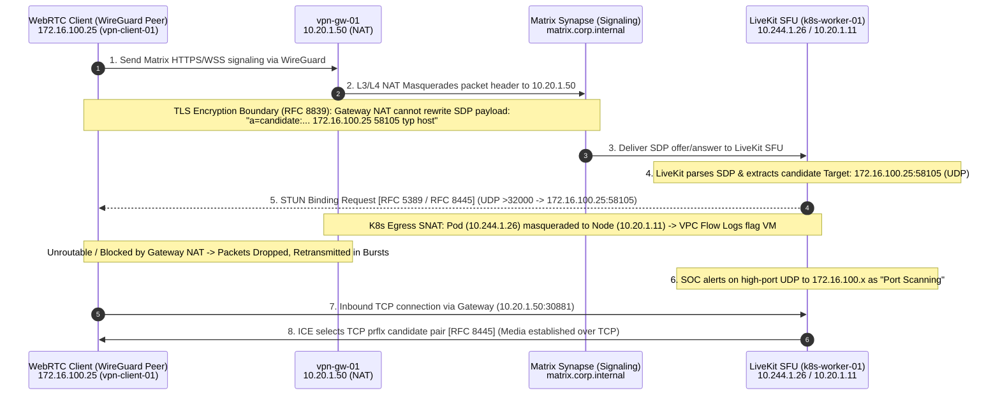

# Network & Threat Intel: Cloud DNS Hunting, GCP Firewall, WebRTC STUN & GTI Translation

<!-- disableFinding(LINE_OVER_80) -->

## Table of Contents

- [1. WebRTC ICE, LiveKit SFU & `GCP_FIREWALL` Port-Scan Triage](#1-webrtc-ice-livekit-sfu-gcp_firewall-port-scan-triage): Lines 14-95
- [2. Google Threat Intelligence (GTI) Translation & Domain Telemetry Triage](#2-google-threat-intelligence-gti-translation-domain-telemetry-triage): Lines 99-116
- [3. Google Cloud DNS (`GCP_DNS`) 1-Year Threat Hunting & Parser Architecture](#3-google-cloud-dns-gcp_dns-1-year-threat-hunting-parser-architecture): Lines 120-140
- [4. Windows DC Locator SRV Queries (`_msdcs` / `_kerberos._tcp`) False-Positive & `NXDOMAIN` Risk Triage](#4-windows-dc-locator-srv-queries-_msdcs-_kerberos_tcp-false-positive-nxdomain-risk-triage): Lines 144-176

---

## 1. WebRTC ICE, LiveKit SFU & `GCP_FIREWALL` Port-Scan Triage

When SIEM or IDS rules alert on suspected UDP/TCP port scanning from Kubernetes worker nodes, NAT bastions, or VPN pools, triage for **WebRTC ICE connectivity checks** (RFC 8445 / RFC 5245) and **`GCP_FIREWALL` parser quirks** before initiating containment.

### A. The L3/L4 NAT vs. L7 SDP Application Payload Blind Spot

1. **Gateway Masquerade vs. ICE Host Candidates:** VPN gateways (WireGuard, IPsec) perform L3/L4 Source NAT on incoming tunnel packets, replacing client tunnel IPs (`172.16.100.x`) with the gateway IP (`10.20.1.50`). However, WebRTC endpoints (Matrix / Element Call, browsers) gather local interface addresses as **ICE Host Candidates** inside the TLS-encrypted **Session Description Protocol (SDP)** payload:
   ```text
   c=IN IP4 172.16.100.25
   a=candidate:3061991910 1 udp 2113937151 172.16.100.25 58105 typ host generation 0 ...
   ```
2. **Direct Probe Execution & K8s Egress SNAT (RFC 5389 / RFC 8445):** LiveKit SFU extracts the raw host candidate and sends **STUN Binding Requests** directly to `172.16.100.25:58105`. Outbound UDP probes from media pods (`10.244.1.26`) toward non-cluster subnets undergo `iptables`/`kube-proxy` SNAT to the worker node IP (`10.20.1.11` / `k8s-worker-01`). If the VPN subnet blocks unsolicited inbound UDP from the cluster, probes drop and retransmit in bursts on every mobile link reconnect (15-30s).

### B. Triage Runbook Using UAC / Kubernetes Pod Logs

1. **Identify Hosting Pod & Extract SDP Candidates:**
   ```bash
   grep -E "^(Name|Namespace):" live_response/kubernetes/crictl_pods_-v.txt
   grep -rn "<TARGET_VPN_IP>" /var/log/pods/*live-kit-sfu*
   ```
2. **Verify 1:1 Participant-to-IP Exclusivity:**
   ```python
   import re
   match = re.search(r'"participant":\s*"([^"]+)".*?c=IN IP4 (172\.\d+\.\d+\.\d+)', log_line)
   ```
3. **Verify Final Media Path Fallback (The 3-Part Proof Chain):**
   - **Proof 1 (RFC 8445 Section 5.1.2 Priority Formula):**
     `Priority = (2^24 * TypePreference) + (2^8 * LocalPreference) + (256 - ComponentID)`
     UDP host candidates carry type preference `126` (`priority > 2.1e9`); TCP `prflx` candidates carry lower preference (`~110`). Under RFC 8445, the engine **must** probe UDP first; selecting TCP proves higher-priority UDP probes failed.
   - **Proof 2 (Candidate Pair Selection):**
     ```bash
     grep -E "(selected ICE candidate pair changed|ICE connection state changed)" /var/log/pods/*live-kit-sfu*/*.log
     # {"localProtocol":"tcp","localPort":30881,"remoteProtocol":"tcp","remoteCandidateType":"prflx","remoteAddress":"<GATEWAY_IP>"}
     ```
   - **Proof 3 (Active RTP Media Stream):**
     ```bash
     grep -E "(DownTrack\.Bind|track subscribed|rtp stats)" /var/log/pods/*live-kit-sfu*/*.log
     ```

### C. `GCP_FIREWALL` Schema Invariants (`0.0.0.0` Hairpin, `resource.name` VM Mapping & `subnetwork_id` Contamination)
When writing or triaging `GCP_FIREWALL` detections, enforce three critical schema rules:

1. **Denied `src_ip = "0.0.0.0"` Hairpin / Health-Check Probe Collapse (`Net_Recon_PortScan`)**:
   - Unroutable source IP `0.0.0.0` probes (`TCP/8080` from `nat-bastion` against `*-vpn-gw-0-*` external VIPs denied by `priority = 65534` `deny-all-ingress` rules) collapse 50+ distinct target VMs into a single `$src_ip = "0.0.0.0"` bucket in `match: $src_ip over 5m`. Always require `$e.principal.ip != "0.0.0.0"` in `GCP_FIREWALL` and `GCP_VPC_FLOW` scan rules.
2. **VM Name Mapping (`principal.resource.name` & `target.resource.name`)**:
   - The `GCP_FIREWALL` parser does **not** populate `principal.hostname` or `target.hostname`; it maps `jsonPayload.instance.vm_name` and `remote_instance.vm_name` to **`principal.resource.name`** and **`target.resource.name`**. Always extract VM names from `principal.resource.name` and `target.resource.name`.
3. **`target.resource_ancestors.product_object_id` 19-Digit `subnetwork_id` Contamination**:
   - The parser writes both `vpc.project_id` (string) and `vpc.subnetwork_id` (19-digit numeric ID) into `resource_ancestors` without setting `resource_type`, creating duplicate rows when grouping by `product_object_id`. Extract the GCP project ID cleanly via `re.capture($e.metadata.product_event_type, "^projects/([^/]+)/")` (from `projects/<project_id>/firewallRules/<rule_name>`).
4. **Kubernetes CNI `MASQUERADE --random-fully` Ephemeral UDP Burst & Cross-Project `$project_id, $stack` Partitioning**:
   - In multi-project GCP environments (`prod-app-01`, `sandbox-dev-01`) with overlapping RFC 1918 ranges (`10.10.20.8`) and ephemeral Kubernetes deployments (`<prefix>-k3s-node-...`), partitioning only by `$src_ip` merges unrelated projects and stacks into a single scan alert. Always partition `match:` by `$src_ip, $project_id, $stack over 5m` (`$stack = strings.coalesce(re.capture(strings.coalesce($e.principal.resource.name, $e.principal.hostname), "^([a-z0-9]{4})-"), "default")`).
   - Exclude Kubernetes CNI `iptables MASQUERADE --random-fully` node-to-node ephemeral UDP port randomization (`not ($e.network.ip_protocol = "UDP" and $e.principal.port >= 1024 and $e.target.port >= 32768 and $e.target.port <= 60999)`), and separate `$allowed_host_ports` (`action = "ALLOW"`) from `$blocked_host_ports` (`action = "BLOCK"`) in `outcome:`.

### D. High-Density UDM Hunting Selectors for Network & DNS Triage

| Rule / Detection Name | MITRE ATT&CK | UDM `log_type` & Key Fields | High-Density UDM Predicates & False-Positive Exclusions | Window & Threshold | Key Outcome / Triage Artifacts |
| :--- | :--- | :--- | :--- | :--- | :--- |
| **`Network_Internal_UDP_Port_Scan_Tuned_WebRTC`**<br>*(UDP Port Scan & Covert C2 Beaconing vs. WebRTC STUN/ICE, Kubernetes CNI & `0.0.0.0` Exclusions)* | `T1046`, `T1071` | `GCP_FIREWALL` / `GCP_VPC_FLOW` / `LINUX_SYSMON` / `ZEEK`<br>`event_type = "NETWORK_CONNECTION"` | • Exclude unroutable hairpin probes: `$e.principal.ip != "0.0.0.0"`<br>• Exclude STUN/TURN protocol & ephemeral browser UDP ports (`3478`, `5349`, `19302`) and STUN magic cookie (`0x2112A442`): `$e.network.application_protocol != "STUN"` and `not ($e.network.ip_protocol = "UDP" and ($e.target.port = 3478 or $e.target.port = 5349 or $e.target.port = 19302 or $e.principal.port = 3478 or $e.principal.port = 5349 or $e.principal.port = 19302))`<br>• Exclude established WebRTC LiveKit SFU nodes and muxer ports: `not (re.regex(strings.coalesce($e.principal.resource.name, $e.principal.hostname), "-agent-") and ($e.principal.port = 30881 or $e.principal.port = 30882 or $e.principal.port = 31478))`<br>• Exclude Kubernetes CNI `MASQUERADE --random-fully` ephemeral UDP bursts (`1024..65535 -> 32768..60999`): `not ($e.network.ip_protocol = "UDP" and $e.principal.port >= 1024 and $e.target.port >= 32768 and $e.target.port <= 60999)`<br>• Extract VM names from `principal.resource.name` / `target.resource.name` | `$src_ip, $project_id, $stack over 5m`<br>Threshold: `count_distinct($e.target.port) >= 20 and count_distinct($target_ip) >= 3` *(or sustained non-STUN UDP C2 beaconing)* | • `src_vm`: `array_distinct(strings.coalesce($e.principal.resource.name, $e.principal.hostname))`<br>• `dst_vms`: `array_distinct(strings.coalesce($e.target.resource.name, $e.target.hostname))`<br>• `allowed_host_ports` vs `blocked_host_ports`<br>• `project_id`: `array_distinct(re.capture($e.metadata.product_event_type, "^projects/([^/]+)/"))` |
| **`DNS_Single_Label_Length_Tunneling_Selector`**<br>*(DNS Exfiltration / C2 Label Length)* | `T1071.004`, `T1048.003` | `GCP_DNS` / `GENERIC_EVENT` / `BIND` / `ZEEK`<br>`$dns_query = strings.coalesce($e.network.dns.questions.name, $e.extracted.fields["jsonPayload.queryName"])` | • Require 37+ continuous non-dot characters within a single label (bypasses 36-char RFC 4122 UUIDs like AD Domain/DSA GUIDs): `re.regex($dns_query, "[a-zA-Z0-9+/=_-]{37,}")`<br>• Exclude RFC 2782 SRV records (`$e.network.dns.questions.type != 33`) and AD partitions: `not re.regex($dns_query, "(?i)^_[a-z0-9-]+\\._(?:tcp\|udp\|tls\|sctp)\\.")` and `not re.regex($dns_query, "(?i)\\.(?:_msdcs\|_sites\|_sub\|_dns-sd\|forestdnszones\|domaindnszones)\\.")`<br>• Exclude Windows TPM 2.0 AIK SCEP enrollment (`not re.regex($dns_query, "(?i)\\.microsoftaik\\.azure\\.net\\.?$")`)<br>• Normalize case before matching Data Tables: `not strings.to_lower($dns_query) in regex %Exclusion_DNS_Suffixes.domain`<br>• **Multi-Project Asset Collision Fix**: Partition `match:` by both `$hostname` and `$project_id` | `$hostname, $project_id over 5m` | • `$authoritative_src_ip = array_distinct($e.extracted.fields["jsonPayload.sourceIP"])`<br>• `queried_domains`: `array_distinct($dns_query)` |
| **`DNS_Stealth_Honeytoken_And_Gobuster_Canary`**<br>*(Dark-Space Answer CIDR & Gobuster UUIDv4 Wildcard Check)* | `T1590.002`, `T1046` | `GCP_DNS` / `GENERIC_EVENT`<br>`$query_name = strings.coalesce($e.network.dns.questions.name, $e.extracted.fields["jsonPayload.queryName"])` | • **Path 1 (Dark-Space Answer CIDR)**: Point direct `A` records (never `CNAME`s containing `trap-*`/`canary`, which leak via `gobuster dns -c`) for SecLists baits (`vcenter`, `citrix`, `cyberark`, `vault-dev`, `corp-vpn-admin`, `prod-bastion-01`; never noisy OS names `wpad`, `isatap`, `autodiscover`, `_ldap`, `time`, `ntp`) to a dark-space `/28` CIDR and match `net.ip_in_range_cidr($e.network.dns.answers.data, "<dark_cidr>/28")`<br>• **Path 2 (`gobuster dns` Startup UUIDv4 Canary)**: Gobuster probes a random RFC 4122 v4 UUID before scanning (`re.regex($query_name, "(?i)^[0-9a-f]{8}-[0-9a-f]{4}-4[0-9a-f]{3}-[89ab][0-9a-f]{3}-[0-9a-f]{12}\\.<domain>\\.?$")`) | `$src_ip over 5m`<br>(`risk_score = 90`) | • `triggered_baits`: `array_distinct($query_name)`<br>• `resolved_dark_ips`: `array_distinct($e.network.dns.answers.data)` |

### E. Root Cause Analysis Sequence Flow Diagram



---

## 2. Google Threat Intelligence (GTI) Translation & Domain Telemetry Triage

When pivoting from Google Threat Intelligence (GTI) or VirusTotal Enterprise entity searches into Google SecOps, translate threat indicators into UDM queries rather than using the console landing search bar:

- **Landing Search Bar Limitations:** Does not support wildcards (`*.domain.com`), does not expand subdomains (`domain.com` misses `news.domain.com`), and only lists `DOMAINS` already observed in ingested logs.
- **Translating `entity:domain parent_domain:<domain>` to UDM Search (Including `GENERIC_EVENT` DNS Downgrades):**
  ```sql
  network.dns.questions.name = /(^|\.)example\.com\.?$/ nocase or
  extracted.fields["jsonPayload.queryName"] = /(^|\.)example\.com\.?$/ nocase or
  target.hostname = /(^|\.)example\.com$/ nocase or
  network.http.parsed_url.hostname = /(^|\.)example\.com$/ nocase
  ```
- **Direct Domain Dossier Navigation (for Unseen External IOCs):**
  `https://<region>.secops.cloud.google.com/instances/<instance>/domains/<domain>`
- **Bulk GTI Campaign / Collection Subdomain Ingestion via Reference Lists (`%gti_ioc_domains`):**
  ```sql
  network.dns.questions.name in %gti_ioc_domains or target.hostname in %gti_ioc_domains or network.http.parsed_url.hostname in %gti_ioc_domains
  ```

---

## 3. Google Cloud DNS (`GCP_DNS`) 1-Year Threat Hunting & Parser Architecture

### A. The `GENERIC_EVENT` Parser Downgrade Trap
The default `GCP_DNS` parser evaluates `jsonPayload.sourceIP`:

- **Standard GCE VM Queries:** Contain `sourceIP` -> mapped to `principal.ip`, setting `metadata.event_type = "NETWORK_DNS"`.
- **Forwarding Zones, Peering & FQDN Firewall Objects:** Omit `sourceIP` (`source_type: "fqdn-firewall-object"`, `target_type: "forwarding-zone"`). When `sourceIP` is absent, the parser's IP grok filter fails and mutates `metadata.event_type = "GENERIC_EVENT"`, leaving `network.dns.questions.name` empty while preserving `extracted.fields["jsonPayload.queryName"]` (with a trailing root dot, e.g., `"evil.com."`).
- **Resolution:** Omit `metadata.event_type` in UDM Search or match both `NETWORK_DNS` and `GENERIC_EVENT`, and coalesce `$query_name = strings.coalesce($e.network.dns.questions.name, $e.extracted.fields["jsonPayload.queryName"])` in YARA-L 2.0 rules with an optional trailing dot (`\.?$`).

### B. Hot Indexed Storage Optimization & Numeric DNS Query Types (IANA)

- **Hot Indexed Field:** `network.dns.questions.name` is indexed in Google SecOps hot indexed storage (`DOMAIN_NAME`), whereas `extracted.fields["jsonPayload.queryName"]` triggers an unindexed scan across raw payloads.
- **Numeric DNS Query Types (`network.dns.questions.type`):** `1` = `A`, `5` = `CNAME`, `6` = `SOA`, `16` = `TXT`, `28` = `AAAA`, `33` = `SRV`.

| Field Available in `NETWORK_DNS` | Equivalent Field in `GENERIC_EVENT` | Triage Purpose |
| :--- | :--- | :--- |
| `principal.ip` | *(Not present)* | Identify source host |
| `principal.asset.hostname` | `principal.resource.attribute.labels` | Identify source mechanism (`fqdn-firewall-object`) |
| `network.dns.questions.name` *(no trailing dot)* | `extracted.fields["jsonPayload.queryName"]` *(has trailing dot `.`)* | Queried FQDN |
| *(N/A)* | `intermediary.ip` / `target.ip` | Cloud DNS Egress proxy IP / Upstream forwarder |
| `principal.cloud.project.name` | `principal.cloud.project.name` | Scope to GCP project owner |

---

## 4. Windows DC Locator SRV Queries (`_msdcs` / `_kerberos._tcp`) False-Positive & `NXDOMAIN` Risk Triage

When DNS C2 / long-hostname rules alert on `_kerberos._tcp.<SiteName>._sites.dc._msdcs.<DOMAIN>` (`queryType = 33` SRV, 70-85+ chars total across short labels where longest single label is `Default-First-Site-Name` at 23 chars):

### A. The 4 Downstream Risks When `responseCode = NXDOMAIN` (`authAnswer: true`)

1. **LLMNR (UDP 5355) / NBT-NS (UDP 137) / mDNS (UDP 5353) Fallback & `Responder` Exposure:** Windows falls back to link-local broadcast when DNS fails to resolve a KDC, allowing an attacker on the subnet to capture Net-NTLMv2 hashes.
2. **Kerberos-to-NTLM Authentication Downgrade:** Without port 88 KDC resolution, authentication degrades to NTLM.
3. **Public TLD Split-Horizon Leakage:** Detaching a Cloud DNS private zone for a publicly registrable AD domain leaks DC Locator queries to public resolvers.
4. **Multi-Realm Configuration Drift:** Pivot to `WINEVTLOG` `4624`/`4768` (`target.administrative_domain`) for stale imaging DNS suffixes.

### B. Distinguishing Domain Controllers from Member Servers in Split-Brain AD DNS

- **Domain Controllers / KDCs (`100% SOA` Type 6 on a 3,600s cadence):** `Netlogon` fires 5 `SOA` queries within ~30ms (`_kerberos._tcp`, `_kerberos._udp`, `_msdcs`, `_sites`, `<DsaGuid>._msdcs`) and aborts RFC 2136 registration on `NXDOMAIN`. On the DC itself, `WINEVTLOG` `4768`/`4624` still succeeds over **`::1` (IPv6 Loopback)**.
- **Member Servers (`100% SRV` Type 33 in 5ms fallback pairs):** Sends Stage 1 Site-Aware `SRV` (`_kerberos._tcp.Default-First-Site-Name._sites.dc._msdcs.<REALM>`) followed **exactly 5ms later** by Stage 2 Site-Less `SRV` (`_kerberos._tcp.dc._msdcs.<REALM>`).

### C. Multi-Project GCE Hostname Collision (`GCP_COMPUTE_CONTEXT` Trap)
`GCP_COMPUTE_CONTEXT` keys on `principal.hostname` and merges identically named VMs (`ad-dc-vm`) across `test`/`preprod` projects into one UDM asset (injecting multiple IPs into `principal.ip`). Always partition `match:` by both `$hostname = strings.coalesce($e.principal.hostname, $e.extracted.fields["jsonPayload.vmInstanceName"])` and `$project_id = strings.coalesce($e.principal.cloud.project.name, $e.extracted.fields["resource.labels.project_id"])`, and extract `$authoritative_src_ip = array_distinct($e.extracted.fields["jsonPayload.sourceIP"])`.

### D. Windows Host-Side Remediation (NRPT & Broadcast Hardening)
Because `google-guest-agent` DHCP resets static NIC DNS back to `169.254.169.254` and `C:\Windows\System32\drivers\etc\hosts` cannot store `SRV`/`SOA` records, deploy a **Name Resolution Policy Table (NRPT)** rule and disable LLMNR/NBT-NS:
```powershell
# 1. Route AD domain and _msdcs subzone directly to KDC while keeping 169.254.169.254 active
Add-DnsClientNrptRule -Namespace ".corp.internal", "._msdcs.corp.internal" -NameServers "10.10.1.6" -DisplayName "Direct AD DNS to KDC"
Clear-DnsClientCache; nltest /dsregdns; nltest /dsgetdc:corp.internal /force

# 2. Disable LLMNR (UDP 5355) & NetBIOS over TCP/IP (UDP 137, P-Node = 2)
New-Item -Path "HKLM:\SOFTWARE\Policies\Microsoft\Windows NT" -Name "DNSClient" -Force | Out-Null
Set-ItemProperty -Path "HKLM:\SOFTWARE\Policies\Microsoft\Windows NT\DNSClient" -Name "EnableMulticast" -Value 0 -Type DWord
Set-ItemProperty -Path "HKLM:\SYSTEM\CurrentControlSet\Services\Netbt\Parameters" -Name "NodeType" -Value 2 -Type DWord
Get-CimInstance -ClassName Win32_NetworkAdapterConfiguration -Filter "IPEnabled=True" |
    Invoke-CimMethod -MethodName SetTcpipNetbios -Arguments @{TcpipNetbiosOptions = [uint32]2}
```
